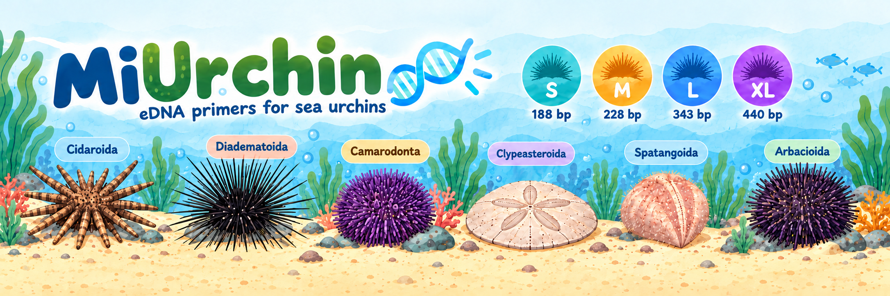
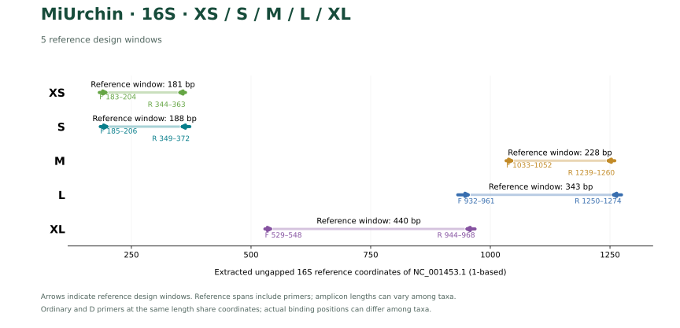
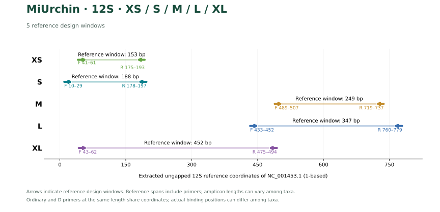
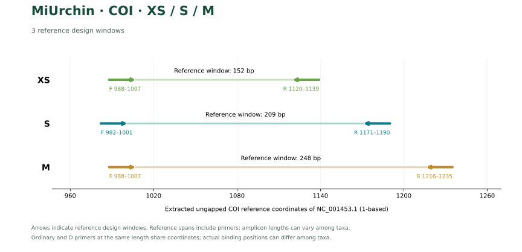
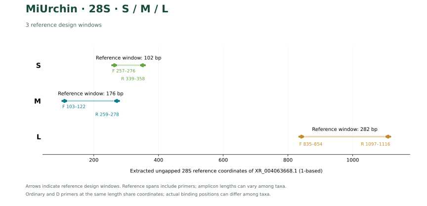

# MiUrchin, a set of universal PCR primers for metabarcoding environmental DNA from sea urchin

**Fei Xia**

[正體中文](README.md) · [English](README.en.md) · [简体中文](README.zh-CN.md)

<!-- publication:start -->
**Preprint v1.1 · 4 November 2026 · Not peer reviewed.**

[PDF](publications/MiUrchin_preprint.pdf) · [Manuscript](publications/MiUrchin_preprint.md) · [Versioned release](https://github.com/GUIBA-EX/MiUrchin/releases/tag/preprint-v1.1) · [CITATION.cff](CITATION.cff) · [BibTeX](CITATION.bib) · [Build and updates](publications/README.md)
<!-- publication:end -->

MiUrchin contains 32 candidate primer pairs for sea-urchin environmental DNA. The collection spans five windows each in mitochondrial 16S and 12S, three in mitochondrial COI and three in nuclear 28S. Each window has an ordinary and a degenerate (D) pair with identical binding coordinates.

## Choosing a window

The strongest candidate depends on whether the priority is broad compatibility or an exact match at both binding sites. Each gene has its own reference panel. Counts within a window compare ordinary and D pairs on the same species.

- **16S.** On the 49 species evaluable across all five windows, XLD covers the most species (45/49), while LD has the most exact matches (19/49). On their larger window-specific panels, MD matches 0/37 Spatangoida and LD matches 36/38.
- **12S.** At 249 bp, MD improves coverage from 25/69 to 61/69 relative to ordinary M and raises exact matches from zero to 24. Strict background hits allowing guanine–thymine pairing increase from one species to two.
- **COI.** The 152 bp XSD covers 79/106 species, including three exact matches. The 209 bp SD covers 63/105, with six exact matches. Of 314 species in the COI library, only 103–106 have evaluable binding sites in each retained window. No L or XL candidate met the background thresholds in this search.
- **28S.** Nuclear 28S MD covers 108 of 111 evaluable species and matches both sites exactly in 72. The shorter SD can detect sea urchins, but only eight of the 99 species with a recovered barcode have a unique internal sequence.

## Sequences and predicted performance

FASTA identifiers include the gene, assay and direction. For example, `MiUrchin-12S_MD_F` is the forward primer of the degenerate 12S M pair. Sequences run 5′ to 3′. Window lengths include both primers and use gene-relative coordinates. Insert length excludes the primers. Mitochondrial coordinates refer to NC_001453.1 and nuclear 28S coordinates to XR_004063668.1.

**Reading the tables.** Covered and Exact give the number of matching species over all species evaluable for that window. Strict off-target hits are two counts in this order: **Watson–Crick pairing only / also allowing guanine–thymine pairing**. For example, 0 / 7 for 16S XSD means that the first model matched zero background records and the second matched seven.

### 16S

Off-target counts use 6,045 background records.

| Assay | F (5′→3′) | R (5′→3′) | Span (bp) | Covered | Exact | Strict off-target hits | Base matching |
| --- | --- | --- | --- | --- | --- | --- | --- |
| XS | `CTTGTGTATAATGGATTAACGA` | `AAACTAATTTCTTGGGAAAC` | 181 | 19/55 | 0/55 | 0 / 0 | [View](results/current_primers/XS/base_matching_XS.svg) |
| XSD | `CTTGTGTATAATGGATTRACRA` | `AAACTAATTTCTTGGRRARC` | 181 | 35/55 | 6/55 | 0 / 7 | [View](results/current_primers/XS/base_matching_XSD.svg) |
| S | `TGTGTATAATGGATTAACGAGA` | `GCTTAGCTAAAACTAATTTCTTGG` | 188 | 13/55 | 2/55 | 0 / 0 | [View](results/current_primers/S/base_matching_S.svg) |
| SD | `TGTGTATAATGGATTAACRAGH` | `GCTTAGCTTAAACYAATTTCTYGR` | 188 | 29/55 | 3/55 | 0 / 0 | [View](results/current_primers/S/base_matching_SD.svg) |
| M | `CGTTAGACGAGAAGACCCTG` | `CTTTGATCACCTTAGTGGATCA` | 228 | 85/158 | 12/158 | 0 / 0 | [View](results/current_primers/M/base_matching_M.svg) |
| MD | `CGTTAGACGAGAAGACCCTR` | `CTTTGATCACCTDARTGGATCA` | 228 | 110/158 | 28/158 | 0 / 0 | [View](results/current_primers/M/base_matching_MD.svg) |
| L | `GTCTCCTAAATAGAGACTAGTATGAATGGC` | `GCGGTAACTTGTTCCTTTGATCACC` | 343 | 103/159 | 18/159 | 0 / 0 | [View](results/current_primers/L/base_matching_L.svg) |
| LD | `GTCTCCTAAATAGAGACTAGHATGAATGGC` | `GCGGTAACTTGTTYCTTTGRTCACY` | 343 | 141/159 | 30/159 | 2 / 12 | [View](results/current_primers/L/base_matching_LD.svg) |
| XL | `GAATAGGCCTAGAAGCAGCC` | `CCGTCTTGCCATTCATACTAGTCTC` | 440 | 41/55 | 9/55 | 2 / 3 | [View](results/current_primers/XL/base_matching_XL.svg) |
| XLD | `AAGTAGGCCTARAAGCAGCC` | `CCGTCTTGCCATTCATACCAGTCTY` | 440 | 51/55 | 6/55 | 0 / 4 | [View](results/current_primers/XL/base_matching_XLD.svg) |

### 12S

Off-target counts use one reference from each of 459 background echinoderm species.

| Assay | F (5′→3′) | R (5′→3′) | Span (bp) | Covered | Exact | Strict off-target hits | Base matching |
| --- | --- | --- | --- | --- | --- | --- | --- |
| XS | `TGCCACATGCAAGCTTATTAG` | `TTTAGCACTGCAGATGTGG` | 153 | 27/67 | 0/67 | 0 / 0 | [View](markers/12S_COI/figures/12S_XS.svg) |
| XSD | `TGCCACATGCAAGCYWAYTAG` | `TTTAGCACTGCAGDYGTGG` | 153 | 32/67 | 19/67 | 0 / 0 | [View](markers/12S_COI/figures/12S_XSD.svg) |
| S | `GTCCTAGTCCCAATTTTAAC` | `AATGTTTAGCACTGCAGTTG` | 188 | 27/64 | 1/64 | 0 / 1 | [View](markers/12S_COI/figures/12S_S.svg) |
| SD | `GTCCTAGTCCCAAYWTTARC` | `AATGTTTAGCACTGCAGDYG` | 188 | 56/64 | 19/64 | 0 / 1 | [View](markers/12S_COI/figures/12S_SD.svg) |
| M | `CGGTTTTCCAAACCTCCCT` | `ACTGCTGAATCCAGTTTCT` | 249 | 25/69 | 0/69 | 1 / 1 | [View](markers/12S_COI/figures/12S_M.svg) |
| MD | `CGGTTTTCCAWAYCTCCCT` | `ACTGCTGAATCCARTTTCN` | 249 | 61/69 | 24/69 | 2 / 2 | [View](markers/12S_COI/figures/12S_MD.svg) |
| L | `ACCCTGTTATACTTAGACGT` | `GCATTCCAGAGCTCTCTTCA` | 347 | 23/69 | 0/69 | 0 / 0 | [View](markers/12S_COI/figures/12S_L.svg) |
| LD | `ACCCTGTTATACTTAGMHGT` | `GCATTCCAGAGCTSWYTTCA` | 347 | 56/69 | 17/69 | 0 / 3 | [View](markers/12S_COI/figures/12S_LD.svg) |
| XL | `CCACATGCAAGCTAACTAGC` | `AAACCGCCAAGTCCTTTGAG` | 452 | 32/67 | 15/67 | 0 / 0 | [View](markers/12S_COI/figures/12S_XL.svg) |
| XLD | `CCACATGCAAGYYAAYTAGC` | `AAACCGCCAARTCCTTTGAR` | 452 | 40/67 | 21/67 | 2 / 3 | [View](markers/12S_COI/figures/12S_XLD.svg) |

### COI

Off-target counts use one reference from each of 1,719 background echinoderm species.

| Assay | F (5′→3′) | R (5′→3′) | Span (bp) | Covered | Exact | Strict off-target hits | Base matching |
| --- | --- | --- | --- | --- | --- | --- | --- |
| XS | `TCAAACCTACAATGAGAAAC` | `ACATAGTGGAAGTGAGCTAC` | 152 | 34/106 | 0/106 | 0 / 1 | [View](markers/12S_COI/figures/COI_XS.svg) |
| XSD | `TCAAACCTACARTGRGARAC` | `ACATAGTGGAAGTGDGCWAC` | 152 | 79/106 | 3/106 | 0 / 1 | [View](markers/12S_COI/figures/COI_XSD.svg) |
| S | `CAAGGATCAAACCTACAATG` | `AATCAGTGAGTAAATCCTGC` | 209 | 28/105 | 3/105 | 0 / 0 | [View](markers/12S_COI/figures/COI_S.svg) |
| SD | `CAAGGATCAAAYYTACARTG` | `AATCAGTGAGTRAAYCCWGC` | 209 | 63/105 | 6/105 | 1 / 1 | [View](markers/12S_COI/figures/COI_SD.svg) |
| M | `TCAAACCTACAATGGGAAAC` | `ACCTTTCCTCATAGTGGGTG` | 248 | 22/103 | 0/103 | 0 / 0 | [View](markers/12S_COI/figures/COI_M.svg) |
| MD | `TCAAACCTACARTGRGARAC` | `ACCTTTCCTCAWAGYGGRTG` | 248 | 57/103 | 1/103 | 0 / 0 | [View](markers/12S_COI/figures/COI_MD.svg) |

### 28S

The 28S panel retains one sequence per named sea-urchin species (122 total). Observed target variants informed ambiguity codes in the 3′ half of each primer. The 832 background records include the other four echinoderm classes and common marine animals. Only three to four sea-cucumber records span both sites per window. Base diagrams show all 122 templates; NA denotes an unevaluable record.

| Assay | F (5′→3′) | R (5′→3′) | Span (bp) | Covered | Exact | Strict off-target hits | Base matching |
| --- | --- | --- | --- | --- | --- | --- | --- |
| S | `GCCTGGAGCCACCAAGAGTC` | `TTGTCTGCTATCGGTCTCGT` | 102 | 99/101 | 78/101 | 0 / 0 | [Base matching](markers/28S/figures/S.svg) |
| SD | `GCCTGGAGCCRCCAAGARTC` | `TTGTCTGCTATCGGTCTCGT` | 102 | 99/101 | 83/101 | 0 / 0 | [Base matching](markers/28S/figures/SD.svg) |
| M | `AAGAGCCCATCGCTGAATCC` | `CCGACTCTTGGTGGCTCCAG` | 176 | 104/111 | 49/111 | 0 / 1 | [Base matching](markers/28S/figures/M.svg) |
| MD | `AAGAGCCCATCGCYGAATCS` | `CCGACTCTTGGYGRCTCCMG` | 176 | 108/111 | 72/111 | 0 / 2 | [Base matching](markers/28S/figures/MD.svg) |
| L | `AAGCTGGGCGCCTGCTCGAC` | `AATCGCTGCGGACCTCCACC` | 282 | 88/91 | 82/91 | 0 / 0 | [Base matching](markers/28S/figures/L.svg) |
| LD | `AAGCTGGGCGCCTGYTCGAC` | `AATCGCTGCGGACCTCCACC` | 282 | 89/91 | 82/91 | 0 / 0 | [Base matching](markers/28S/figures/LD.svg) |

[16S CSV](results/current_primers/comparison.csv) · [12S / COI CSV](markers/12S_COI/candidates.csv) · [28S CSV](markers/28S/selected.csv)

## Binding positions and base matching

The arrows show forward and reverse binding sites. Each gene uses its own coordinate axis. In the base diagrams linked above, the reverse template is shown in primer orientation. The box marks the terminal three bases. The 12S and COI diagrams show one representative per order selected by binding-site completeness, with accession as the tie-breaker. Their green cells indicate compatible bases, orange cells indicate mismatches and the rightmost label gives the paired full-sequence scan outcome.

## Reference panels and screening rules

The 16S library contains 1,401 target records. Curation retained one representative per species (165 species) and resolved order names against WoRMS. The 12S and COI searches of NCBI Nucleotide yielded 9,988 distinct accession records after deduplication. Sequence extraction and quality checks retained 208 eligible 12S sequences and 9,392 COI sequences, representing 69 and 314 named species on their respective design panels. Missing binding windows are excluded from the corresponding denominator.

Coverage requires a paired product with ≤2 mismatches per primer and compatible terminal three bases. Exact matching requires zero mismatches at both ends. Each D oligonucleotide has ≤8 concrete variants. Relaxed scans omit the terminal constraint and allow up to three and two mismatches per primer, respectively, in the order given above the tables. These counts describe computational template compatibility.

[16S methods](docs/METHODS.md) · [16S reference audit](results/species_qc/README.md) · [12S and COI data and verification](markers/12S_COI/README.md)

## Additional evaluation of 16S

The five 16S windows contain 55, 55, 158, 159 and 55 evaluable species, respectively. Their intersection contains 49 species. On this common panel, XSD, SD, MD, LD and XLD cover 30, 28, 42, 39 and 45 species and exactly match 6, 3, 11, 19 and 4. Using this shared denominator reverses the own-panel coverage ranking of MD and LD.

Primer-free inserts were compared against all unambiguous representatives for each window. XS, S and XL each had 55/55 identity-unique representatives. M and L each had 150/158, with four shared-barcode species pairs flagged for source review. One L insert contained ambiguous bases. These values describe identity in the frozen reference set.

Five-fold genus holdout evaluated sequence selection within the predefined 16S regions. Each fold selected candidates from training species only. Genera sharing an identical complete representative were assigned to the same fold. The resulting scores describe fold-specific candidates before thermal and background screening.

[Common-panel figure](results/computational_evaluation/figures/common_panel.svg) · [Barcode resolution](results/computational_evaluation/figures/resolution.svg) · [Holdout results](results/computational_evaluation/results/cv_summary.csv) · [Data and reproduction](results/computational_evaluation/README.md)

## Citation and permissions

Xia, F. (2026). *MiUrchin, a set of universal PCR primers for metabarcoding environmental DNA from sea urchin*. Computational preprint v1.1. [GitHub Release](https://github.com/GUIBA-EX/MiUrchin/releases/tag/preprint-v1.1).

[CITATION.cff](CITATION.cff) · [BibTeX](CITATION.bib) · [Copyright and permissions](COPYRIGHT.md)

## References

1. Gold, Z., Wall, A. R., Schweizer, T. M., et al. (2022). A manager’s guide to using eDNA metabarcoding in marine ecosystems. *PeerJ*, 10, e14071. https://doi.org/10.7717/peerj.14071

2. Miya, M., Sato, Y., Fukunaga, T., et al. (2015). MiFish, a set of universal PCR primers for metabarcoding environmental DNA from fishes: detection of more than 230 subtropical marine species. *Royal Society Open Science*, 2, 150088. https://doi.org/10.1098/rsos.150088

3. Sutera, A., Bonaviri, C., Di Trapani, F., et al. (2025). Unravelling hidden trophic interactions among sea urchin juveniles and macroinvertebrates by DNA amplification. *Molecular Ecology*, 34, e70163. https://doi.org/10.1111/mec.70163

4. Katoh, K., & Standley, D. M. (2013). MAFFT multiple sequence alignment software version 7: improvements in performance and usability. *Molecular Biology and Evolution*, 30, 772–780. https://doi.org/10.1093/molbev/mst010

5. Untergasser, A., Cutcutache, I., Koressaar, T., et al. (2012). Primer3—new capabilities and interfaces. *Nucleic Acids Research*, 40, e115. https://doi.org/10.1093/nar/gks596

6. Riaz, T., Shehzad, W., Viari, A., et al. (2011). ecoPrimers: inference of new DNA barcode markers from whole genome sequence analysis. *Nucleic Acids Research*, 39, e145. https://doi.org/10.1093/nar/gkr732

7. McCartin et al. (2024). Nuclear eDNA metabarcoding primers for anthozoan coral biodiversity assessment. [PeerJ](https://doi.org/10.7717/peerj.18607).
