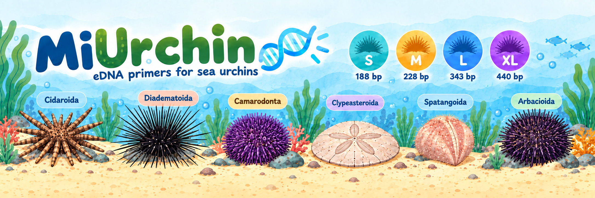
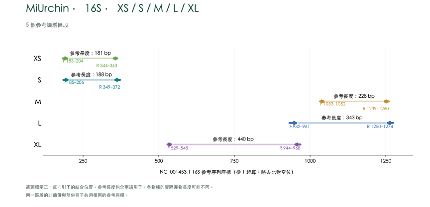
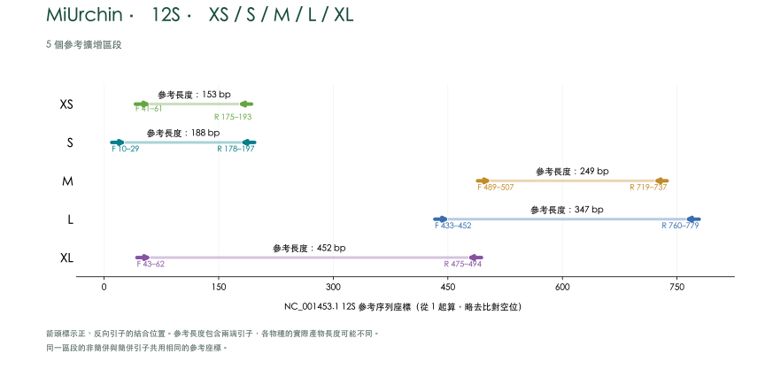
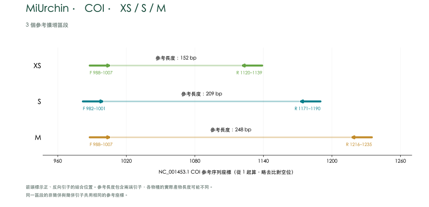

# MiUrchin

[正體中文](README.md) · [English](README.en.md) · [简体中文](README.zh-CN.md)

MiUrchin 收錄 26 對海膽環境 DNA（eDNA）研究用的粒線體候選引子。16S 與 12S 各有五個擴增區段，COI 有三個。每個區段各有一對非簡併引子和一對簡併引子（名稱加 D），兩者在參考序列上的結合位置完全相同。

[下載完整引子 FASTA](sequences/all_markers.fasta) · [預印本 PDF](publications/MiUrchin_preprint.pdf) · [論文 Markdown](publications/MiUrchin_preprint.md)

## 如何選擇擴增區段

可依研究目的選擇涵蓋較多物種的引子，或優先考慮兩端都與模板完全相符的引子。每個基因使用獨立的參考資料集；同一區段的兩種引子則用相同物種比較。

- **16S**　在五個區段都可評估的 49 種海膽中，XLD 涵蓋最多物種（45/49），LD 的雙端完全匹配數最高（19/49）。若關注 Spatangoida，MD 在其可評估資料集中涵蓋 0/37 種，LD 則涵蓋 36/38 種。
- **12S**　在 249 bp 的 M 區段，改用 MD 後，涵蓋物種由 25/69 增為 61/69，雙端完全匹配由 0 種增為 24 種。允許鳥嘌呤與胸腺嘧啶配對時，符合嚴格條件的非目標物種由 1 種增為 2 種。
- **COI**　152 bp 的 XSD 涵蓋 79/106 種，其中 3 種雙端完全匹配。209 bp 的 SD 涵蓋 63/105 種，其中 6 種雙端完全匹配。COI 參考資料集共有 314 種，但各保留區段僅有 103–106 種具備可評估的結合位置。此次篩選的 L 與 XL 候選均未通過非目標篩選門檻。

## 引子序列與預測結果

FASTA 名稱依序標示基因、引子名稱與方向。例如，`MiUrchin-12S_MD_F` 是 12S M 區段的簡併正向引子。所有序列均依 5′→3′ 方向書寫。參考擴增長度依 NC_001453.1 各基因內的座標計算，包含兩端引子；內部條碼長度只計算兩個結合位置之間的序列。

**表格讀法。**「涵蓋」與「完全匹配」均以符合條件的物種數除以該區段可評估的物種數。「嚴格非目標」欄的兩個數字依序代表 **僅允許華生–克里克配對 / 另允許鳥嘌呤與胸腺嘧啶配對** 的結果。例如，16S XSD 的 0 / 7 表示兩種模型分別在 0 筆與 7 筆非目標紀錄中找到符合條件的引子配對。

### 16S

非目標背景包含 6,045 筆參考序列紀錄。

| 引子 | F（5′→3′） | R（5′→3′） | 參考擴增長度（bp） | 涵蓋 | 完全匹配 | 嚴格非目標 | 鹼基比對圖 |
| --- | --- | --- | --- | --- | --- | --- | --- |
| XS | `CTTGTGTATAATGGATTAACGA` | `AAACTAATTTCTTGGGAAAC` | 181 | 19/55 | 0/55 | 0 / 0 | [檢視](results/current_primers/XS/base_matching_XS.svg) |
| XSD | `CTTGTGTATAATGGATTRACRA` | `AAACTAATTTCTTGGRRARC` | 181 | 35/55 | 6/55 | 0 / 7 | [檢視](results/current_primers/XS/base_matching_XSD.svg) |
| S | `TGTGTATAATGGATTAACGAGA` | `GCTTAGCTAAAACTAATTTCTTGG` | 188 | 13/55 | 2/55 | 0 / 0 | [檢視](results/current_primers/S/base_matching_S.svg) |
| SD | `TGTGTATAATGGATTAACRAGH` | `GCTTAGCTTAAACYAATTTCTYGR` | 188 | 29/55 | 3/55 | 0 / 0 | [檢視](results/current_primers/S/base_matching_SD.svg) |
| M | `CGTTAGACGAGAAGACCCTG` | `CTTTGATCACCTTAGTGGATCA` | 228 | 85/158 | 12/158 | 0 / 0 | [檢視](results/current_primers/M/base_matching_M.svg) |
| MD | `CGTTAGACGAGAAGACCCTR` | `CTTTGATCACCTDARTGGATCA` | 228 | 110/158 | 28/158 | 0 / 0 | [檢視](results/current_primers/M/base_matching_MD.svg) |
| L | `GTCTCCTAAATAGAGACTAGTATGAATGGC` | `GCGGTAACTTGTTCCTTTGATCACC` | 343 | 103/159 | 18/159 | 0 / 0 | [檢視](results/current_primers/L/base_matching_L.svg) |
| LD | `GTCTCCTAAATAGAGACTAGHATGAATGGC` | `GCGGTAACTTGTTYCTTTGRTCACY` | 343 | 141/159 | 30/159 | 2 / 12 | [檢視](results/current_primers/L/base_matching_LD.svg) |
| XL | `GAATAGGCCTAGAAGCAGCC` | `CCGTCTTGCCATTCATACTAGTCTC` | 440 | 41/55 | 9/55 | 2 / 3 | [檢視](results/current_primers/XL/base_matching_XL.svg) |
| XLD | `AAGTAGGCCTARAAGCAGCC` | `CCGTCTTGCCATTCATACCAGTCTY` | 440 | 51/55 | 6/55 | 0 / 4 | [檢視](results/current_primers/XL/base_matching_XLD.svg) |

### 12S

非目標背景包含 459 種其他棘皮動物，每種取一條代表序列。

| 引子 | F（5′→3′） | R（5′→3′） | 參考擴增長度（bp） | 涵蓋 | 完全匹配 | 嚴格非目標 | 鹼基比對圖 |
| --- | --- | --- | --- | --- | --- | --- | --- |
| XS | `TGCCACATGCAAGCTTATTAG` | `TTTAGCACTGCAGATGTGG` | 153 | 27/67 | 0/67 | 0 / 0 | [檢視](markers/12S_COI/figures/12S_XS.svg) |
| XSD | `TGCCACATGCAAGCYWAYTAG` | `TTTAGCACTGCAGDYGTGG` | 153 | 32/67 | 19/67 | 0 / 0 | [檢視](markers/12S_COI/figures/12S_XSD.svg) |
| S | `GTCCTAGTCCCAATTTTAAC` | `AATGTTTAGCACTGCAGTTG` | 188 | 27/64 | 1/64 | 0 / 1 | [檢視](markers/12S_COI/figures/12S_S.svg) |
| SD | `GTCCTAGTCCCAAYWTTARC` | `AATGTTTAGCACTGCAGDYG` | 188 | 56/64 | 19/64 | 0 / 1 | [檢視](markers/12S_COI/figures/12S_SD.svg) |
| M | `CGGTTTTCCAAACCTCCCT` | `ACTGCTGAATCCAGTTTCT` | 249 | 25/69 | 0/69 | 1 / 1 | [檢視](markers/12S_COI/figures/12S_M.svg) |
| MD | `CGGTTTTCCAWAYCTCCCT` | `ACTGCTGAATCCARTTTCN` | 249 | 61/69 | 24/69 | 2 / 2 | [檢視](markers/12S_COI/figures/12S_MD.svg) |
| L | `ACCCTGTTATACTTAGACGT` | `GCATTCCAGAGCTCTCTTCA` | 347 | 23/69 | 0/69 | 0 / 0 | [檢視](markers/12S_COI/figures/12S_L.svg) |
| LD | `ACCCTGTTATACTTAGMHGT` | `GCATTCCAGAGCTSWYTTCA` | 347 | 56/69 | 17/69 | 0 / 3 | [檢視](markers/12S_COI/figures/12S_LD.svg) |
| XL | `CCACATGCAAGCTAACTAGC` | `AAACCGCCAAGTCCTTTGAG` | 452 | 32/67 | 15/67 | 0 / 0 | [檢視](markers/12S_COI/figures/12S_XL.svg) |
| XLD | `CCACATGCAAGYYAAYTAGC` | `AAACCGCCAARTCCTTTGAR` | 452 | 40/67 | 21/67 | 2 / 3 | [檢視](markers/12S_COI/figures/12S_XLD.svg) |

### COI

非目標背景包含 1,719 種其他棘皮動物，每種取一條代表序列。

| 引子 | F（5′→3′） | R（5′→3′） | 參考擴增長度（bp） | 涵蓋 | 完全匹配 | 嚴格非目標 | 鹼基比對圖 |
| --- | --- | --- | --- | --- | --- | --- | --- |
| XS | `TCAAACCTACAATGAGAAAC` | `ACATAGTGGAAGTGAGCTAC` | 152 | 34/106 | 0/106 | 0 / 1 | [檢視](markers/12S_COI/figures/COI_XS.svg) |
| XSD | `TCAAACCTACARTGRGARAC` | `ACATAGTGGAAGTGDGCWAC` | 152 | 79/106 | 3/106 | 0 / 1 | [檢視](markers/12S_COI/figures/COI_XSD.svg) |
| S | `CAAGGATCAAACCTACAATG` | `AATCAGTGAGTAAATCCTGC` | 209 | 28/105 | 3/105 | 0 / 0 | [檢視](markers/12S_COI/figures/COI_S.svg) |
| SD | `CAAGGATCAAAYYTACARTG` | `AATCAGTGAGTRAAYCCWGC` | 209 | 63/105 | 6/105 | 1 / 1 | [檢視](markers/12S_COI/figures/COI_SD.svg) |
| M | `TCAAACCTACAATGGGAAAC` | `ACCTTTCCTCATAGTGGGTG` | 248 | 22/103 | 0/103 | 0 / 0 | [檢視](markers/12S_COI/figures/COI_M.svg) |
| MD | `TCAAACCTACARTGRGARAC` | `ACCTTTCCTCAWAGYGGRTG` | 248 | 57/103 | 1/103 | 0 / 0 | [檢視](markers/12S_COI/figures/COI_MD.svg) |

[16S CSV](results/current_primers/comparison.csv) · [12S / COI CSV](markers/12S_COI/candidates.csv)

## 結合位置與逐鹼基比對

箭頭標示正、反向引子的結合位置，每個基因各有獨立的座標軸。表格連結的鹼基比對圖依引子方向呈現反向模板，方框標示 3′ 端最後三個鹼基。12S 與 COI 各目選取結合區鹼基最完整的一條代表序列，完整度相同時依資料庫登錄號排序。綠色表示相容，橘色表示錯配；最右欄為掃描完整序列所得的成對匹配結果。

## 參考資料集與篩選準則

16S 目標資料庫包含 1,401 筆紀錄。經品質與分類審查後，每種保留一條代表序列，共 165 種；目級分類名稱依 WoRMS 核對。12S 與 COI 從 NCBI Nucleotide 取得 9,988 筆不重複的登錄紀錄。分別擷取基因並完成品質審查後，12S 保留 208 條合格序列，代表 69 個具名物種；COI 保留 9,392 條，代表 314 個具名物種。各區段的分母只計入可評估兩端結合位置的物種。

預測涵蓋要求兩端引子能形成擴增產物，每端最多容許兩個錯配，且 3′ 端最後三個鹼基均須相容。雙端完全匹配表示兩條引子都沒有錯配。每條簡併引子最多包含八種具體序列。寬鬆篩選取消末端限制，依表註中兩種模型的順序，每端分別容許最多三個與兩個錯配。

[16S 方法](docs/METHODS.zh-CN.md) · [16S 參考序列審查](results/species_qc/README.md) · [12S 與 COI 資料及驗證](markers/12S_COI/README.md)

## 16S 補充評估

16S 的 XS、S、M、L、XL 區段分別有 55、55、158、159 和 55 種可評估，其中 49 種可評估全部五個區段。在這 49 種中，XSD、SD、MD、LD、XLD 分別涵蓋 30、28、42、39、45 種，雙端完全匹配分別為 6、3、11、19、4 種。使用相同分母比較時，MD 的涵蓋率高於 LD；使用各區段全部可評估物種時，兩者的排名相反。

移除引子後，XS、S、XL 三個區段各有 55/55 種具有該資料集中獨有的條碼。M 與 L 則各有 150/158 種，其餘各有四組不同物種共享相同條碼，仍需核對參考紀錄來源。L 有一條內部序列因鹼基不明而未納入條碼比較。

16S 另進行以屬為單位的五折交叉驗證。每一折僅用訓練物種選配引子，再用保留的屬測試。若不同屬的完整代表序列相同，則分在同一折。結果反映預先選定區段內的引子選配表現；折內候選尚未經過熱力學與非目標篩選。

[共同物種比較圖](results/computational_evaluation/figures/common_panel.svg) · [條碼鑑別力圖](results/computational_evaluation/figures/resolution.svg) · [交叉驗證結果](results/computational_evaluation/results/cv_summary.csv) · [完整資料與重現步驟](results/computational_evaluation/README.zh-CN.md)

## 引用方式與著作權

Xia, F. (2026). *MiUrchin, a set of universal PCR primers for metabarcoding environmental DNA from sea urchin*. GitHub.

[CITATION.cff](CITATION.cff) · [BibTeX](CITATION.bib) · [著作權與使用聲明](COPYRIGHT.md)

## 參考文獻

1. Gold, Z., Wall, A. R., Schweizer, T. M., et al. (2022). A manager’s guide to using eDNA metabarcoding in marine ecosystems. *PeerJ*, 10, e14071. https://doi.org/10.7717/peerj.14071

2. Miya, M., Sato, Y., Fukunaga, T., et al. (2015). MiFish, a set of universal PCR primers for metabarcoding environmental DNA from fishes: detection of more than 230 subtropical marine species. *Royal Society Open Science*, 2, 150088. https://doi.org/10.1098/rsos.150088

3. Sutera, A., Bonaviri, C., Di Trapani, F., et al. (2025). Unravelling hidden trophic interactions among sea urchin juveniles and macroinvertebrates by DNA amplification. *Molecular Ecology*, 34, e70163. https://doi.org/10.1111/mec.70163

4. Katoh, K., & Standley, D. M. (2013). MAFFT multiple sequence alignment software version 7: improvements in performance and usability. *Molecular Biology and Evolution*, 30, 772–780. https://doi.org/10.1093/molbev/mst010

5. Untergasser, A., Cutcutache, I., Koressaar, T., et al. (2012). Primer3—new capabilities and interfaces. *Nucleic Acids Research*, 40, e115. https://doi.org/10.1093/nar/gks596

6. Riaz, T., Shehzad, W., Viari, A., et al. (2011). ecoPrimers: inference of new DNA barcode markers from whole genome sequence analysis. *Nucleic Acids Research*, 39, e145. https://doi.org/10.1093/nar/gkr732
