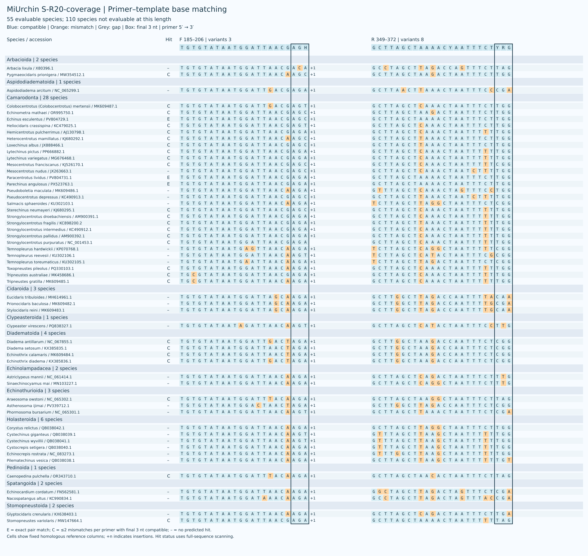
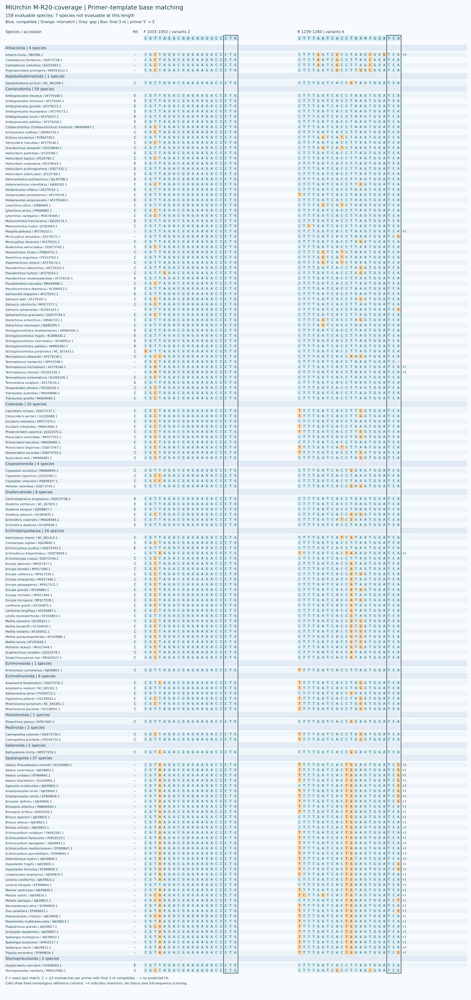
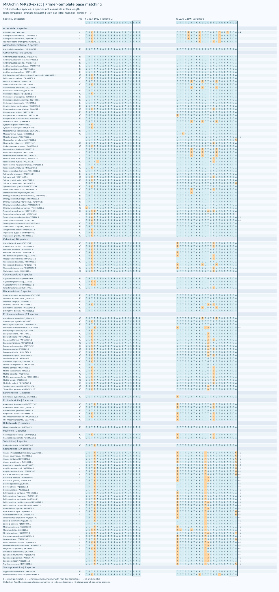
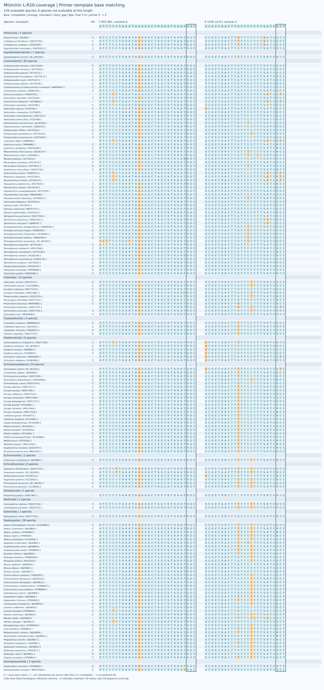
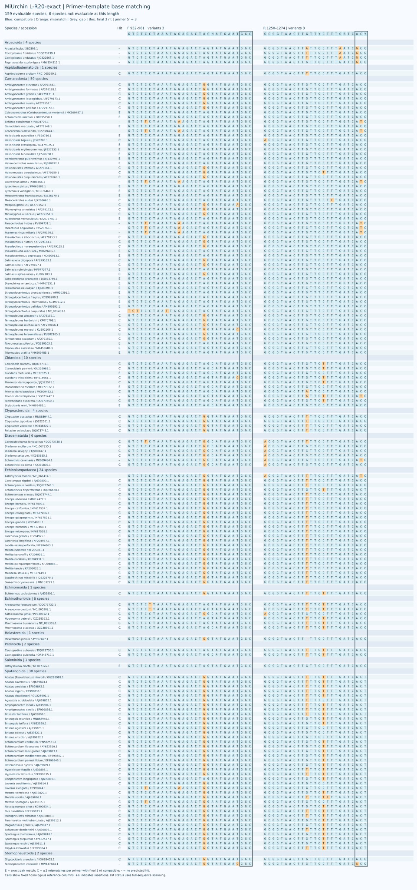
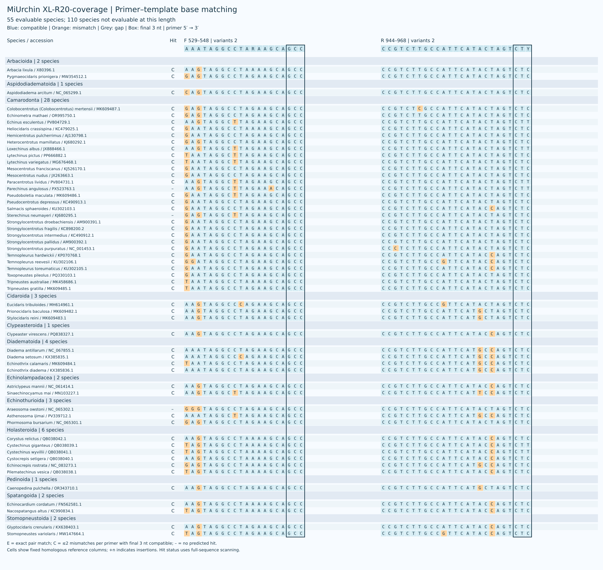
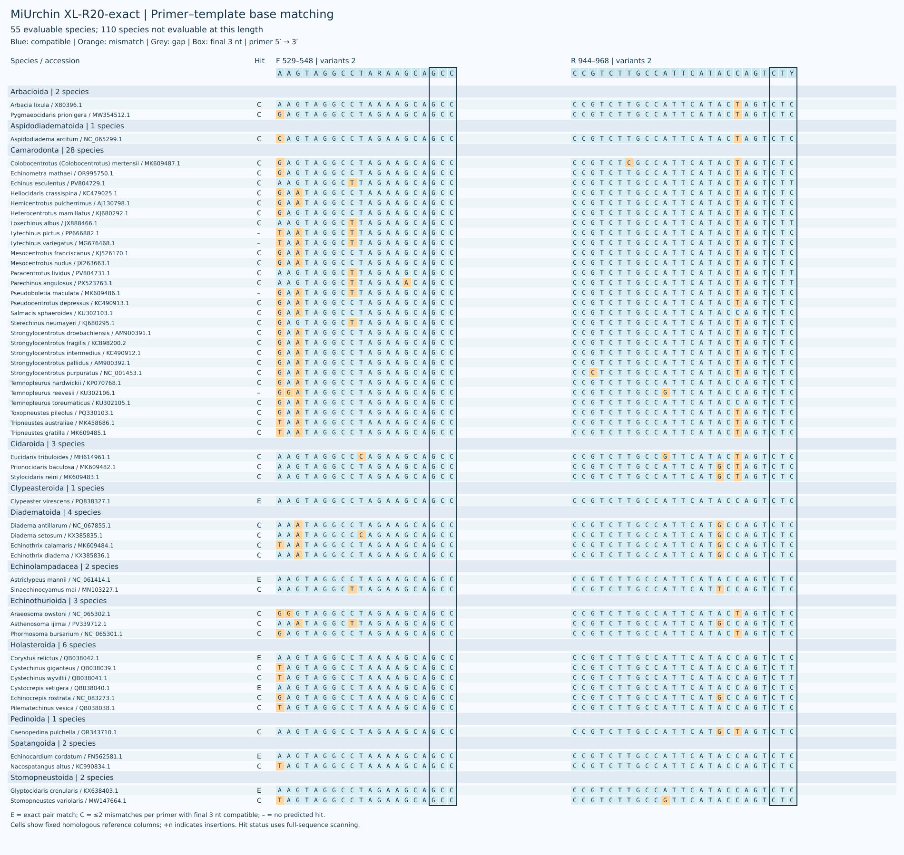

# MiUrchin

[中文](README.zh-CN.md)

Candidate mitochondrial 16S rRNA primers for echinoid eDNA across S, M, L and XL windows. One reference per species is retained and evaluable species are weighted equally; results for each order are reported separately.
The reference panel contains 165 species; S, M, L and XL have 55, 158, 159 and 55 evaluable species, respectively. Missing windows are not counted as failures. The header illustrates representative taxa under the earlier classification; the current panel uses WoRMS order names.

[参考面板 / Reference panel](results/species_qc/panel.csv) · [参考序列审核 / Reference curation](results/species_qc/README.md) · [S](results/species_refine/S/by_order.csv) · [M](results/species_refine/M/by_order.csv) · [L](results/species_refine/L/by_order.csv) · [XL](results/species_refine/XL/by_order.csv)

## Current performance

| Candidate | Species coverage | Exact | Strict WC / GT | WC≤3 / GT≤2 |
|---|---:|---:|---:|---:|
| S-R20-coverage | 29/55 (52.73%) | 3/55 (5.45%) | 0 / 0 | 0 / 0 |
| S-R20-exact | 29/55 (52.73%) | 3/55 (5.45%) | 0 / 0 | 3 / 0 |
| M-R20-coverage | 110/158 (69.62%) | 28/158 (17.72%) | 0 / 0 | 0 / 0 |
| M-R20-exact | 103/158 (65.19%) | 33/158 (20.89%) | 0 / 0 | 0 / 0 |
| L-R20-coverage | 147/159 (92.45%) | 0/159 (0.00%) | 2 / 12 | 15 / 12 |
| L-R20-exact | 141/159 (88.68%) | 30/159 (18.87%) | 2 / 12 | 12 / 12 |
| XL-R20-coverage | 52/55 (94.55%) | 0/55 (0.00%) | 2 / 19 | 10 / 19 |
| XL-R20-exact | 51/55 (92.73%) | 6/55 (10.91%) | 0 / 4 | 6 / 6 |
| XL-R100-exact | 51/55 (92.73%) | 10/55 (18.18%) | 2 / 19 | 12 / 21 |

Coverage allows at most two mismatches per primer with compatible terminal 3 nt; exact matching requires zero mismatches at both primers. WC≤3 / GT≤2 are permissive background screens without the terminal constraint. Background counts refer to reference records.

New D oligos have at most eight variants, with ambiguity confined to the 3′ half. Coverage-prioritised and exact-match-prioritised candidates are retained separately. Ordinary single pairs remain available; their performance was not reassessed on this panel.

M-R20-coverage matches 110/158 species (28 exactly), compared with 104/158 (21 exactly) for the previous D. L-R20-coverage matches 147/159 but has no exact matches; L-R20-exact matches 141/159 with 30 exact matches. The previous L D matched 145/159 with 28 exact matches. XL-R100-exact is identical to the previous XL D. Previous D results remain in the screening tables for comparison.

## Primer sequences (5′→3′)

### S

| Name | F | R |
|---|---|---|
| S | `TGTGTATAATGGATTAACGAGA` | `GCTTAGCTAAAACTAATTTCTTGG` |
| S-R20-coverage | `TGTGTATAATGGATTAACGAGH` | `GCTTAGCTAAAACYAATTTCTYRG` |
| S-R20-exact | `TGTGTATAATGGATTAACRAGH` | `GCTTAGCTTAAACYAATTTCTYGR` |

### M

| Name | F | R |
|---|---|---|
| M | `CGTTAGACGAGAAGACCCTG` | `CTTTGATCACCTTAGTGGATCA` |
| M-R20-coverage | `CGTTAGACGAGAAGACCCTR` | `CTTTGATCACCTDARTGGATCA` |
| M-R20-exact | `CGTTAGACGAGAAGACCCTR` | `CTTTGATCACCKDAGTGGATCA` |

### L

| Name | F | R |
|---|---|---|
| L | `GTCTCCTAAATAGAGACTAGTATGAATGGC` | `GCGGTAACTTGTTCCTTTGATCACC` |
| L-R20-coverage | `GTCTCCTAAATAAAGACTRGHATGAATGGC` | `GCGGTAACTTGTTCCTTTGATCRCY` |
| L-R20-exact | `GTCTCCTAAATAGAGACTAGHATGAATGGC` | `GCGGTAACTTGTTYCTTTGRTCACY` |

### XL

| Name | F | R |
|---|---|---|
| XL | `GAATAGGCCTAGAAGCAGCC` | `CCGTCTTGCCATTCATACTAGTCTC` |
| XL-R20-coverage | `AAATAGGCCTARAAGCAGCC` | `CCGTCTTGCCATTCATACTAGTCTY` |
| XL-R20-exact | `AAGTAGGCCTARAAGCAGCC` | `CCGTCTTGCCATTCATACCAGTCTY` |
| XL-R100-exact | `AAGTAGGCCTARAAGCAGCC` | `CCGTCTTGCCATTCATRCYAGTCTY` |

Computational predictions require experimental validation.

[Screening / 筛选结果](results/species_refine/README.md) · [Scripts / 脚本](scripts/species_screening/README.md) · [Methods / 方法](docs/METHODS.md) · [Validation / 验证](docs/VALIDATION.md) · [Copyright](COPYRIGHT.md)
