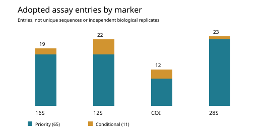

# MiUrchin：海膽分支限定引子與計算驗證

**Fei Xia · v2.0.0 本地整合修訂 · 尚未遠端發佈或經同儕審查**

目前採用76對分支／分類群限定方案：65對優先驗證、11對條件備選。每對分別PCR；設計面板內末端三位匹配不等於對全部海膽有效。

| 基因 | 原方案數 | 優先驗證 | 條件備選 |
| --- | --- | --- | --- |
| 16S | 10 | 17 | 2 |
| 12S | 10 | 17 | 5 |
| COI | 6 | 9 | 3 |
| 28S | 6 | 22 | 1 |

[目前交互清單](report.html) · [全部引子表](sequences/primer_pairs.csv) · [優先序列 FASTA](sequences/priority.fasta) · [條件備選 FASTA](sequences/conditional.fasta) · [全部采用序列 FASTA](sequences/all_markers.fasta)

[方法](docs/METHODS.md) · [中文方法](docs/METHODS.zh-CN.md) · [重現說明](docs/REPRODUCIBILITY.md) · [版本整合說明](docs/MIGRATION.md) · [预印本](publications/MiUrchin_preprint.pdf) · [補充表](publications/MiUrchin_supplement.md)

目前统计單位是各方案设计面板中的参考记錄。覆盖、精确匹配、原版對照、四项非目標计數與两種濃度下的结构結果见[统一证據清單](results/catalog.json)。尚無獨立留出或湿實驗驗證；移動后條碼分辨率未重评。不推荐直接混合子引子，COI S交叉配對可命中非目標。

歷史32對序列、共同面板、條碼分析、圖表與预印本完整保存在[legacy/v1.2](legacy/v1.2/README.md)，不用于描述目前新引子。
