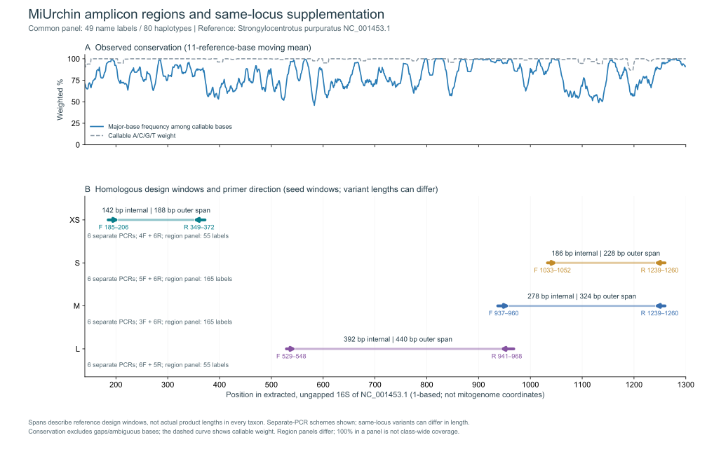

# MiUrchin

[中文](README.zh-CN.md)

## Abstract

Mitochondrial 16S rRNA primers for echinoid eDNA in five windows: XS, S, M, L and XL. Each window retains an ordinary pair and a degenerate D pair with shared reference endpoints.
The reference panel contains 165 species; the XS, S, M, L and XL windows have 55, 55, 158, 159 and 55 evaluable species, respectively. Missing windows are not counted as failures. The overview uses the earlier classification; the current panel uses WoRMS order names.

On the common 49-species panel, XSD, SD, MD, LD and XLD cover 30, 28, 42, 39 and 45 species, with 6, 3, 11, 19 and 4 exact paired matches. Primer-free barcode identity and a genus-blocked conditional holdout analysis complement the released assay evaluation.

## Introduction

Environmental DNA metabarcoding of echinoids requires a balance between target coverage, primer compatibility and non-target amplification. MiUrchin compares five mitochondrial 16S windows, each with ordinary and degenerate primers at shared reference positions. Marine eDNA metabarcoding studies demonstrate the importance of marker and reference-library choice (Gold et al., 2022); MiFish provides an example of sequence-alignment-based primer design for fishes (Miya et al., 2015). Mitochondrial markers have also been used to investigate sea-urchin DNA in trophic samples (Sutera et al., 2025).

[参考面板 / Reference panel](results/species_qc/panel.csv) · [审核 / Reference curation](results/species_qc/README.md)

## Methods

### Reference datasets and alignment

The target library comprised 1,401 mitochondrial sequence records from echinoids; the non-target library comprised 6,045 reference records. Target records were reviewed for sequence quality and taxonomy, and one representative was retained per identifiable species (165 species). Representatives were selected using binding-window completeness, ambiguous bases and reference-site coverage, without using primer-match outcomes. The retained sequences were realigned with MAFFT 7.526 (Katoh & Standley, 2013) using the ungapped mitochondrial 16S rRNA reference NC_001453.1; positions are reported as 1-based coordinates. For the curated species panels, each binding window had to span the reference region, contain at least 90% of its reference-site count as A/C/G/T, and contain no ambiguous nucleotide; alignment gaps were permitted. The numbers of evaluable species were 55, 55, 158, 159 and 55 for XS, S, M, L and XL, respectively; missing windows were excluded from the corresponding denominator. The [reference audit](results/species_qc/README.md) provides the selection criteria and accession-level records.

### Primer design and screening

Ordinary and degenerate candidates were compared within fixed forward and reverse reference windows. For S–XL, the ordinary and D pairs at each length share the same reference endpoints. D oligonucleotides were limited to eight concrete variants per primer, with IUPAC ambiguity confined to the 3′ half. Terminal screening excluded homotriplet ends and homopolymers longer than four bases and required a G or C in the final three positions. Primer3 (Untergasser et al., 2012) evaluations used 50 mM monovalent salt, 1.5 mM Mg²⁺ and 0.6 mM dNTP, under 50 nM per variant and 200 nM total per direction. The S–XL structural gate required a maximum predicted structure Tm below 55 °C and a forward–reverse duplex-Tm midpoint difference of at most 5 °C. XS and XSD share the observed reference endpoints F 183–204 and R 344–363. The ordinary XS search enumerated substitutions around the reference binding sequences while fixing the final three bases to the reference; candidates were screened for target matching, terminal properties, primer structure and non-target hits. XS target scans used products of 70–500 bp and an internal distance of at least 20 bp.

### In-silico evaluation

Target coverage required at most two mismatches per primer and IUPAC-compatible final 3 nt; exact matching required zero mismatches at both sites. For S–XL, paired target scans required an amplicon of 150–500 bp and an internal distance of at least 50 bp. Background searches allowed an internal distance of 0–1,000 bp. Strict Watson–Crick (WC) and G–T models retained the terminal constraint; WC≤3 and GT≤2 were additional permissive screens without that constraint. Coverage and exact-match percentages weighted evaluable species equally, with results also summarized by order; non-target counts represent reference records. C++ and Python scans were compared on the same sequence data to verify target and strict background hit sets. These results describe computational template compatibility.

### Common panel, barcode discrimination and genus-blocked holdout

We intersected the five window panels by accession to obtain 49 common species; this panel controls the denominator for length comparisons. Own-panel results retain the larger available reference sets. Primer-free inserts were extracted strictly between the aligned binding windows, with gaps removed and ambiguous inserts excluded. Identity uniqueness was assessed against every available unambiguous insert for the same window, including species outside the common panel. Pairwise unit-cost Levenshtein distances identified each species' nearest other-species neighbor. This separates marker discrimination from primer compatibility, following the joint coverage/discrimination logic of ecoPrimers (Riaz et al., 2011).

For five-fold holdout testing, genera were shuffled with seed 20261030 and assigned to folds; genera sharing identical complete representative sequences were linked to the same fold. Each fold selected new F/R sequences using training representatives only, without seeding from the released primers or global candidate pool. A deterministic greedy search used up to 24 admissible frequent concrete seeds per side, 3′-half ambiguity and ≤8 variants per oligonucleotide. The local search allowed offsets within five alignment columns of the frozen binding intervals while keeping oligonucleotide lengths fixed. Held-out species were evaluated with full-sequence paired scans. This tests sequence selection conditional on previously discovered regions: window discovery preceded splitting, and fold candidates did not undergo the formal thermal/background gates. Fold candidates are diagnostic sequences, not additions to the released primer set.

[Analysis methods and reproduction](results/computational_evaluation/README.md)

[Detailed methods](docs/METHODS.md) · [Validation](docs/VALIDATION.md)

## Results

### Predicted performance

| Name | Coverage | Exact | Strict WC / GT | WC≤3 / GT≤2 |
|---|---:|---:|---:|---:|
| XS | 19/55 (34.55%) | 0/55 (0%) | 0 / 0 | 0 / 0 |
| XSD | 35/55 (63.64%) | 6/55 (10.91%) | 0 / 7 | 19 / 7 |
| S | 13/55 (23.64%) | 2/55 (3.64%) | 0 / 0 | 0 / 0 |
| SD | 29/55 (52.73%) | 3/55 (5.45%) | 0 / 0 | 3 / 0 |
| M | 85/158 (53.80%) | 12/158 (7.59%) | 0 / 0 | 0 / 0 |
| MD | 110/158 (69.62%) | 28/158 (17.72%) | 0 / 0 | 0 / 0 |
| L | 103/159 (64.78%) | 18/159 (11.32%) | 0 / 0 | 2 / 1 |
| LD | 141/159 (88.68%) | 30/159 (18.87%) | 2 / 12 | 12 / 12 |
| XL | 41/55 (74.55%) | 9/55 (16.36%) | 2 / 3 | 3 / 5 |
| XLD | 51/55 (92.73%) | 6/55 (10.91%) | 0 / 4 | 6 / 6 |

Coverage allows at most two mismatches per primer with compatible terminal 3 nt; exact matching requires zero mismatches in both primers. Strict WC/GT use the terminal constraint; WC≤3 / GT≤2 are permissive background screens without it.

Each degenerate primer has at most eight concrete variants, with ambiguity confined to the 3′ half. Results describe computational compatibility.

### Comparison on 49 common species

| Name | Coverage | Exact | Covered + identity-unique |
| --- | --- | --- | --- |
| XS | 19/49 | 0/49 | 19/49 |
| XSD | 30/49 | 6/49 | 30/49 |
| S | 13/49 | 2/49 | 13/49 |
| SD | 28/49 | 3/49 | 28/49 |
| M | 29/49 | 8/49 | 29/49 |
| MD | 42/49 | 11/49 | 41/49 |
| L | 37/49 | 10/49 | 36/49 |
| LD | 39/49 | 19/49 | 38/49 |
| XL | 40/49 | 9/49 | 40/49 |
| XLD | 45/49 | 4/49 | 45/49 |

Coverage and exact matching use the same 49 species for all ten released assays. The final column counts species that both match the primers and have a reference insert not shared by any other available species in that window. XLD has the highest common-panel coverage (45/49), while LD has the most exact paired matches (19/49). MD covers more common-panel species than LD (42 versus 39), reversing their own-panel percentage ranking.

### Primer-free barcode discrimination

| Window | Unambiguous inserts | Identity-unique species | Insert length (bp) |
| --- | --- | --- | --- |
| XS | 55 | 55/55 | 137–144 |
| S | 55 | 55/55 | 140–147 |
| M | 158 | 150/158 | 179–208 |
| L | 158 | 150/158 | 280–310 |
| XL | 55 | 55/55 | 395–413 |

Lengths exclude both primers. The L binding panel has 159 species, but one ambiguous internal insert leaves 158 for barcode analysis. XS, S and XL have no identical inserts between their sampled species representatives; this is reference-set uniqueness, not measured identification accuracy or population-wide resolution. M and L each contain four two-species identity conflicts. These include cross-order records and are flagged for source review rather than interpreted as established biological non-resolution. Common-panel M/L uniqueness is 48/49 when assessed against all available inserts, even though the 49 common-panel sequences differ from each other.

[Identical-barcode conflicts](results/computational_evaluation/results/barcode_collisions.csv) · [Nearest-neighbor edit distances](results/computational_evaluation/results/nearest_neighbors.csv) · [Conflict-exclusion sensitivity](results/computational_evaluation/results/conflict_exclusion_sensitivity.csv)

### Genus-blocked conditional holdout

| Window | Held-out coverage | Held-out exact |
| --- | --- | --- |
| XS | 47/55 (85.45%) | 3/55 (5.45%) |
| S | 30/55 (54.55%) | 1/55 (1.82%) |
| M | 112/158 (70.89%) | 24/158 (15.19%) |
| L | 156/159 (98.11%) | 114/159 (71.70%) |
| XL | 53/55 (96.36%) | 15/55 (27.27%) |

These results use 25 fold-specific, training-selected pairs, not the released ordinary/D pairs. Every species is tested once within its window, and identical complete sequences never cross folds. Values measure conditional template compatibility without thermal or background selection; they do not demonstrate that the fold pairs outperform released assays under the full design constraints. All fold sequences, training sizes and held-out predictions are available below.

[Fold-specific candidates](results/computational_evaluation/results/cv_folds.csv) · [Held-out predictions](results/computational_evaluation/results/cv_predictions.csv) · [Complete comparison tables](results/computational_evaluation/results/panel_comparison.csv)

### XS

| Name | F (5′→3′) | R (5′→3′) |
|---|---|---|
| XS | `CTTGTGTATAATGGATTAACGA` | `AAACTAATTTCTTGGGAAAC` |
| XSD | `CTTGTGTATAATGGATTRACRA` | `AAACTAATTTCTTGGRRARC` |

Both pairs bind at F 183–204 and R 344–363 on NC_001453.1; the reference amplicon is 181 bp, 7 bp shorter than S. XS has no exact pair match in the 55 evaluable species; its predicted coverage allows mismatches. XSD improves coverage, with R (A/G) at the fourth base from the reverse primer’s 3′ end. Non-target counts are reference records.

[XS by order](results/current_primers/XS/XS_by_order.csv) · [XS by species](results/current_primers/XS/XS_by_taxon.csv) · [XSD by order](results/current_primers/XS/XSD_by_order.csv) · [XSD by species](results/current_primers/XS/XSD_by_taxon.csv) · [Candidate comparison](results/current_primers/XS/ordinary_screening.md)

### S

| Name | F (5′→3′) | R (5′→3′) |
|---|---|---|
| S | `TGTGTATAATGGATTAACGAGA` | `GCTTAGCTAAAACTAATTTCTTGG` |
| SD | `TGTGTATAATGGATTAACRAGH` | `GCTTAGCTTAAACYAATTTCTYGR` |

[S order matches](results/current_primers/S/SD_by_order.csv) · [S species matches](results/current_primers/S/SD_by_taxon.csv)

### M

| Name | F (5′→3′) | R (5′→3′) |
|---|---|---|
| M | `CGTTAGACGAGAAGACCCTG` | `CTTTGATCACCTTAGTGGATCA` |
| MD | `CGTTAGACGAGAAGACCCTR` | `CTTTGATCACCTDARTGGATCA` |

[M order matches](results/current_primers/M/MD_by_order.csv) · [M species matches](results/current_primers/M/MD_by_taxon.csv)

### L

| Name | F (5′→3′) | R (5′→3′) |
|---|---|---|
| L | `GTCTCCTAAATAGAGACTAGTATGAATGGC` | `GCGGTAACTTGTTCCTTTGATCACC` |
| LD | `GTCTCCTAAATAGAGACTAGHATGAATGGC` | `GCGGTAACTTGTTYCTTTGRTCACY` |

[L order matches](results/current_primers/L/LD_by_order.csv) · [L species matches](results/current_primers/L/LD_by_taxon.csv)

### XL

| Name | F (5′→3′) | R (5′→3′) |
|---|---|---|
| XL | `GAATAGGCCTAGAAGCAGCC` | `CCGTCTTGCCATTCATACTAGTCTC` |
| XLD | `AAGTAGGCCTARAAGCAGCC` | `CCGTCTTGCCATTCATACCAGTCTY` |

[XL order matches](results/current_primers/XL/XLD_by_order.csv) · [XL species matches](results/current_primers/XL/XLD_by_taxon.csv)

## Discussion

Common-panel comparison separates length effects from reference availability. XLD favors mismatch-tolerant coverage, while LD favors exact paired matching; neither score alone establishes a universally preferable window. XS shortens the reference span by only 7 bp relative to S, so retaining both should be justified by compatibility and informative variation as well as length.

Lineage gaps remain substantial in the own-panel data: MD matches 0/37 Spatangoida, compared with LD's 36/38; both miss all four evaluable Arbacioida. Barcode identity conflicts and incomplete population sampling also limit inference beyond the frozen references. Genus-blocked sequence selection adds a conditional generalization analysis, while external data or fully nested window discovery would support stronger claims about the full design process. The present study reports computational compatibility and discrimination, with the released primer sequences unchanged.

[Copyright / 著作权](COPYRIGHT.md)

## Citation

If you use the primers, reference data or analysis code, please cite:

Xia, F. (2026). *MiUrchin: candidate mitochondrial 16S rRNA primers for sea-urchin environmental DNA metabarcoding*. GitHub. https://github.com/GUIBA-EX/MiUrchin

[CITATION.cff](CITATION.cff) · [BibTeX](CITATION.bib)

## References

1. Gold, Z., Wall, A. R., Schweizer, T. M., et al. (2022). A manager’s guide to using eDNA metabarcoding in marine ecosystems. *PeerJ*, 10, e14071. https://doi.org/10.7717/peerj.14071

2. Miya, M., Sato, Y., Fukunaga, T., et al. (2015). MiFish, a set of universal PCR primers for metabarcoding environmental DNA from fishes: detection of more than 230 subtropical marine species. *Royal Society Open Science*, 2, 150088. https://doi.org/10.1098/rsos.150088

3. Sutera, A., Bonaviri, C., Di Trapani, F., et al. (2025). Unravelling hidden trophic interactions among sea urchin juveniles and macroinvertebrates by DNA amplification. *Molecular Ecology*, 34, e70163. https://doi.org/10.1111/mec.70163

4. Katoh, K., & Standley, D. M. (2013). MAFFT multiple sequence alignment software version 7: improvements in performance and usability. *Molecular Biology and Evolution*, 30, 772–780. https://doi.org/10.1093/molbev/mst010

5. Untergasser, A., Cutcutache, I., Koressaar, T., et al. (2012). Primer3—new capabilities and interfaces. *Nucleic Acids Research*, 40, e115. https://doi.org/10.1093/nar/gks596

6. Riaz, T., Shehzad, W., Viari, A., et al. (2011). ecoPrimers: inference of new DNA barcode markers from whole genome sequence analysis. *Nucleic Acids Research*, 39, e145. https://doi.org/10.1093/nar/gkr732
