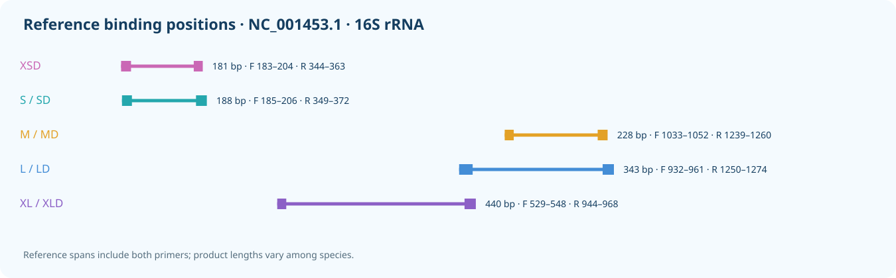

# MiUrchin

[中文](README.zh-CN.md)

Mitochondrial 16S rRNA primers for echinoid eDNA in five windows: XS, S, M, L and XL. S–XL each retain an ordinary pair and a degenerate D pair with shared reference endpoints; XS currently has one degenerate candidate, XSD.
The reference panel contains 165 species; XSD, S, M, L and XL have 55, 55, 158, 159 and 55 evaluable species, respectively. Missing windows are not counted as failures. The overview uses the earlier classification; the current panel uses WoRMS order names.

[参考面板 / Reference panel](results/species_qc/panel.csv) · [审核 / Reference curation](results/species_qc/README.md)

## Predicted performance

| Name | Coverage | Exact | Strict WC / GT | WC≤3 / GT≤2 |
|---|---:|---:|---:|---:|
| XSD | 35/55 (63.64%) | 6/55 (10.91%) | 0 / 7 | 19 / 7 |
| S | 13/55 (23.64%) | 2/55 (3.64%) | 0 / 0 | 0 / 0 |
| SD | 29/55 (52.73%) | 3/55 (5.45%) | 0 / 0 | 3 / 0 |
| M | 85/158 (53.80%) | 12/158 (7.59%) | 0 / 0 | 0 / 0 |
| MD | 110/158 (69.62%) | 28/158 (17.72%) | 0 / 0 | 0 / 0 |
| L | 103/159 (64.78%) | 18/159 (11.32%) | 0 / 0 | 2 / 1 |
| LD | 141/159 (88.68%) | 30/159 (18.87%) | 2 / 12 | 12 / 12 |
| XL | 41/55 (74.55%) | 9/55 (16.36%) | 2 / 3 | 3 / 5 |
| XLD | 51/55 (92.73%) | 6/55 (10.91%) | 0 / 4 | 6 / 6 |

Coverage allows at most two mismatches per primer with compatible terminal 3 nt; exact matching requires zero mismatches in both primers. Strict WC/GT use the terminal constraint; WC≤3 / GT≤2 are permissive background screens without it.

Each degenerate primer has at most eight concrete variants, with ambiguity confined to the 3′ half. Predictions require experimental validation.

## XS

| Name | F (5′→3′) | R (5′→3′) |
|---|---|---|
| XSD | `CTTGTGTATAATGGATTRACRA` | `AAACTAATTTCTTGGRRARC` |

The reference amplicon is 181 bp, 7 bp shorter than S; 55 species are evaluable in this window. R (A/G) at the fourth base from the reverse primer’s 3′ end improves coverage of species-rich Camarodonta. Non-target counts are reference records.

[XSD by order](results/current_primers/XS/XSD_by_order.csv) · [XSD by species](results/current_primers/XS/XSD_by_taxon.csv) · [候选比较 / Candidate comparison](results/current_primers/XS/candidate_comparison.md)

## S

| Name | F (5′→3′) | R (5′→3′) |
|---|---|---|
| S | `TGTGTATAATGGATTAACGAGA` | `GCTTAGCTAAAACTAATTTCTTGG` |
| SD | `TGTGTATAATGGATTAACRAGH` | `GCTTAGCTTAAACYAATTTCTYGR` |

[S order matches](results/current_primers/S/SD_by_order.csv) · [S species matches](results/current_primers/S/SD_by_taxon.csv)

## M

| Name | F (5′→3′) | R (5′→3′) |
|---|---|---|
| M | `CGTTAGACGAGAAGACCCTG` | `CTTTGATCACCTTAGTGGATCA` |
| MD | `CGTTAGACGAGAAGACCCTR` | `CTTTGATCACCTDARTGGATCA` |

[M order matches](results/current_primers/M/MD_by_order.csv) · [M species matches](results/current_primers/M/MD_by_taxon.csv)

## L

| Name | F (5′→3′) | R (5′→3′) |
|---|---|---|
| L | `GTCTCCTAAATAGAGACTAGTATGAATGGC` | `GCGGTAACTTGTTCCTTTGATCACC` |
| LD | `GTCTCCTAAATAGAGACTAGHATGAATGGC` | `GCGGTAACTTGTTYCTTTGRTCACY` |

[L order matches](results/current_primers/L/LD_by_order.csv) · [L species matches](results/current_primers/L/LD_by_taxon.csv)

## XL

| Name | F (5′→3′) | R (5′→3′) |
|---|---|---|
| XL | `GAATAGGCCTAGAAGCAGCC` | `CCGTCTTGCCATTCATACTAGTCTC` |
| XLD | `AAGTAGGCCTARAAGCAGCC` | `CCGTCTTGCCATTCATACCAGTCTY` |

[XL order matches](results/current_primers/XL/XLD_by_order.csv) · [XL species matches](results/current_primers/XL/XLD_by_taxon.csv)

[Methods / 方法](docs/METHODS.md)

[Validation / 验证](docs/VALIDATION.md) · [Copyright / 著作权](COPYRIGHT.md)
