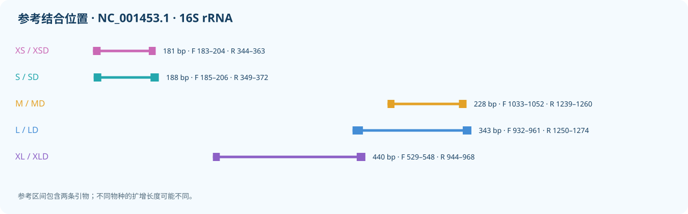

# MiUrchin

[English](README.md)

海胆环境 DNA 线粒体 16S rRNA 引物，包含 XSD、S、M、L、XL 五个长度。S–XL 每个长度保留普通单对和简并单对 D，同一长度使用相同参考坐标；XS 暂保留一对简并候选 XSD。
参考面板包含 165 个物种，XSD、S、M、L、XL 分别有 55、55、158、159、55 个可评价物种；缺失结合区域不计为漏检。图示使用旧分类体系，新面板的目级名称以 WoRMS 为准。

[参考面板 / Reference panel](results/species_qc/panel.csv) · [审核 / Reference curation](results/species_qc/README.md)

## 预测表现

| Name | Coverage | Exact | Strict WC / GT | WC≤3 / GT≤2 |
|---|---:|---:|---:|---:|
| XSD | 35/55 (63.64%) | 6/55 (10.91%) | 0 / 7 | 19 / 7 |
| S | 13/55 (23.64%) | 2/55 (3.64%) | 0 / 0 | 0 / 0 |
| SD | 29/55 (52.73%) | 3/55 (5.45%) | 0 / 0 | 3 / 0 |
| M | 85/158 (53.80%) | 12/158 (7.59%) | 0 / 0 | 0 / 0 |
| MD | 110/158 (69.62%) | 28/158 (17.72%) | 0 / 0 | 0 / 0 |
| L | 103/159 (64.78%) | 18/159 (11.32%) | 0 / 0 | 2 / 1 |
| LD | 141/159 (88.68%) | 30/159 (18.87%) | 2 / 12 | 12 / 12 |
| XL | 41/55 (74.55%) | 9/55 (16.36%) | 2 / 3 | 3 / 5 |
| XLD | 51/55 (92.73%) | 6/55 (10.91%) | 0 / 4 | 6 / 6 |

覆盖要求每条引物最多 2 个错配且末端 3 nt 兼容；完全匹配要求两条引物零错配。严格 WC/GT 使用末端约束；WC≤3 / GT≤2 是不施加末端约束的非目标筛查。

简并引物每条最多 8 个具体变体，简并位点限于 3′ 半段。结果为计算预测，仍需实验验证。

## XS

| Name | F (5′→3′) | R (5′→3′) |
|---|---|---|
| XSD | `CTTGTGTATAATGGATTRACRA` | `AAACTAATTTCTTGGRRARC` |

参考序列扩增区间为 181 bp，比 S 短 7 bp；此处可评价 55 个物种。反向引物倒数第 4 位使用 R（A/G），优先提高物种数较多的 Camarodonta 覆盖。非目标数字为参考序列记录数。

[XSD 各目匹配](results/current_primers/XS/XSD_by_order.csv) · [XSD 各物种匹配](results/current_primers/XS/XSD_by_taxon.csv) · [候选比较 / Candidate comparison](results/current_primers/XS/candidate_comparison.md)

## S

| Name | F (5′→3′) | R (5′→3′) |
|---|---|---|
| S | `TGTGTATAATGGATTAACGAGA` | `GCTTAGCTAAAACTAATTTCTTGG` |
| SD | `TGTGTATAATGGATTAACRAGH` | `GCTTAGCTTAAACYAATTTCTYGR` |

[S 各目匹配](results/current_primers/S/SD_by_order.csv) · [S 各物种匹配](results/current_primers/S/SD_by_taxon.csv)

## M

| Name | F (5′→3′) | R (5′→3′) |
|---|---|---|
| M | `CGTTAGACGAGAAGACCCTG` | `CTTTGATCACCTTAGTGGATCA` |
| MD | `CGTTAGACGAGAAGACCCTR` | `CTTTGATCACCTDARTGGATCA` |

[M 各目匹配](results/current_primers/M/MD_by_order.csv) · [M 各物种匹配](results/current_primers/M/MD_by_taxon.csv)

## L

| Name | F (5′→3′) | R (5′→3′) |
|---|---|---|
| L | `GTCTCCTAAATAGAGACTAGTATGAATGGC` | `GCGGTAACTTGTTCCTTTGATCACC` |
| LD | `GTCTCCTAAATAGAGACTAGHATGAATGGC` | `GCGGTAACTTGTTYCTTTGRTCACY` |

[L 各目匹配](results/current_primers/L/LD_by_order.csv) · [L 各物种匹配](results/current_primers/L/LD_by_taxon.csv)

## XL

| Name | F (5′→3′) | R (5′→3′) |
|---|---|---|
| XL | `GAATAGGCCTAGAAGCAGCC` | `CCGTCTTGCCATTCATACTAGTCTC` |
| XLD | `AAGTAGGCCTARAAGCAGCC` | `CCGTCTTGCCATTCATACCAGTCTY` |

[XL 各目匹配](results/current_primers/XL/XLD_by_order.csv) · [XL 各物种匹配](results/current_primers/XL/XLD_by_taxon.csv)

[Methods / 方法](docs/METHODS.zh-CN.md)

[Validation / 验证](docs/VALIDATION.md) · [Copyright / 著作权](COPYRIGHT.md)
