# MiUrchin

[English](README.md)

预印本: [PDF](publications/MiUrchin_preprint.pdf) · [Markdown](publications/MiUrchin_preprint.md) · [Provenance](publications/preprint_provenance.json)

## 摘要

海胆环境 DNA 线粒体 16S rRNA 引物，包含 XS、S、M、L、XL 五个长度。每个长度保留普通单对和简并单对 D；同一长度使用相同参考坐标。
参考面板包含 165 个物种，XS、S、M、L、XL 区域分别有 55、55、158、159、55 个可评价物种；缺失结合区域不计为漏检。图示使用旧分类体系，新面板的目级名称以 WoRMS 为准。

在49个共同物种面板上，XSD、SD、MD、LD、XLD分别覆盖30、28、42、39、45种，双端完全匹配分别为6、3、11、19、4种。新增内部条码区分能力与属级条件性留出测试，为正式引物提供补充计算评价。

## 引言

海胆环境 DNA 宏条形码引物需要兼顾目标类群覆盖、结合兼容性和非目标扩增。MiUrchin 比较五个线粒体 16S 窗口，每个窗口均包含共享参考坐标的普通和简并引物。 海洋环境 DNA 宏条形码研究显示，标记和参考数据库的选择会影响检测结果（Gold 等，2022）；MiFish 则提供了基于序列比对设计鱼类引物的实例（Miya 等，2015）。线粒体标记也曾用于调查营养关系样品中的海胆 DNA（Sutera 等，2025）。

[参考面板 / Reference panel](results/species_qc/panel.csv) · [审核 / Reference curation](results/species_qc/README.md)

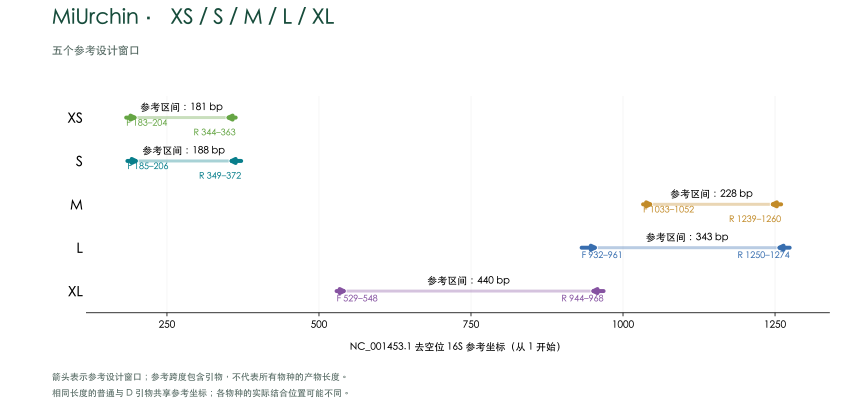

## 方法

### 参考数据与序列比对

目标数据库包含 1,401 条海胆线粒体序列，非目标数据库包含 6,045 条参考记录。经序列质量和分类审核，每个可确认物种保留一条代表，共 165 个物种。代表序列依据结合窗口完整性、模糊碱基和参考位点覆盖情况选择，不以引物匹配结果为筛选依据。保留序列使用 MAFFT 7.526（Katoh & Standley，2013）重新比对，参考坐标采用去除空位的线粒体 16S rRNA 序列 NC_001453.1，从 1 开始计数。清理后的物种面板中，正、反向窗口均需跨越参考区域，A/C/G/T 数量达到参考位点数的 90% 且无模糊碱基，允许比对空位；符合条件的物种才纳入该窗口的评价分母。可评价物种数为 XS、S、M、L、XL 分别为 55、55、158、159、55 个。缺失窗口不计为漏检，筛选标准及 accession 记录见[参考序列审核](results/species_qc/README.md)。

### 引物设计与筛选

在固定的正、反向参考窗口内比较普通和简并候选。S–XL 每个长度的普通引物与 D 引物使用相同参考起止坐标。每条 D 引物最多包含 8 种具体序列，IUPAC 简并碱基限于 3′ 半段。末端筛查排除末端三连和超过 4 bp 的同聚物，要求末端 3 nt 至少含一个 G 或 C。Primer3（Untergasser 等，2012）计算采用单价盐 50 mM、Mg²⁺ 1.5 mM、dNTP 0.6 mM，分别评估每变体 50 nM 和每方向总浓度 200 nM 两种情景。S–XL 的结构筛查要求预测结构最高 Tm 低于 55 °C，正、反向双链 Tm 区间中点之差不超过 5 °C。XS 与 XSD 在参考序列上的实际结合坐标均为 F 183–204、R 344–363。普通 XS 搜索在参考结合序列附近枚举碱基替换，固定与参考一致的末端 3 nt，并筛查目标匹配、末端性质、引物结构与非目标命中。XS 目标扫描要求产物长 70–500 bp，双引物之间的内部长度至少 20 bp。

### 计算评价

预测覆盖要求每条引物最多 2 个错配，且末端 3 nt 与模板按 IUPAC 规则兼容；完全匹配要求两个结合位点均无错配。S–XL 目标双引物扫描要求产物长 150–500 bp、双引物之间的内部长度至少 50 bp；非目标扫描允许内部距离 0–1,000 bp。严格 Watson–Crick（WC）和 G–T 模型保留末端约束；WC≤3 和 GT≤2 为不施加末端约束的宽松筛查。覆盖率和完全匹配率对可评价物种等权，并分别汇总各目结果；非目标数字为参考记录数。使用 C++ 与 Python 对同一参考数据的目标及严格非目标命中集合进行独立算法复核。结果为计算兼容性预测。

### 共同面板、条码分辨率与属级留出测试

按 accession 对五个窗口取交集，得到49个共同物种，用于统一长度比较的分母；各窗口完整面板结果另行保留。条码取正反向结合窗口之间的同源比对列，去除空位，排除内部模糊碱基。唯一性相对于该窗口全部可用的明确条码判断，包括共同面板以外的物种。计算两两单位代价Levenshtein编辑距离，并列出每个物种的最近邻。这将标记分辨率与引物兼容性分开评价，与ecoPrimers同时考虑覆盖和分类区分能力的思路一致（Riaz等，2011）。

属级五折测试使用种子20261030分组；完整代表序列相同的跨属记录绑定在同一折。每折只用训练物种重新选配F/R，不使用正式引物或全数据候选池作为种子。确定性贪心搜索每端最多使用24个符合要求的高频普通序列种子，简并限于3′半段，每条≤8种变体；固定寡核苷酸长度，允许在既定结合区间附近±5个比对列内搜索。留出物种通过完整原始序列成对扫描评价。窗口发现早于划分，且折内候选未执行正式热力学和背景门槛，因此这是既定区域内序列选配的条件性测试；折内序列作为诊断结果，不纳入正式引物集。

[分析方法与复现](results/computational_evaluation/README.zh-CN.md)

[详细方法](docs/METHODS.zh-CN.md) · [验证](docs/VALIDATION.md)

## 结果

### 预测表现

| Name | Coverage | Exact | Strict WC / GT | WC≤3 / GT≤2 |
|---|---:|---:|---:|---:|
| XS | 19/55 (34.55%) | 0/55 (0%) | 0 / 0 | 0 / 0 |
| XSD | 35/55 (63.64%) | 6/55 (10.91%) | 0 / 7 | 19 / 7 |
| S | 13/55 (23.64%) | 2/55 (3.64%) | 0 / 0 | 0 / 0 |
| SD | 29/55 (52.73%) | 3/55 (5.45%) | 0 / 0 | 3 / 0 |
| M | 85/158 (53.80%) | 12/158 (7.59%) | 0 / 0 | 0 / 0 |
| MD | 110/158 (69.62%) | 28/158 (17.72%) | 0 / 0 | 0 / 0 |
| L | 103/159 (64.78%) | 18/159 (11.32%) | 0 / 0 | 2 / 1 |
| LD | 141/159 (88.68%) | 30/159 (18.87%) | 2 / 12 | 12 / 12 |
| XL | 41/55 (74.55%) | 9/55 (16.36%) | 2 / 3 | 3 / 5 |
| XLD | 51/55 (92.73%) | 6/55 (10.91%) | 0 / 4 | 6 / 6 |

覆盖要求每条引物最多 2 个错配且末端 3 nt 兼容；完全匹配要求两条引物零错配。严格 WC/GT 使用末端约束；WC≤3 / GT≤2 是不施加末端约束的非目标筛查。

简并引物每条最多 8 个具体变体，简并位点限于 3′ 半段。结果为计算兼容性预测。

### 49个共同物种的比较

| Name | Coverage | Exact | Covered + identity-unique |
| --- | --- | --- | --- |
| XS | 19/49 | 0/49 | 19/49 |
| XSD | 30/49 | 6/49 | 30/49 |
| S | 13/49 | 2/49 | 13/49 |
| SD | 28/49 | 3/49 | 28/49 |
| M | 29/49 | 8/49 | 29/49 |
| MD | 42/49 | 11/49 | 41/49 |
| L | 37/49 | 10/49 | 36/49 |
| LD | 39/49 | 19/49 | 38/49 |
| XL | 40/49 | 9/49 | 40/49 |
| XLD | 45/49 | 4/49 | 45/49 |

十对正式引物均使用相同49物种计算覆盖与完全匹配。末列表示既匹配引物、内部条码又不与该窗口其他可用物种重复的物种数。XLD共同面板覆盖最高（45/49），LD完全匹配最多（19/49）。MD在共同面板上覆盖42种，高于LD的39种，与各自面板百分比的排序不同。

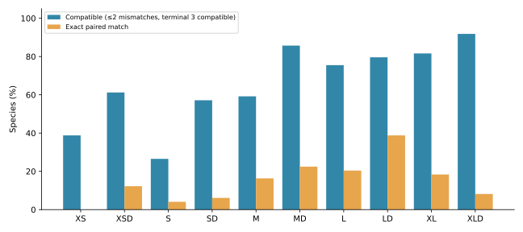

### 去除引物后的条码分辨率

| Window | Unambiguous inserts | Identity-unique species | Insert length (bp) |
| --- | --- | --- | --- |
| XS | 55 | 55/55 | 137–144 |
| S | 55 | 55/55 | 140–147 |
| M | 158 | 150/158 | 179–208 |
| L | 158 | 150/158 | 280–310 |
| XL | 55 | 55/55 | 395–413 |

长度不含两端引物。L结合窗口面板为159物种，其中一条内部片段含模糊碱基，条码分析保留158条。XS、S、XL的当前单物种代表之间没有相同条码；这表示参考集合内的唯一性，不是实测鉴定准确率或种群范围的分辨率。M和L各有四组双物种同条码冲突，其中涉及跨目记录，已标记来源待核查，未据此认定为生物学上不能区分。共同面板内49条M/L序列彼此不同，但与该窗口全部可用参考比较时，唯一物种数为48/49。

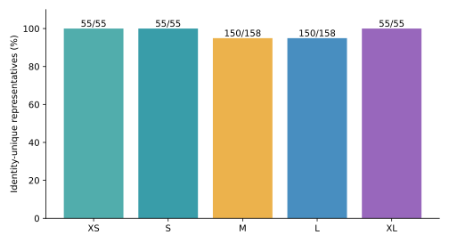

[同条码冲突](results/computational_evaluation/results/barcode_collisions.csv) · [最近邻编辑距离](results/computational_evaluation/results/nearest_neighbors.csv) · [剔除冲突记录的敏感性结果](results/computational_evaluation/results/conflict_exclusion_sensitivity.csv)

### 属级条件性留出测试

| Window | Held-out coverage | Held-out exact |
| --- | --- | --- |
| XS | 47/55 (85.45%) | 3/55 (5.45%) |
| S | 30/55 (54.55%) | 1/55 (1.82%) |
| M | 112/158 (70.89%) | 24/158 (15.19%) |
| L | 156/159 (98.11%) | 114/159 (71.70%) |
| XL | 53/55 (96.36%) | 15/55 (27.27%) |

此表来自25组逐折训练选配的候选，不是正式普通/D引物的性能表。每个窗口内每种物种仅测试一次，完整序列相同的记录不跨训练和测试折。结果评价未经过热力学与背景筛查的条件性模板兼容性，不能用于认定折内候选在完整设计约束下优于正式方案。折内序列、训练规模和逐物种预测均公开如下。

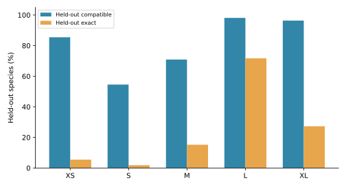

[逐折候选](results/computational_evaluation/results/cv_folds.csv) · [逐物种留出预测](results/computational_evaluation/results/cv_predictions.csv) · [完整面板比较表](results/computational_evaluation/results/panel_comparison.csv)

### XS

| Name | F (5′→3′) | R (5′→3′) |
|---|---|---|
| XS | `CTTGTGTATAATGGATTAACGA` | `AAACTAATTTCTTGGGAAAC` |
| XSD | `CTTGTGTATAATGGATTRACRA` | `AAACTAATTTCTTGGRRARC` |

两对引物在 NC_001453.1 上均结合于 F 183–204、R 344–363，参考扩增区间为 181 bp，比 S 短 7 bp。普通 XS 在 55 个可评价物种中没有正反引物均完全匹配的物种；其预测覆盖允许错配。XSD 反向引物倒数第 4 位使用 R（A/G），覆盖率更高。非目标数字为参考序列记录数。

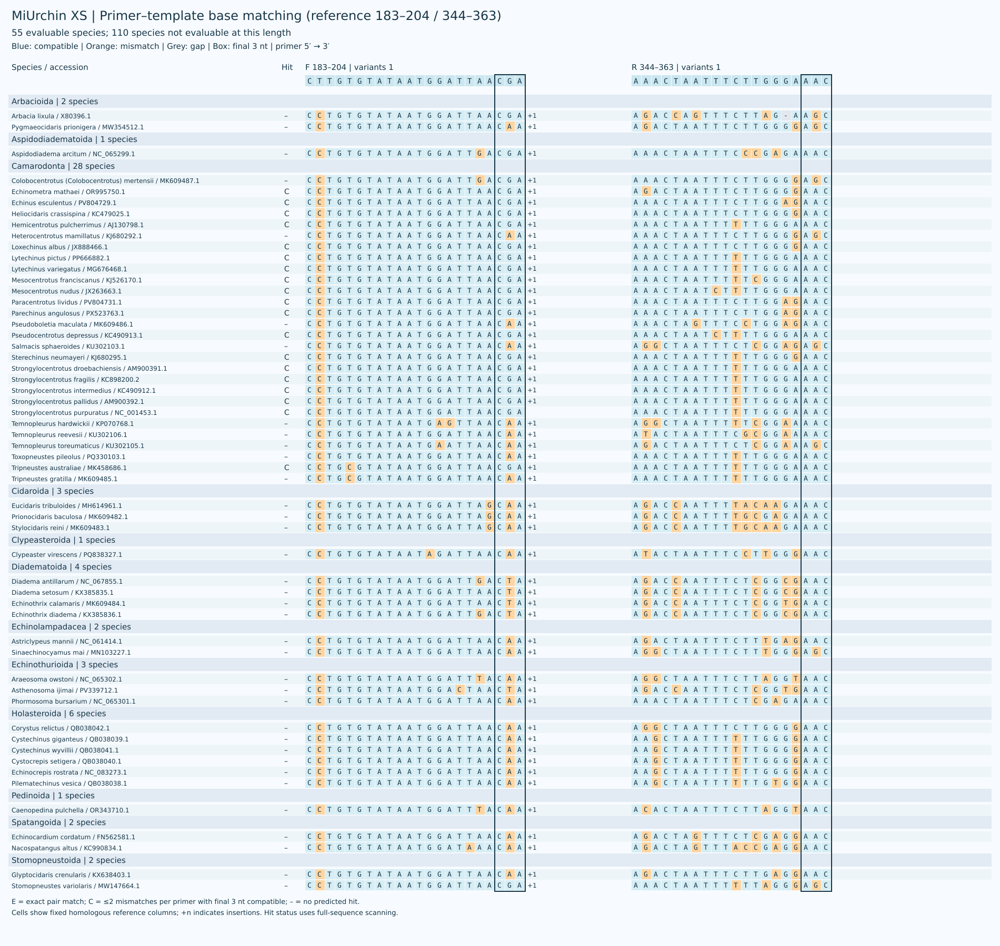

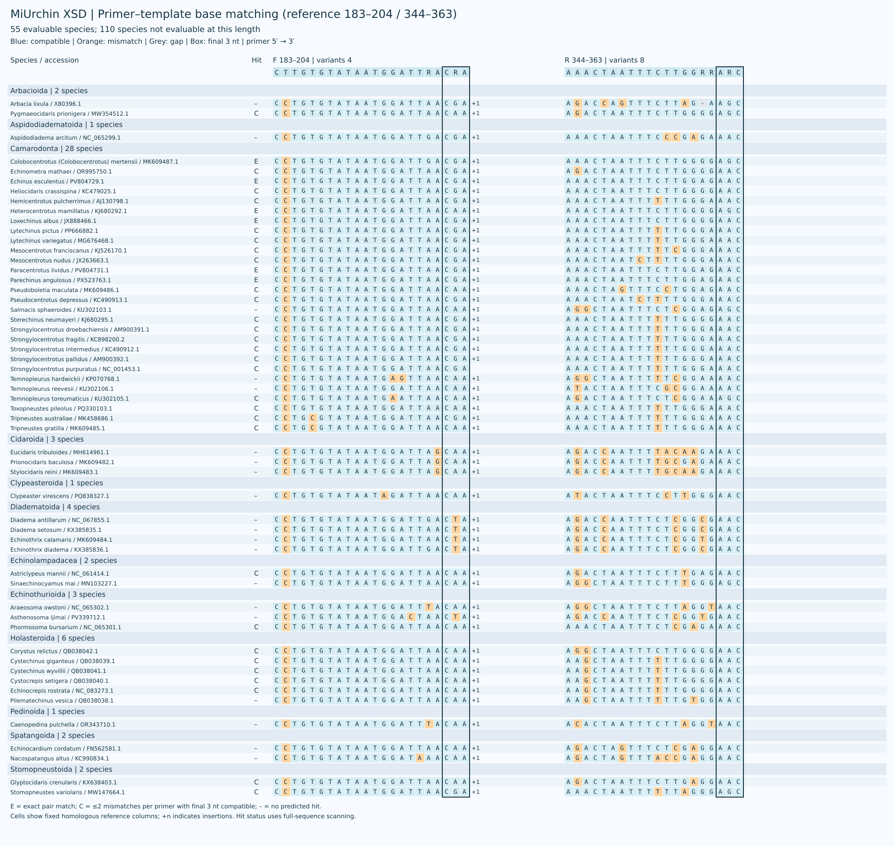

[XS 各目匹配](results/current_primers/XS/XS_by_order.csv) · [XS 各物种匹配](results/current_primers/XS/XS_by_taxon.csv) · [XSD 各目匹配](results/current_primers/XS/XSD_by_order.csv) · [XSD 各物种匹配](results/current_primers/XS/XSD_by_taxon.csv) · [普通候选比较](results/current_primers/XS/ordinary_screening.md)

### S

| Name | F (5′→3′) | R (5′→3′) |
|---|---|---|
| S | `TGTGTATAATGGATTAACGAGA` | `GCTTAGCTAAAACTAATTTCTTGG` |
| SD | `TGTGTATAATGGATTAACRAGH` | `GCTTAGCTTAAACYAATTTCTYGR` |

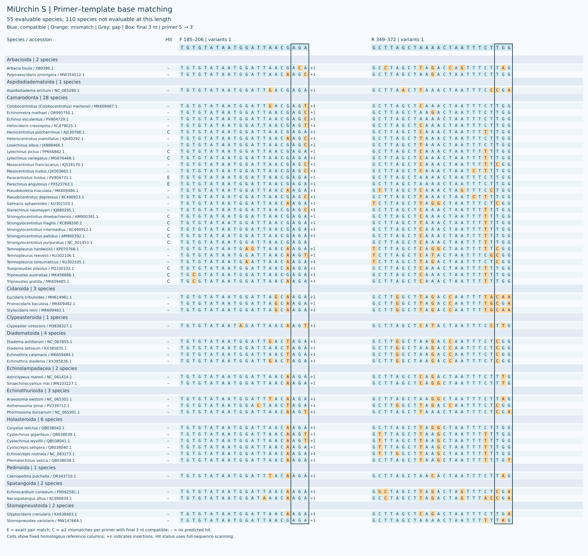

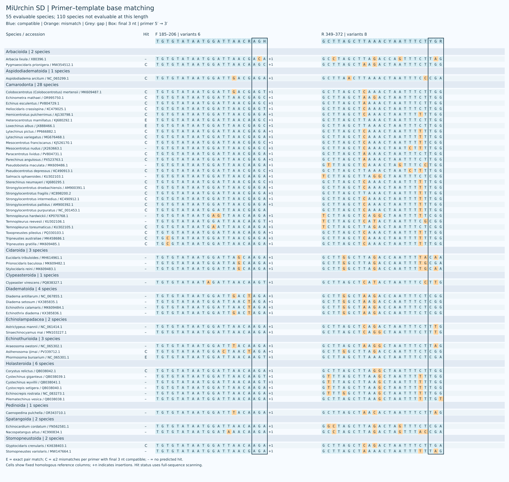

[S 各目匹配](results/current_primers/S/SD_by_order.csv) · [S 各物种匹配](results/current_primers/S/SD_by_taxon.csv)

### M

| Name | F (5′→3′) | R (5′→3′) |
|---|---|---|
| M | `CGTTAGACGAGAAGACCCTG` | `CTTTGATCACCTTAGTGGATCA` |
| MD | `CGTTAGACGAGAAGACCCTR` | `CTTTGATCACCTDARTGGATCA` |

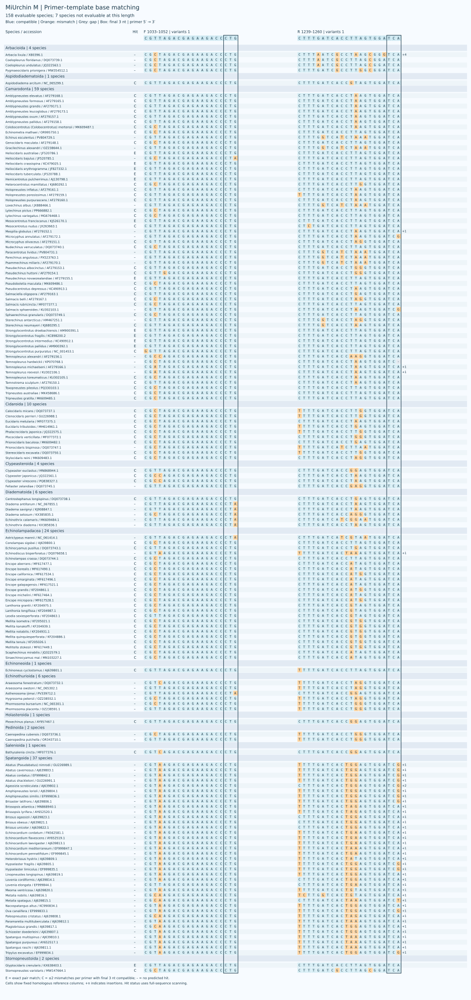

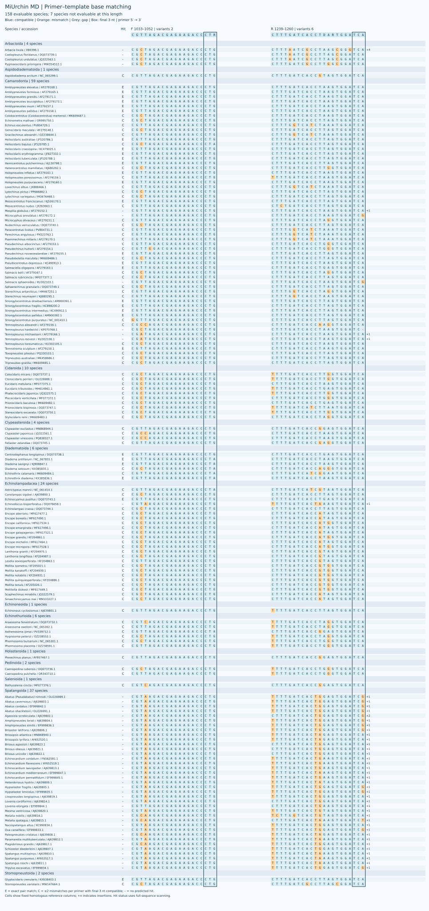

[M 各目匹配](results/current_primers/M/MD_by_order.csv) · [M 各物种匹配](results/current_primers/M/MD_by_taxon.csv)

### L

| Name | F (5′→3′) | R (5′→3′) |
|---|---|---|
| L | `GTCTCCTAAATAGAGACTAGTATGAATGGC` | `GCGGTAACTTGTTCCTTTGATCACC` |
| LD | `GTCTCCTAAATAGAGACTAGHATGAATGGC` | `GCGGTAACTTGTTYCTTTGRTCACY` |

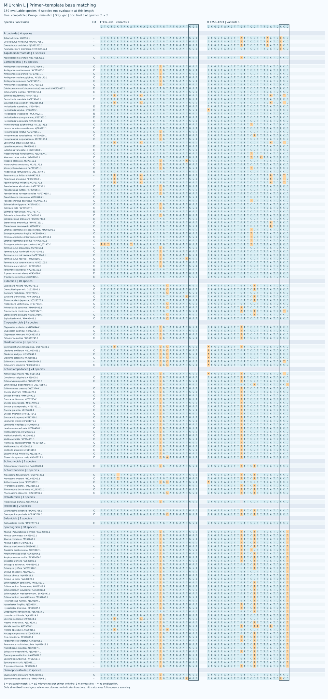

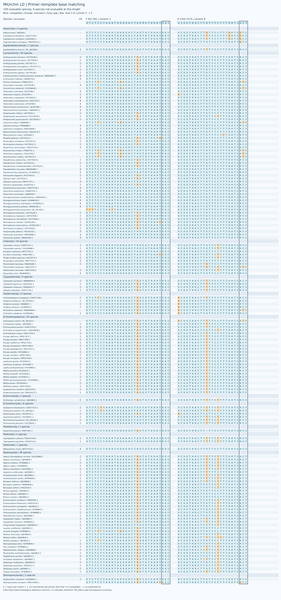

[L 各目匹配](results/current_primers/L/LD_by_order.csv) · [L 各物种匹配](results/current_primers/L/LD_by_taxon.csv)

### XL

| Name | F (5′→3′) | R (5′→3′) |
|---|---|---|
| XL | `GAATAGGCCTAGAAGCAGCC` | `CCGTCTTGCCATTCATACTAGTCTC` |
| XLD | `AAGTAGGCCTARAAGCAGCC` | `CCGTCTTGCCATTCATACCAGTCTY` |

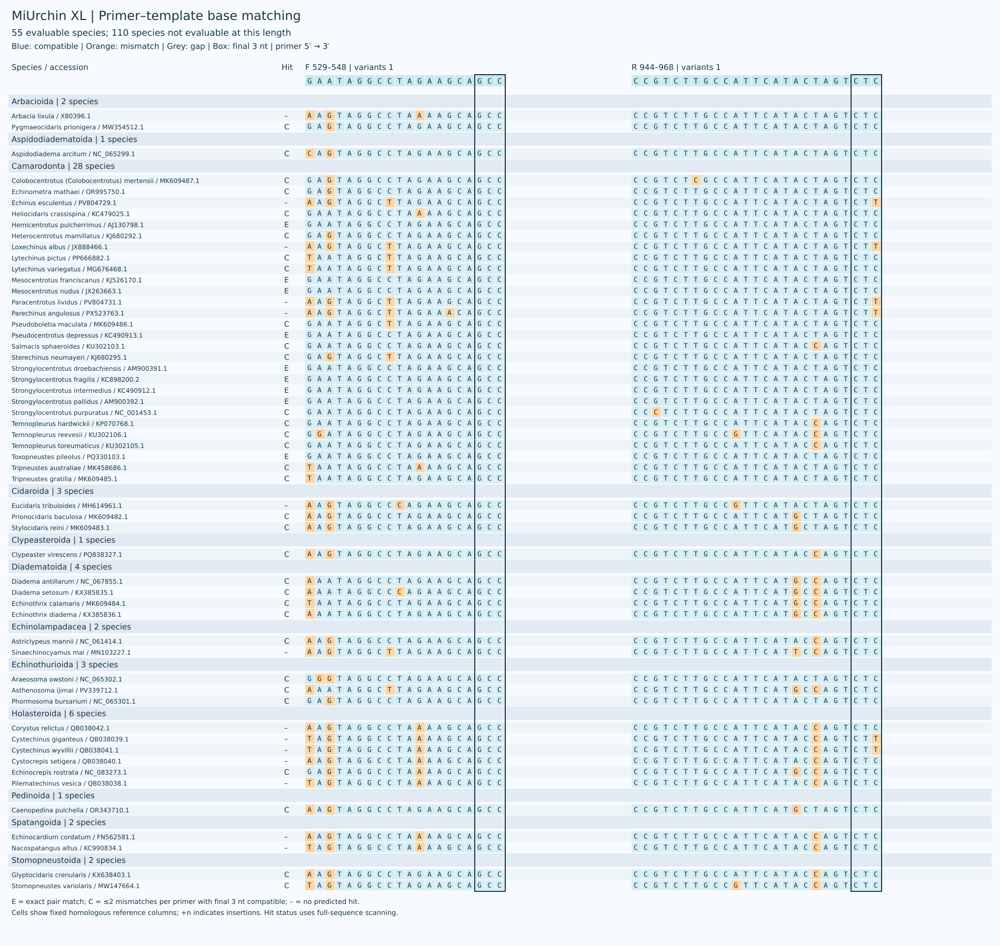

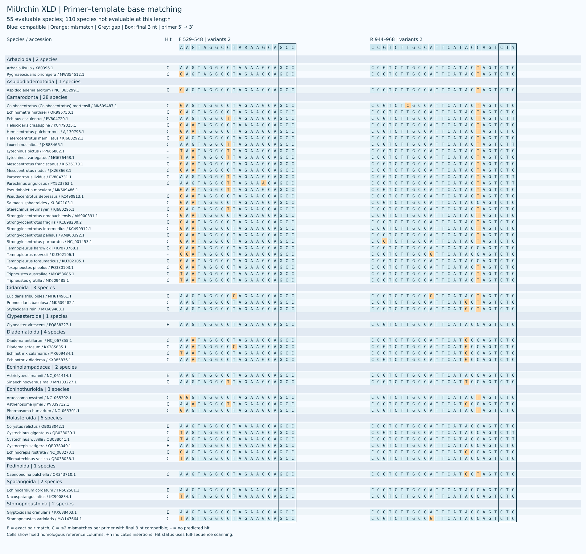

[XL 各目匹配](results/current_primers/XL/XLD_by_order.csv) · [XL 各物种匹配](results/current_primers/XL/XLD_by_taxon.csv)

## 讨论

共同面板比较将长度差异与参考数据可用性分开。XLD偏向容许错配时的覆盖，LD偏向双端完全匹配；单个指标不足以确定普遍最优的窗口。XS的参考跨度只比S短7 bp，保留二者应同时考虑兼容性和信息量。

各自面板仍有明显类群缺口：MD覆盖Spatangoida的0/37，LD为36/38；二者均未覆盖4个可评价Arbacioida。条码来源冲突和种内采样不足也限制了向参考集合外推断。属级选配测试提供条件性泛化分析；完整设计过程的更强推断仍需外部数据或嵌套窗口发现分析。本研究报告计算兼容性与条码区分能力，正式引物序列保持不变。

[Copyright / 著作权](COPYRIGHT.md)

## 引用方式

使用本项目引物、参考数据或分析代码时，请引用：

Xia, F. (2026). *MiUrchin: candidate mitochondrial 16S rRNA primers for sea-urchin environmental DNA metabarcoding*. GitHub. https://github.com/GUIBA-EX/MiUrchin

[CITATION.cff](CITATION.cff) · [BibTeX](CITATION.bib)

## 参考文献

1. Gold, Z., Wall, A. R., Schweizer, T. M., et al. (2022). A manager’s guide to using eDNA metabarcoding in marine ecosystems. *PeerJ*, 10, e14071. https://doi.org/10.7717/peerj.14071

2. Miya, M., Sato, Y., Fukunaga, T., et al. (2015). MiFish, a set of universal PCR primers for metabarcoding environmental DNA from fishes: detection of more than 230 subtropical marine species. *Royal Society Open Science*, 2, 150088. https://doi.org/10.1098/rsos.150088

3. Sutera, A., Bonaviri, C., Di Trapani, F., et al. (2025). Unravelling hidden trophic interactions among sea urchin juveniles and macroinvertebrates by DNA amplification. *Molecular Ecology*, 34, e70163. https://doi.org/10.1111/mec.70163

4. Katoh, K., & Standley, D. M. (2013). MAFFT multiple sequence alignment software version 7: improvements in performance and usability. *Molecular Biology and Evolution*, 30, 772–780. https://doi.org/10.1093/molbev/mst010

5. Untergasser, A., Cutcutache, I., Koressaar, T., et al. (2012). Primer3—new capabilities and interfaces. *Nucleic Acids Research*, 40, e115. https://doi.org/10.1093/nar/gks596

6. Riaz, T., Shehzad, W., Viari, A., et al. (2011). ecoPrimers: inference of new DNA barcode markers from whole genome sequence analysis. *Nucleic Acids Research*, 39, e145. https://doi.org/10.1093/nar/gkr732
