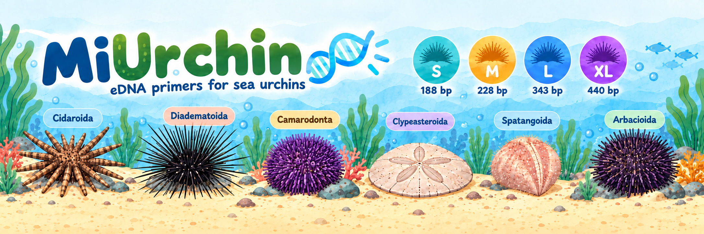
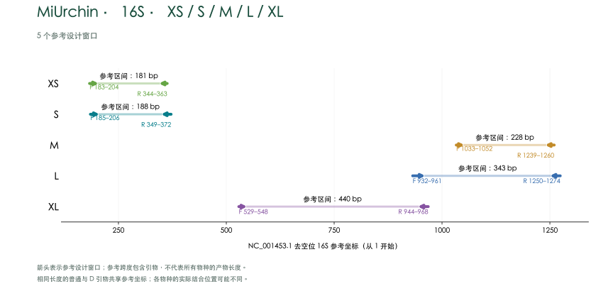
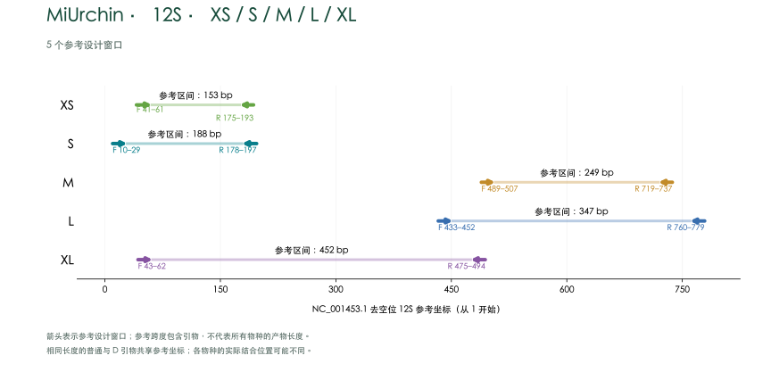
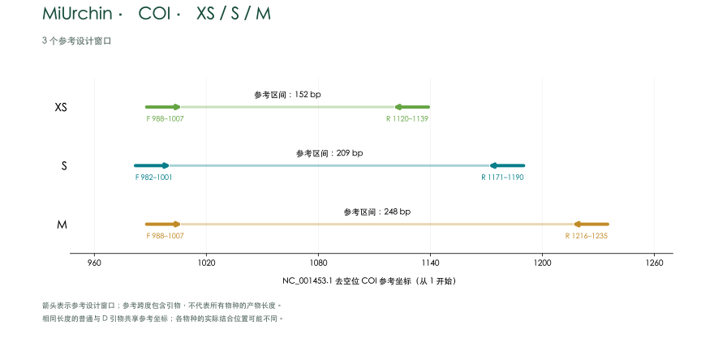

# MiUrchin

[English](README.md)

MiUrchin 收录了 26 对用于海胆环境 DNA 宏条形码研究的线粒体候选引物。16S、12S 各有五个窗口，COI 有三个窗口。每个窗口保留一对普通引物和一对简并引物（后缀 D），两对共用相同的参考起止坐标。

[下载完整引物 FASTA](sequences/all_markers.fasta) · [预印本 PDF](publications/MiUrchin_preprint.pdf) · [论文 Markdown](publications/MiUrchin_preprint.md)

## 如何选择窗口

选择窗口时，可分别考虑预测覆盖和双端完全匹配。每个基因独立建库，同一窗口的普通与 D 引物使用相同物种比较。

- **16S**：在五个窗口均可评价的 49 个物种中，XLD 覆盖最多（45/49），LD 的双端完全匹配最多（19/49）。在各窗口完整面板中，MD 对 Spatangoida 的覆盖为 0/37，LD 为 36/38。
- **12S**：在 249 bp 的 M 窗口，MD 相比普通 M 将覆盖从 25/69 提高到 61/69，完全匹配从 0 种增至 24 种。允许鸟嘌呤–胸腺嘧啶配对的严格非目标命中从 1 种增至 2 种。
- **COI**：152 bp 的 XSD 覆盖 79/106 种，其中 3 种完全匹配。209 bp 的 SD 覆盖 63/105 种，其中 6 种完全匹配。COI 库有 314 个物种，各保留窗口仅有 103–106 种可评价。本轮 L 和 XL 候选均未通过背景门槛。

## 引物序列与预测表现

FASTA 名称包含基因、方案和方向。例如，`MiUrchin-12S_MD_F` 表示 12S 的 M 窗口简并正向引物。序列均按 5′→3′ 书写。参考跨度按 NC_001453.1 相应基因内部的坐标计算，包含两端引物；内部条码长度仅计算两引物之间的序列。

**读表说明。** “覆盖”和“完全匹配”均为命中物种数 / 该窗口可评价物种数。“严格非目标”栏的两个数依次表示 **仅沃森–克里克配对 / 另允许鸟嘌呤–胸腺嘧啶配对** 下的命中数。例如，0 / 7 表示第一种模型命中 0 条、第二种模型命中 7 条（16S XSD）。

### 16S

非目标背景为 6,045 条参考记录。

| 方案 | F（5′→3′） | R（5′→3′） | 跨度（bp） | 覆盖 | 完全匹配 | 严格非目标 | 碱基匹配图 |
| --- | --- | --- | --- | --- | --- | --- | --- |
| XS | `CTTGTGTATAATGGATTAACGA` | `AAACTAATTTCTTGGGAAAC` | 181 | 19/55 | 0/55 | 0 / 0 | [查看](results/current_primers/XS/base_matching_XS.svg) |
| XSD | `CTTGTGTATAATGGATTRACRA` | `AAACTAATTTCTTGGRRARC` | 181 | 35/55 | 6/55 | 0 / 7 | [查看](results/current_primers/XS/base_matching_XSD.svg) |
| S | `TGTGTATAATGGATTAACGAGA` | `GCTTAGCTAAAACTAATTTCTTGG` | 188 | 13/55 | 2/55 | 0 / 0 | [查看](results/current_primers/S/base_matching_S.svg) |
| SD | `TGTGTATAATGGATTAACRAGH` | `GCTTAGCTTAAACYAATTTCTYGR` | 188 | 29/55 | 3/55 | 0 / 0 | [查看](results/current_primers/S/base_matching_SD.svg) |
| M | `CGTTAGACGAGAAGACCCTG` | `CTTTGATCACCTTAGTGGATCA` | 228 | 85/158 | 12/158 | 0 / 0 | [查看](results/current_primers/M/base_matching_M.svg) |
| MD | `CGTTAGACGAGAAGACCCTR` | `CTTTGATCACCTDARTGGATCA` | 228 | 110/158 | 28/158 | 0 / 0 | [查看](results/current_primers/M/base_matching_MD.svg) |
| L | `GTCTCCTAAATAGAGACTAGTATGAATGGC` | `GCGGTAACTTGTTCCTTTGATCACC` | 343 | 103/159 | 18/159 | 0 / 0 | [查看](results/current_primers/L/base_matching_L.svg) |
| LD | `GTCTCCTAAATAGAGACTAGHATGAATGGC` | `GCGGTAACTTGTTYCTTTGRTCACY` | 343 | 141/159 | 30/159 | 2 / 12 | [查看](results/current_primers/L/base_matching_LD.svg) |
| XL | `GAATAGGCCTAGAAGCAGCC` | `CCGTCTTGCCATTCATACTAGTCTC` | 440 | 41/55 | 9/55 | 2 / 3 | [查看](results/current_primers/XL/base_matching_XL.svg) |
| XLD | `AAGTAGGCCTARAAGCAGCC` | `CCGTCTTGCCATTCATACCAGTCTY` | 440 | 51/55 | 6/55 | 0 / 4 | [查看](results/current_primers/XL/base_matching_XLD.svg) |

### 12S

非目标背景为 459 种棘皮动物，每种取一条代表序列。

| 方案 | F（5′→3′） | R（5′→3′） | 跨度（bp） | 覆盖 | 完全匹配 | 严格非目标 | 碱基匹配图 |
| --- | --- | --- | --- | --- | --- | --- | --- |
| XS | `TGCCACATGCAAGCTTATTAG` | `TTTAGCACTGCAGATGTGG` | 153 | 27/67 | 0/67 | 0 / 0 | [查看](markers/12S_COI/figures/12S_XS.svg) |
| XSD | `TGCCACATGCAAGCYWAYTAG` | `TTTAGCACTGCAGDYGTGG` | 153 | 32/67 | 19/67 | 0 / 0 | [查看](markers/12S_COI/figures/12S_XSD.svg) |
| S | `GTCCTAGTCCCAATTTTAAC` | `AATGTTTAGCACTGCAGTTG` | 188 | 27/64 | 1/64 | 0 / 1 | [查看](markers/12S_COI/figures/12S_S.svg) |
| SD | `GTCCTAGTCCCAAYWTTARC` | `AATGTTTAGCACTGCAGDYG` | 188 | 56/64 | 19/64 | 0 / 1 | [查看](markers/12S_COI/figures/12S_SD.svg) |
| M | `CGGTTTTCCAAACCTCCCT` | `ACTGCTGAATCCAGTTTCT` | 249 | 25/69 | 0/69 | 1 / 1 | [查看](markers/12S_COI/figures/12S_M.svg) |
| MD | `CGGTTTTCCAWAYCTCCCT` | `ACTGCTGAATCCARTTTCN` | 249 | 61/69 | 24/69 | 2 / 2 | [查看](markers/12S_COI/figures/12S_MD.svg) |
| L | `ACCCTGTTATACTTAGACGT` | `GCATTCCAGAGCTCTCTTCA` | 347 | 23/69 | 0/69 | 0 / 0 | [查看](markers/12S_COI/figures/12S_L.svg) |
| LD | `ACCCTGTTATACTTAGMHGT` | `GCATTCCAGAGCTSWYTTCA` | 347 | 56/69 | 17/69 | 0 / 3 | [查看](markers/12S_COI/figures/12S_LD.svg) |
| XL | `CCACATGCAAGCTAACTAGC` | `AAACCGCCAAGTCCTTTGAG` | 452 | 32/67 | 15/67 | 0 / 0 | [查看](markers/12S_COI/figures/12S_XL.svg) |
| XLD | `CCACATGCAAGYYAAYTAGC` | `AAACCGCCAARTCCTTTGAR` | 452 | 40/67 | 21/67 | 2 / 3 | [查看](markers/12S_COI/figures/12S_XLD.svg) |

### COI

非目标背景为 1,719 种棘皮动物，每种取一条代表序列。

| 方案 | F（5′→3′） | R（5′→3′） | 跨度（bp） | 覆盖 | 完全匹配 | 严格非目标 | 碱基匹配图 |
| --- | --- | --- | --- | --- | --- | --- | --- |
| XS | `TCAAACCTACAATGAGAAAC` | `ACATAGTGGAAGTGAGCTAC` | 152 | 34/106 | 0/106 | 0 / 1 | [查看](markers/12S_COI/figures/COI_XS.svg) |
| XSD | `TCAAACCTACARTGRGARAC` | `ACATAGTGGAAGTGDGCWAC` | 152 | 79/106 | 3/106 | 0 / 1 | [查看](markers/12S_COI/figures/COI_XSD.svg) |
| S | `CAAGGATCAAACCTACAATG` | `AATCAGTGAGTAAATCCTGC` | 209 | 28/105 | 3/105 | 0 / 0 | [查看](markers/12S_COI/figures/COI_S.svg) |
| SD | `CAAGGATCAAAYYTACARTG` | `AATCAGTGAGTRAAYCCWGC` | 209 | 63/105 | 6/105 | 1 / 1 | [查看](markers/12S_COI/figures/COI_SD.svg) |
| M | `TCAAACCTACAATGGGAAAC` | `ACCTTTCCTCATAGTGGGTG` | 248 | 22/103 | 0/103 | 0 / 0 | [查看](markers/12S_COI/figures/COI_M.svg) |
| MD | `TCAAACCTACARTGRGARAC` | `ACCTTTCCTCAWAGYGGRTG` | 248 | 57/103 | 1/103 | 0 / 0 | [查看](markers/12S_COI/figures/COI_MD.svg) |

[16S CSV](results/current_primers/comparison.csv) · [12S / COI CSV](markers/12S_COI/candidates.csv)

## 结合位置与逐碱基匹配

箭头标示正反向引物的结合区，每个基因使用独立坐标轴。上表的碱基图按引物方向显示反向模板，方框标示 3′ 末端三位。12S 和 COI 每目展示一个结合区碱基最完整的代表，同分时按 accession 排序。绿色表示兼容，橙色表示错配，最右列为完整序列成对扫描的结果。

## 参考面板与筛选规则

16S 目标库含 1,401 条记录，经质控后每种保留一条代表，共 165 种，目级名称依据 WoRMS 核对。12S 和 COI 的 NCBI Nucleotide 检索合计获得 9,988 条去重记录；按基因提取和质控后，分别保留 208 条和 9,392 条合格序列，设计面板分别包含 69 种和 314 种具名物种。每个窗口只统计结合区域可评价的物种。

覆盖要求形成成对产物，每端最多 2 个错配，且各自末端 3 nt 兼容；完全匹配要求双端零错配。每条 D 引物最多包含 8 种具体变体。宽松筛查取消末端约束，按表注中的模型顺序分别允许每端最多三个和两个错配。这些指标描述计算预测的模板兼容性。

[16S 方法](docs/METHODS.zh-CN.md) · [16S 参考审核](results/species_qc/README.md) · [12S 与 COI 数据和复核](markers/12S_COI/README.md)

## 16S 补充评价

16S 的 XS、S、M、L、XL 窗口分别有 55、55、158、159 和 55 种可评价，共同面板有 49 种。在共同面板中，XSD、SD、MD、LD、XLD 分别覆盖 30、28、42、39、45 种，完全匹配分别为 6、3、11、19、4 种。统一分母后，MD 的覆盖高于 LD，与各自面板百分比的排序不同。

去除引物后，在各窗口全部明确的参考条码中，XS、S、XL 各有 55/55 种条码唯一，M 和 L 均为 150/158，各有四组双物种同条码记录待复核。L 有一条内部片段含模糊碱基。这些数值描述冻结参考集合内的条码唯一性。

属级五折留出评价既定 16S 区域内的序列选配。每折仅用训练物种生成候选，完整代表序列相同的属绑定在同一折。留出结果描述折内候选在热力学与背景筛查之前的表现。

[共同面板图](results/computational_evaluation/figures/common_panel.svg) · [条码分辨率图](results/computational_evaluation/figures/resolution.svg) · [留出测试结果](results/computational_evaluation/results/cv_summary.csv) · [完整数据与复现](results/computational_evaluation/README.zh-CN.md)

## 引用与著作权

Xia, F. (2026). *MiUrchin, a set of universal PCR primers for metabarcoding environmental DNA from sea urchin*. GitHub.

[CITATION.cff](CITATION.cff) · [BibTeX](CITATION.bib) · [著作权与使用声明](COPYRIGHT.md)

## 参考文献

1. Gold, Z., Wall, A. R., Schweizer, T. M., et al. (2022). A manager’s guide to using eDNA metabarcoding in marine ecosystems. *PeerJ*, 10, e14071. https://doi.org/10.7717/peerj.14071

2. Miya, M., Sato, Y., Fukunaga, T., et al. (2015). MiFish, a set of universal PCR primers for metabarcoding environmental DNA from fishes: detection of more than 230 subtropical marine species. *Royal Society Open Science*, 2, 150088. https://doi.org/10.1098/rsos.150088

3. Sutera, A., Bonaviri, C., Di Trapani, F., et al. (2025). Unravelling hidden trophic interactions among sea urchin juveniles and macroinvertebrates by DNA amplification. *Molecular Ecology*, 34, e70163. https://doi.org/10.1111/mec.70163

4. Katoh, K., & Standley, D. M. (2013). MAFFT multiple sequence alignment software version 7: improvements in performance and usability. *Molecular Biology and Evolution*, 30, 772–780. https://doi.org/10.1093/molbev/mst010

5. Untergasser, A., Cutcutache, I., Koressaar, T., et al. (2012). Primer3—new capabilities and interfaces. *Nucleic Acids Research*, 40, e115. https://doi.org/10.1093/nar/gks596

6. Riaz, T., Shehzad, W., Viari, A., et al. (2011). ecoPrimers: inference of new DNA barcode markers from whole genome sequence analysis. *Nucleic Acids Research*, 39, e145. https://doi.org/10.1093/nar/gkr732
