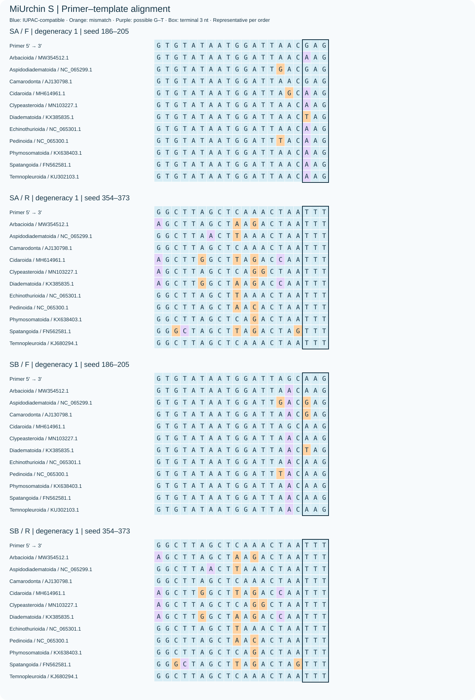
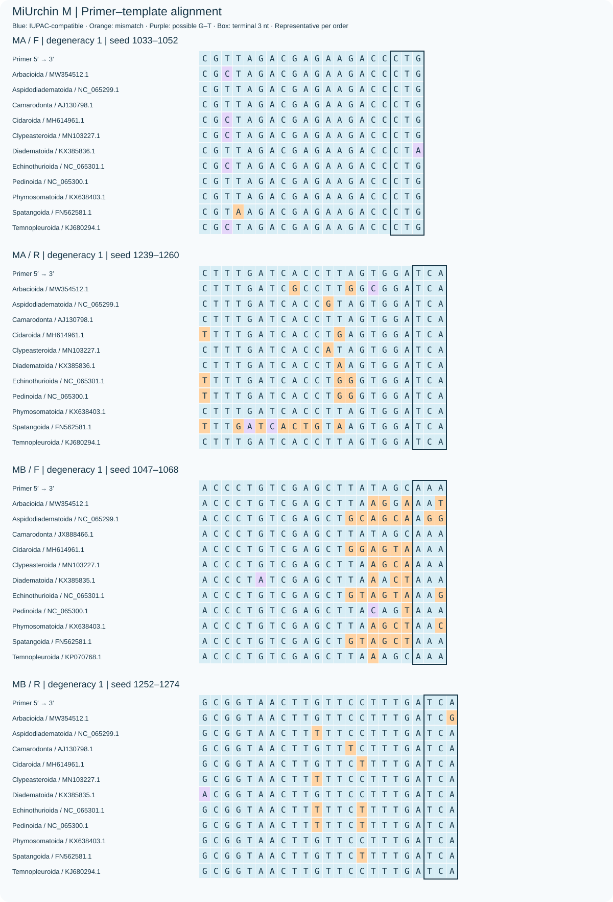
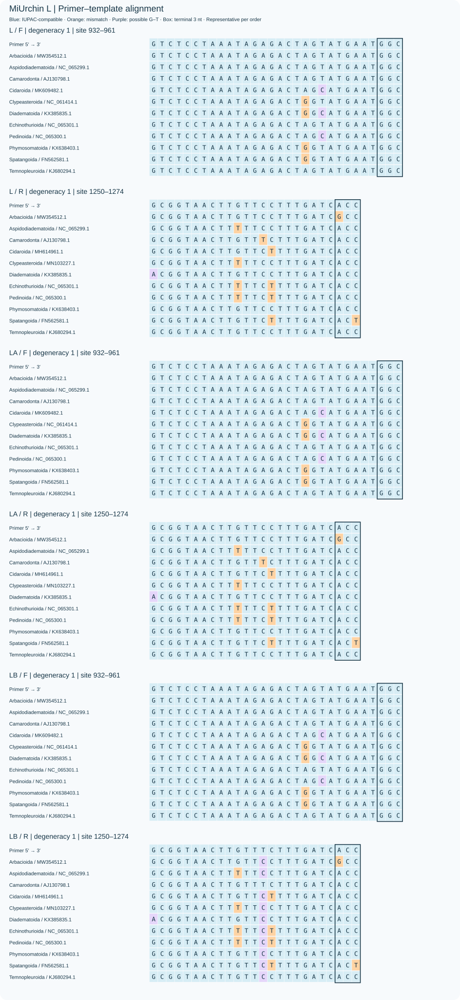
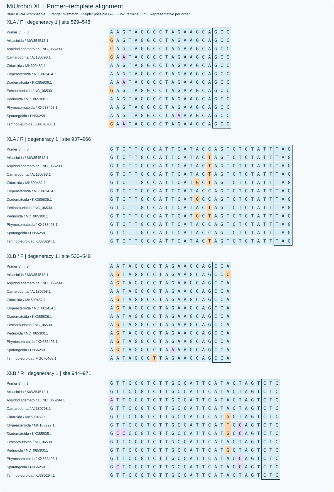

置顶图依据真实照片绘制，展示设计面板11个目的代表；徽标为S/M/L/XL共同参考跨度188/228/343/440 bp。[代表物种与照片来源](figures/overview_design.md)。

# MiUrchin

[English](README.md)

每个长度联合选择一个共同位点：普通、A、B、D的正反向起止坐标完全相同。位点内按覆盖率与完全匹配率之和选择普通单对、普通A/B并集和简并单对，三类评分等权平均选择位点。背景门槛：MiLily的SD/MD各20条，MiUrchin的XLD各50条，其余方案各5条，均分别应用于WC≤3和GT≤2。所有实际序列变体通过末端规则和两种浓度热力学检查。A/B指标为独立PCR并集，未验证混池；设计与评估共用参考数据，计算覆盖率不代表实测扩增效率。

D表示简并单对；无后缀为普通单对，A/B为同位点普通双对。每个项目12套方案、16对记录、32条序列。

## 保留理由

每个长度只保留一套D方案，固定普通/A/B/D共同坐标，本次A/B重选保留普通单对与D不变。扩大简并候选后，在覆盖与完全匹配不低于原D的方案中，优先选取接近最佳评分但简并度更低的候选；收益不足以抵偿复杂度时不追求最高评分。

S采用54/48，M采用8/96，L采用1/16，XL采用8/24。S舍弃108/96档，以较低简并度和较高覆盖率换取较低完全匹配率；M、L舍弃完全匹配率仅多约2个百分点的更复杂档。

[完整比较 / Full comparison](docs/DECISIONS.md)

| Scheme | Coverage % | Exact % | WC≤3 | GT≤2 | WC≤4 |
|---|---:|---:|---:|---:|---:|
| SD | 73.47 | 22.45 | 3 | 0 | 22 |
| S | 26.53 | 4.08 | 0 | 0 | 1 |
| SA+SB | 41.84 | 6.12 | 0 | 0 | 7 |
| MD | 87.76 | 67.35 | 0 | 0 | 0 |
| M | 59.18 | 16.33 | 0 | 0 | 0 |
| MA+MB | 59.18 | 30.61 | 0 | 0 | 0 |
| LD | 93.88 | 36.73 | 2 | 1 | 228 |
| L | 75.51 | 19.39 | 2 | 1 | 161 |
| LA+LB | 75.51 | 33.67 | 2 | 1 | 161 |
| XLD | 100.00 | 57.14 | 16 | 26 | 47 |
| XL | 81.63 | 18.37 | 3 | 5 | 11 |
| XLA+XLB | 91.84 | 24.49 | 3 | 5 | 16 |

宽松错配模型下的背景命中仍可能较高；完整结果和漏检记录见数据文件。

[Sequences](sequences/primer_pairs.csv) · [FASTA](sequences/primers.fasta) · [Results](results/terminal_optimization/comparison.csv) · [Verification](results/terminal_optimization/verification.json) · [Full base matching](results/terminal_optimization/base_matching.html)

## S

| Name | F (5′→3′) | R (5′→3′) |
|---|---|---|
| SD | `YGTGTATAATGGATTDACDAGH` | `KCTTAGCTHARACTAATTTCTYGR` |
| S | `TGTGTATAATGGATTAACGAGA` | `GCTTAGCTAAAACTAATTTCTTGG` |
| SA | `TGTGTATAATGGATTAACAAGC` | `GCTTAGCTTAAACTAATTTCTTGG` |
| SB | `TGTGTATAATGGATTAACGAGA` | `GCTTAGCTAAAACTAATTTCTTGG` |

## M

| Name | F (5′→3′) | R (5′→3′) |
|---|---|---|
| MD | `SGYTAGACGAGAAGACCCTR` | `CTTTGRTCAYCKDRRTGGATCA` |
| M | `CGTTAGACGAGAAGACCCTG` | `CTTTGATCACCTTAGTGGATCA` |
| MA | `CGCTAGACGAGAAGACCCTG` | `CTTTGATCACCTTAGTGGATCA` |
| MB | `CGTTAGACGAGAAGACCCTG` | `CTTTGATCACCTTAGTGGATCA` |

## L

| Name | F (5′→3′) | R (5′→3′) |
|---|---|---|
| LD | `GTCTCCTAAATAGAGACTAGTATGAATGGC` | `GCGGTAACTTGTTYCTTTGRTCRYC` |
| L | `GTCTCCTAAATAGAGACTAGTATGAATGGC` | `GCGGTAACTTGTTCCTTTGATCACC` |
| LA | `GTCTCCTAAATAGAGACTAGTATGAATGGC` | `GCGGTAACTTGTTCCTTTGATCACC` |
| LB | `GTCTCCTAAATAGAGACTAGTATGAATGGC` | `GCGGTAACTTGTTTCTTTGATCACC` |

## XL

| Name | F (5′→3′) | R (5′→3′) |
|---|---|---|
| XLD | `NARTAGGCCTAGAAGCAGCC` | `CCSTCTTGCCATTCATDCYAGTCTY` |
| XL | `GAATAGGCCTAGAAGCAGCC` | `CCGTCTTGCCATTCATACTAGTCTC` |
| XLA | `AAGTAGGCCTAGAAGCAGCC` | `CCGTCTTGCCATTCATACCAGTCTC` |
| XLB | `GAATAGGCCTAGAAGCAGCC` | `CCGTCTTGCCATTCATACTAGTCTC` |

Independent target checks: 2560; disagreements: 0. Background set checks: 32; disagreements: 0.

[Copyright / 著作权声明](COPYRIGHT.md)

扩大同坐标搜索后，各长度A/B均有双方独有贡献；两项并集指标均不低于此前方案。普通单对和D保持不变。依据样本目标选择单对或互补双对。[互补性与独有命中](docs/AB_COMPLEMENTARITY.md)
