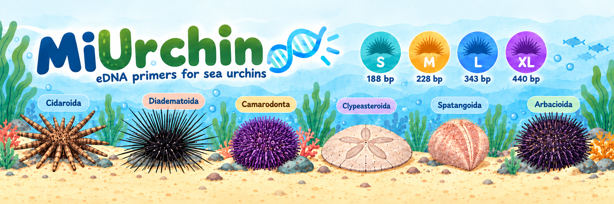
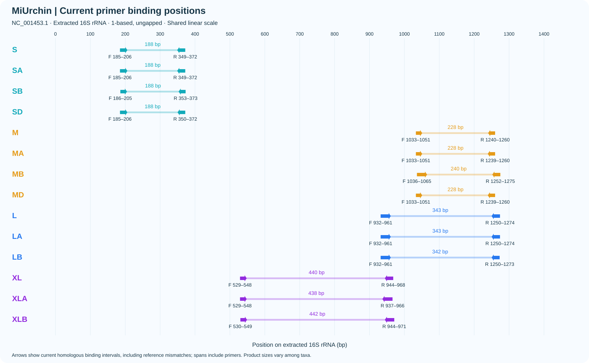
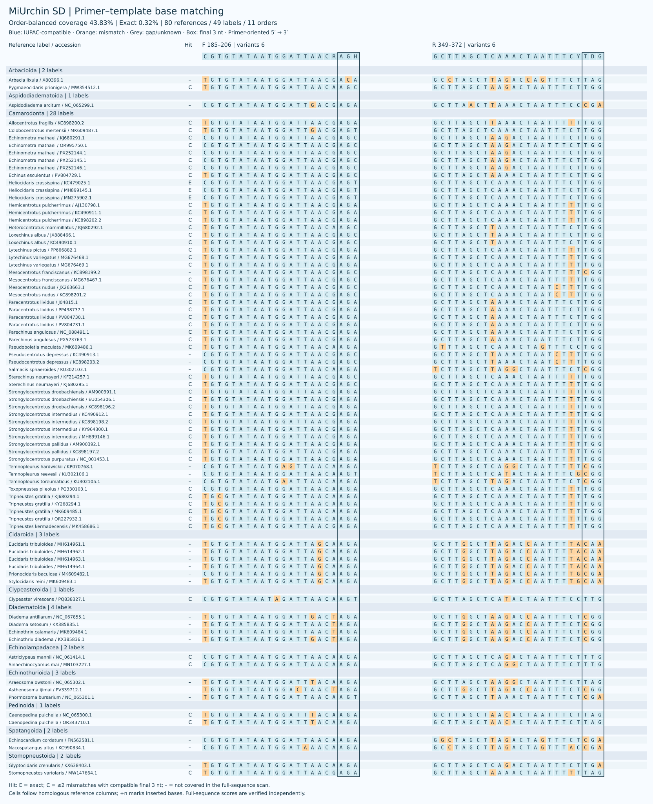
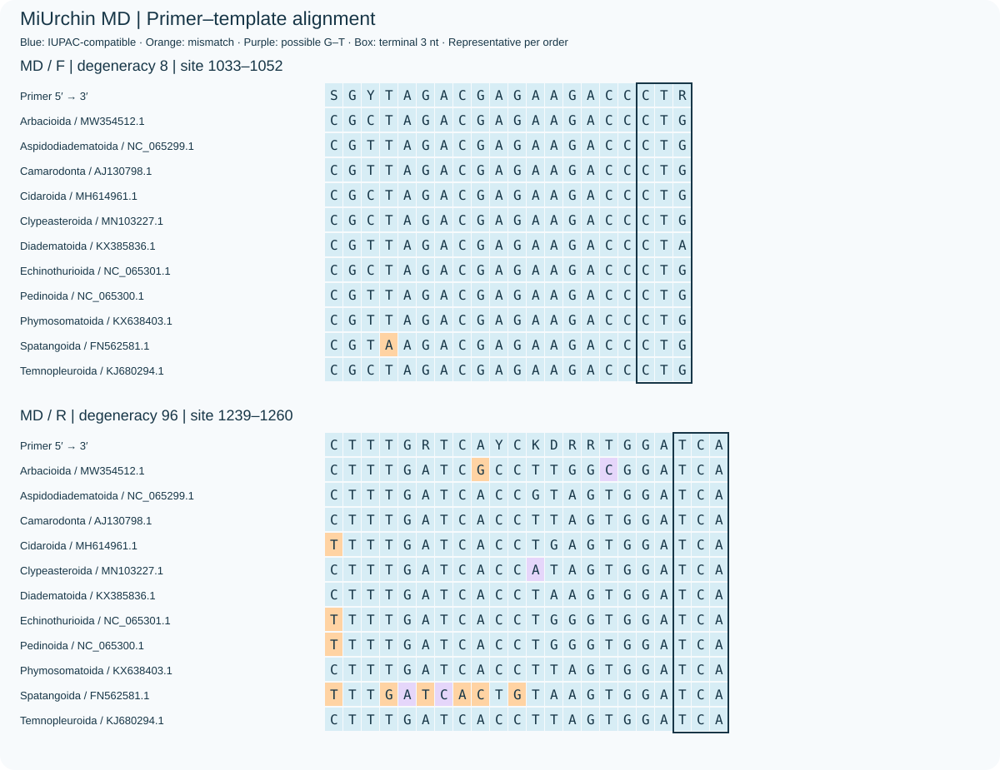
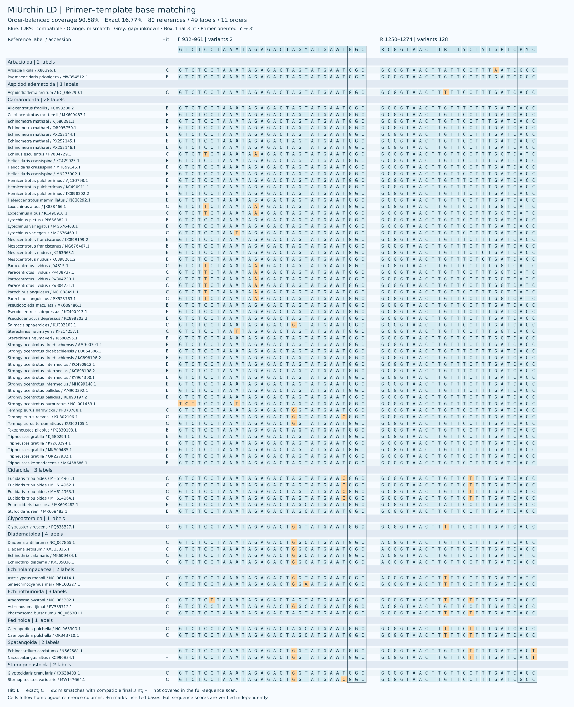
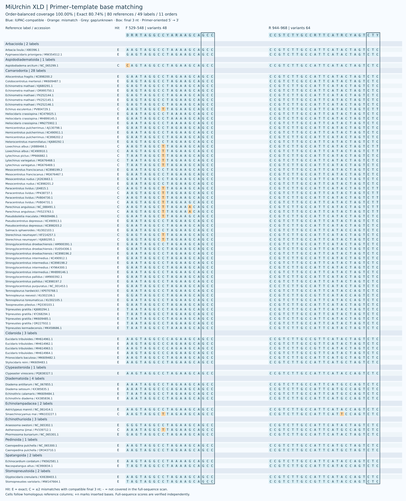

# MiUrchin

[English](README.md)

海胆16S rRNA环境DNA候选引物，保留S、M、L、XL四个长度。每个长度的普通、A、B、D起止坐标一致；D为一对简并引物，A/B为普通引物分别PCR后的并集。参考跨度为188、228、343、440 bp。

主指标采用**目间等权**：每目内先计算检出物种标签比例，再对11个目取均值；任一参考命中即可检出该标签，完全匹配采用同一层级。共同面板80条参考、49个标签，目级归属已按WoRMS接受分类核对。三个目各只有一个标签，满覆盖不代表覆盖该目所有物种。

[分类映射 / Taxonomy](results/D_optimization/panel.csv) · [图片来源 / Photo references](figures/overview_design.md)

## 当前表现

| Scheme | Order coverage % | Order exact % | WC≤3 | GT≤2 | WC≤4 |
|---|---:|---:|---:|---:|---:|
| SD | 64.18 | 20.78 | 4 | 0 | 30 |
| S | 4.22 | 0.65 | 0 | 0 | 1 |
| SA+SB | 11.04 | 0.97 | 0 | 0 | 7 |
| MD | 85.39 | 67.53 | 0 | 0 | 1 |
| M | 47.73 | 6.82 | 0 | 0 | 0 |
| MA+MB | 47.73 | 9.09 | 0 | 0 | 0 |
| LD | 90.58 | 16.77 | 12 | 1 | 246 |
| L | 68.83 | 3.25 | 2 | 1 | 161 |
| LA+LB | 68.83 | 5.52 | 2 | 1 | 161 |
| XLD | 100.00 | 80.74 | 12 | 22 | 84 |
| XL | 77.49 | 2.92 | 3 | 5 | 11 |
| XLA+XLB | 98.70 | 21.10 | 3 | 5 | 16 |

覆盖要求两端各≤2错配且末端3 nt兼容，完全匹配要求两端无错配。WC3/GT2为宽松模型的非目标记录数，不强制末端兼容；背景库6,045条。

## D方案的取舍

- **SD**：目间覆盖42.10→64.18%；新增7个、丢失5个标签。108/108简并度，覆盖收益伴随变体稀释。
- **MD**：覆盖不变；完全匹配仍为33/49个标签，但在目间分布更均衡，目间完全匹配41.88→67.53%。
- **LD**：覆盖不变，增加3个完全匹配标签；反向简并度16→128。
- **XLD**：保持49/49覆盖，完全匹配28→38/49；目间完全匹配62.01→80.74%。

[D完整选择与逐类群增减 / D selection and taxon changes](docs/D_OPTIMIZATION.md) · [A/B互补性 / A/B complementarity](docs/AB_COMPLEMENTARITY.md)

次要比较：原参考加权口径

| Scheme | Coverage % | Exact % | WC≤3 | GT≤2 | WC≤4 |
|---|---:|---:|---:|---:|---:|
| SD | 77.55 | 22.45 | 4 | 0 | 30 |
| S | 26.53 | 4.08 | 0 | 0 | 1 |
| SA+SB | 41.84 | 6.12 | 0 | 0 | 7 |
| MD | 87.76 | 67.35 | 0 | 0 | 1 |
| M | 59.18 | 16.33 | 0 | 0 | 0 |
| MA+MB | 59.18 | 30.61 | 0 | 0 | 0 |
| LD | 93.88 | 42.86 | 12 | 1 | 246 |
| L | 75.51 | 19.39 | 2 | 1 | 161 |
| LA+LB | 75.51 | 33.67 | 2 | 1 | 161 |
| XLD | 100.00 | 77.55 | 12 | 22 | 84 |
| XL | 81.63 | 18.37 | 3 | 5 | 11 |
| XLA+XLB | 91.84 | 24.49 | 3 | 5 | 16 |

该表先按物种标签等权，再在标签内按参考等权，与主表的目间等权不同。

## S

| Name | F (5′→3′) | R (5′→3′) |
|---|---|---|
| SD | `YGTGTATAATGGATTDACDASH` | `GCTTAGCTHAVACYAATTTCTYDG` |
| S | `TGTGTATAATGGATTAACGAGA` | `GCTTAGCTAAAACTAATTTCTTGG` |
| SA | `TGTGTATAATGGATTAACAAGC` | `GCTTAGCTTAAACTAATTTCTTGG` |
| SB | `TGTGTATAATGGATTAACGAGA` | `GCTTAGCTAAAACTAATTTCTTGG` |

## M

| Name | F (5′→3′) | R (5′→3′) |
|---|---|---|
| MD | `SGYYAGACGAGAAGACCCTR` | `YTTTGATCAYCKDRRTGGATCA` |
| M | `CGTTAGACGAGAAGACCCTG` | `CTTTGATCACCTTAGTGGATCA` |
| MA | `CGCTAGACGAGAAGACCCTG` | `CTTTGATCACCTTAGTGGATCA` |
| MB | `CGTTAGACGAGAAGACCCTG` | `CTTTGATCACCTTAGTGGATCA` |

## L

| Name | F (5′→3′) | R (5′→3′) |
|---|---|---|
| LD | `GTCTCCTAAATAGAGACTAGYATGAATGGC` | `RCGGTAACTTRTTYCTYTGRTCRYC` |
| L | `GTCTCCTAAATAGAGACTAGTATGAATGGC` | `GCGGTAACTTGTTCCTTTGATCACC` |
| LA | `GTCTCCTAAATAGAGACTAGTATGAATGGC` | `GCGGTAACTTGTTCCTTTGATCACC` |
| LB | `GTCTCCTAAATAGAGACTAGTATGAATGGC` | `GCGGTAACTTGTTTCTTTGATCACC` |

## XL

| Name | F (5′→3′) | R (5′→3′) |
|---|---|---|
| XLD | `DRRTAGGCCYARAAGCAGCC` | `CCSTCTYGCCRTTCATRCYAGTCTY` |
| XL | `GAATAGGCCTAGAAGCAGCC` | `CCGTCTTGCCATTCATACTAGTCTC` |
| XLA | `AAGTAGGCCTAGAAGCAGCC` | `CCGTCTTGCCATTCATACCAGTCTC` |
| XLB | `GAATAGGCCTAGAAGCAGCC` | `CCGTCTTGCCATTCATACTAGTCTC` |

图中每行对应一条参考，按现行目分组；F/R均按引物5′→3′方向显示，方框标记末端3 nt，+n表示参考同源列间插入碱基。左侧E/C表示全序列扫描的完全匹配/覆盖。

[全部16对碱基匹配图 / All 16 base plots](results/terminal_optimization/base_matching.html)

## 方法与复核

搜索10,394组同坐标配对，每方向简并度≤128，3′端可简并。目间覆盖优先，同时保护目间及标签完全匹配率；所有具体变体通过末端和两种浓度场景的热力学检查。8对新旧D方案的独立C++/Python扫描完成1,280项目标判定和32个背景集合比较，差异0。当前发布12套方案、16对引物、32条序列。结果来自计算参考库，尚需实验验证。

[Sequences](sequences/primer_pairs.csv) · [FASTA](sequences/primers.fasta) · [Results](results/current/taxonomic_comparison.csv) · [Methods](docs/METHODS.zh-CN.md) · [Reproduction](docs/REPRODUCIBILITY.md) · [Validation](docs/VALIDATION.md)

[Copyright / 著作权声明](COPYRIGHT.md)
