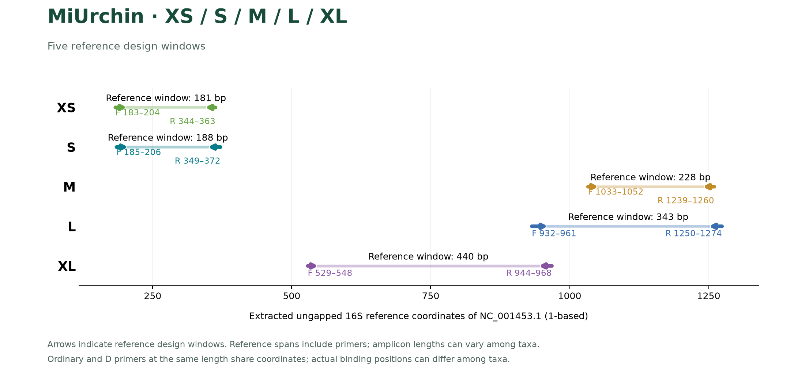

# MiUrchin

> 历史分析记录；当前引物、指标与验证见 [中文 README](../README.zh-CN.md)、[English README](../README.md) 和 [VALIDATION](VALIDATION.md)。 / Historical analysis; see the linked current README and validation.

**Mitochondrial 16S primer candidates for Echinoidea (sea urchins, including irregular echinoids).**

[中文](../README.zh-CN.md) · [Methods](../docs/METHODS.md) · [Reproducibility / 复现](../docs/REPRODUCIBILITY.md) · [Copyright / 著作权](../COPYRIGHT.md)

MiUrchin adapts the MiStar/MiCucumber workflow to a new target group: target-balanced design, specificity-first background screening, same-locus complementary pairs, independent full-sequence validation, and region visualization. Four length series are retained for both short-fragment applications and higher-quality DNA. **v0.1.0 is a computational candidate prerelease; no wet-lab performance is claimed.**

## Final candidates

| Scheme / 方案 | F + R | PCR mode / 模式 | Common coverage / 共同覆盖 | Region coverage / 区域覆盖 | Region exact / 区域完全匹配 | Product bp / 产物 | WC≤3 / GT≤2 / WC≤4 |
|---|---:|---|---:|---:|---:|---:|---:|
| MiUrchin-XS-Separate | 4 + 6 | 6 separate | 87.76% | 85.45% (55 labels) | 41.82% | 188–193 | 0 / 0 / 8 |
| MiUrchin-XS-Pool | 6 + 6 | 1 pool / 36 combinations | 87.76% | 85.45% (55 labels) | 49.09% | 188–193 | 0 / 4 / 12 |
| MiUrchin-S-Separate | 5 + 6 | 6 separate | 95.92% | 96.12% (165 labels) | 45.88% | 221–250 | 0 / 4 / 17 |
| MiUrchin-S-Pool | 6 + 6 | 1 pool / 36 combinations | 95.92% | 96.12% (165 labels) | 47.88% | 221–250 | 0 / 5 / 18 |
| MiUrchin-M-Separate | 3 + 6 | 6 separate | 97.96% | 95.30% (165 labels) | 44.83% | 316–346 | 1 / 1 / 18 |
| MiUrchin-M-Pool | 4 + 6 | 1 pool / 24 combinations | 97.96% | 96.08% (165 labels) | 45.44% | 316–346 | 1 / 2 / 19 |
| MiUrchin-L-Separate | 6 + 5 | 6 separate | 100.00% | 100.00% (55 labels) | 49.09% | 440–458 | 1 / 4 / 14 |
| MiUrchin-L-Pool | 6 + 5 | 1 pool / 30 combinations | 100.00% | 100.00% (55 labels) | 74.55% | 440–458 | 1 / 5 / 17 |

The common panel contains **49 name labels / 80 haplotypes**. Each locus also has its own eligible, within-label deduplicated panel: XS **55/70**, S **165/446**, M **165/483**, L **55/77** (labels/haplotypes). Region percentages have different denominators and must not be ranked as if measured on the same taxa. Both panels use equal label weight, then equal haplotype weight within each label. Names are not synonym-reconciled.

Coverage permits ≤2 mismatches per primer with the terminal three 3′ bases perfectly matched; exact coverage requires zero mismatches in both primers. Product ranges include primer sequences, exclude adapters, and describe observed predicted hits in each region panel. They are not universal sizes for all sea urchins.

Background counts are accession unions among **6,045 records**, not species counts or sequencing-read fractions. WC≤3 / WC≤4 allow at most 3 / 4 mismatches per primer; GT≤2 is the inherited G:T-tolerance sensitivity model plus up to two other mismatches. Ambiguous-template candidates are listed separately. Complete schemes remain within ≤5 WC≤3 and ≤5 GT≤2 records; small residual risk was accepted to improve coverage and exact matching.

## Get the sequences

- [Complete primer table](../results/primers.csv) and [FASTA](../results/primers.fasta): 5′→3′ gene-specific sequences, no adapters/indexes; reverse primers are already in ordering orientation.
- [Explicit pairings and every allowed pool cross-pair](../results/pairings.csv).
- [Full comparison, including exact coverage and ambiguous hits](../results/comparison.csv).
- [Coverage by source taxonomy](../results/portfolio_order_coverage.tsv), [remaining label gaps](../results/uncovered_labels.tsv), [off-target accessions](../results/portfolio_offtarget_records.tsv).

**Separate** means six independent PCRs and their detection union. **Pool** means one tube containing the listed unique F and R oligos; all F×R combinations have been evaluated. Sets differ between modes: do not mix Separate oligos and assume Pool metrics. Cross-length multiplexing has not been evaluated. In-silico dimer checks do not establish experimental compatibility or concentration ratios.

## Amplicon regions



The curves use the common panel. Arrows show homologous seed design windows on the extracted, ungapped 16S of **Strongylocentrotus purpuratus NC_001453.1**, in 1-based coordinates. These are not whole-mitogenome coordinates or physical lengths of every primer variant. [SVG](../figures/amplicon_regions.en.svg) · [PDF](../figures/amplicon_regions.en.pdf) · [coordinates](../figures/region_coordinates.csv).

## Evidence and limitations

- Frozen inputs: **1,401 target records**, **6,045 background records**, **86 full-length label/haplotype representatives**. No new database download.
- Initial search: **1,656 oligos / 63,613 pairs**. Expanded same-locus search: **301 oligos / 5,072 F×R combinations**, using each region's complete eligible panel.
- Limited greedy search followed by local pair swaps improves exact coverage while retaining discovery coverage within 0.5 percentage points of the initial solution. This is not a global optimum.
- **170 selected/cross pairs** passed **234,496 independent scanner consistency checks**; all eight portfolios passed the declared specificity and structural gates.
- Discovery and evaluation reuse the same database. Fragment availability limits the panels: L's 100% means 55 labels, not all Echinoidea. Exact-match coverage remains substantially below mismatch-tolerant coverage.
- Remaining source-order gaps include XS Spatangoida (0/2 labels in its region panel); M and S retain incomplete Holasteroida and Arbacioida coverage. Inspect the detailed table; source taxonomy is historical, not a current taxonomic revision.
- No experimental sensitivity, primer competition, sequencing classification accuracy, or finalized PCR conditions are established. The background panel has limited non-echinoderm representation (239 records).

## Revalidate

Python 3.12 and a C++17 compiler:

```bash
python -m pip install -r requirements.txt
python revalidate.py
python check_release.py
```

The supported scope is revalidation of selected candidates from frozen sequences, not automatic fresh database acquisition or complete rediscovery. See [reproducibility](../docs/REPRODUCIBILITY.md).

## Provenance and rights

Input accession metadata: `analysis/metadata.tsv`; fingerprints: `analysis/input_manifest.json`. The MiCucumber/MiStar frozen sequence set is repartitioned so Echinoidea is target and other records are background. No private correspondence or original workbooks are included.

**Copyright © 2026 Fei Xia (GUIBA-EX). All rights reserved.** Unauthorized republication, mirroring, or redistribution of protected original material is prohibited. Public visibility is not an open-source license. Statutory exceptions, GitHub platform rights, and existing third-party reference-data rights remain unaffected. See [COPYRIGHT.md](../COPYRIGHT.md).
