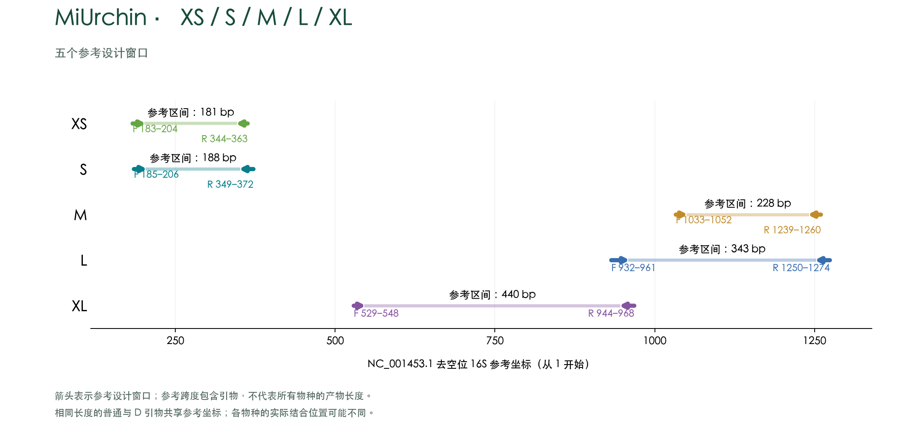

# MiUrchin

**海胆纲线粒体16S引物候选，包括规则与不规则海胆。**

[English](../README.md) · [方法说明](../docs/METHODS.zh-CN.md) · [复现](../docs/REPRODUCIBILITY.md) · [著作权声明](../COPYRIGHT.md)

本项目将MiStar/MiCucumber工作流用于海胆：分类标签均衡设计、特异性优先筛查、同位置多对补覆盖、原始序列独立复核及扩增区域可视化。按使用需求保留四个长度系列，兼顾短片段与高质量DNA。**v0.1.0为计算候选预发布版，尚未经湿实验验证。**

## 最终候选

| Scheme / 方案 | F + R | PCR mode / 模式 | Common coverage / 共同覆盖 | Region coverage / 区域覆盖 | Region exact / 区域完全匹配 | Product bp / 产物 | WC≤3 / GT≤2 / WC≤4 |
|---|---:|---|---:|---:|---:|---:|---:|
| MiUrchin-XS-Separate | 4 + 6 | 6 separate | 87.76% | 85.45% (55 labels) | 41.82% | 188–193 | 0 / 0 / 8 |
| MiUrchin-XS-Pool | 6 + 6 | 1 pool / 36 combinations | 87.76% | 85.45% (55 labels) | 49.09% | 188–193 | 0 / 4 / 12 |
| MiUrchin-S-Separate | 5 + 6 | 6 separate | 95.92% | 96.12% (165 labels) | 45.88% | 221–250 | 0 / 4 / 17 |
| MiUrchin-S-Pool | 6 + 6 | 1 pool / 36 combinations | 95.92% | 96.12% (165 labels) | 47.88% | 221–250 | 0 / 5 / 18 |
| MiUrchin-M-Separate | 3 + 6 | 6 separate | 97.96% | 95.30% (165 labels) | 44.83% | 316–346 | 1 / 1 / 18 |
| MiUrchin-M-Pool | 4 + 6 | 1 pool / 24 combinations | 97.96% | 96.08% (165 labels) | 45.44% | 316–346 | 1 / 2 / 19 |
| MiUrchin-L-Separate | 6 + 5 | 6 separate | 100.00% | 100.00% (55 labels) | 49.09% | 440–458 | 1 / 4 / 14 |
| MiUrchin-L-Pool | 6 + 5 | 1 pool / 30 combinations | 100.00% | 100.00% (55 labels) | 74.55% | 440–458 | 1 / 5 / 17 |

共同面板为**49个名称标签 / 80条单倍型**；各区域另有自己的可评估、标签内去重面板：XS **55/70**、S **165/446**、M **165/483**、L **55/77**（标签/单倍型）。各区域分母不同，不可直接将区域覆盖率当作同一批分类群的比较。均采用标签等权、标签内单倍型等权；未统一同物异名。

容错覆盖允许每条引物≤2个错配且3′末端3碱基完全匹配；完全匹配要求双引物均零错配。产物长度含引物、不含接头，为该区域面板实际预测命中的范围，不代表所有海胆物种的统一产物长度。

非目标数为**6,045条背景参考记录的accession并集**，不是物种数或实验读数比例。WC≤3/≤4分别允许每条引物≤3/≤4个错配；GT≤2沿用G:T容忍敏感性模型并允许至多2个其他错配。模糊模板另列。所有完整方案均满足WC≤3和GT≤2分别不超过5条的分析约束；接受少量残余风险，以改善覆盖与完全匹配。

## 引物与配对

- [完整引物表](../results/primers.csv)、[FASTA](../results/primers.fasta)：均为5′→3′基因特异序列，不含接头/索引；反向引物已按订购方向给出。
- [指定配对及全部混合交叉组合](../results/pairings.csv)。
- [完整比较表](../results/comparison.csv)：包含完全匹配率及模糊背景命中。
- [源分类群覆盖](../results/portfolio_order_coverage.tsv)、[未完全覆盖标签](../results/uncovered_labels.tsv)、[非目标accession](../results/portfolio_offtarget_records.tsv)。

**Separate**代表6个独立PCR取检测并集；**Pool**代表将列出的不同F/R寡核苷酸放入同管，已经评估全部F×R组合。两种模式的序列集合不同，不能直接混合Separate引物并套用Pool指标。未评估跨长度混合；计算二聚体检查不等于实验兼容性验证或浓度配方。

## 扩增区域可视化



曲线基于共同面板；箭头表示**紫海胆Strongylocentrotus purpuratus NC_001453.1提取的无缺口16S**上的同源种子设计窗口，采用1-based坐标，并非整条线粒体基因组坐标或每条引物变体的实际长度。[SVG](../figures/amplicon_regions.zh.svg) · [PDF](../figures/amplicon_regions.zh.pdf) · [坐标表](../figures/region_coordinates.csv)。

## 证据与局限

- 冻结输入：**1,401条目标、6,045条背景、86条完整标签/单倍型代表序列**；未重新下载数据库。
- 初筛**1,656条寡核苷酸、63,613个配对**；扩展同位置搜索**301条寡核苷酸及5,072种F×R组合**，采用各区域全部可评估标签。
- 有限贪心搜索后进行局部配对替换，在初始发现覆盖率下降不超过0.5个百分点内改善完全匹配率，不保证全局最优。
- **170个候选/交叉配对**通过**234,496项独立扫描一致性检查**；8个完整方案通过指定特异性和结构筛选。
- 发现与评估使用同一数据库；参考片段完整度限制面板。L的100%仅指55个标签，不代表覆盖整个海胆纲。完全匹配率仍明显低于容错覆盖率。
- 仍有源分类群缺口：XS对区域面板中的Spatangoida为0/2标签；M、S的Holasteroida与Arbacioida尚未完全覆盖。分类沿用源记录，不是现代分类修订。
- 尚未建立实验敏感性、引物竞争、测序分类准确率或最终PCR条件。非棘皮动物背景仅239条，排他性结论受限。

## 复现

需要Python 3.12与C++17编译器：

```bash
python -m pip install -r requirements.txt
python revalidate.py
python check_release.py
```

支持从冻结输入重新验证已选候选，不等于自动重新获取数据库或完整重新发现全部候选。详见[复现说明](../docs/REPRODUCIBILITY.md)。

## 来源与权利

参考accession见`analysis/metadata.tsv`，指纹见`analysis/input_manifest.json`。将MiCucumber/MiStar冻结序列库重新划分为海胆目标及其他背景，不包含私人通信或原始工作簿。

**版权所有 © 2026 Fei Xia（GUIBA-EX），保留所有权利。** 未经书面许可，禁止转载、镜像、再分发受保护原创材料。公开访问不等于开源许可；法定例外、GitHub平台权利及第三方参考数据原有权利不受影响。详见[COPYRIGHT.md](../COPYRIGHT.md)。
