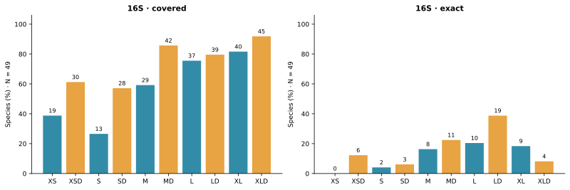
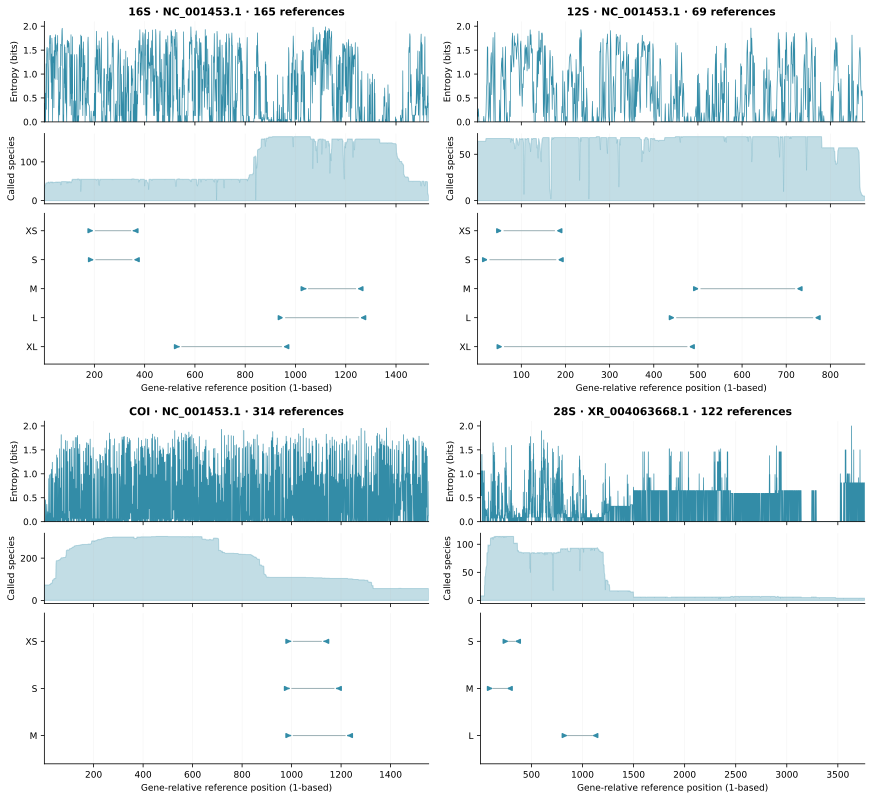
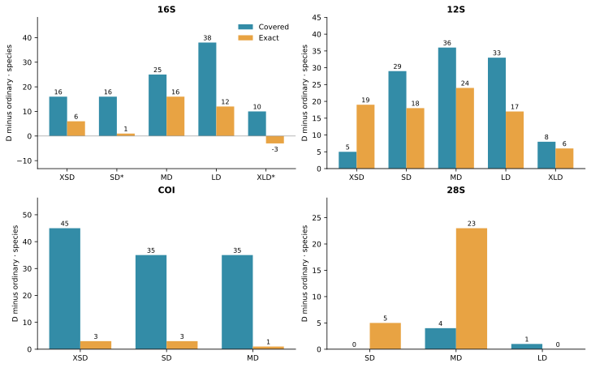
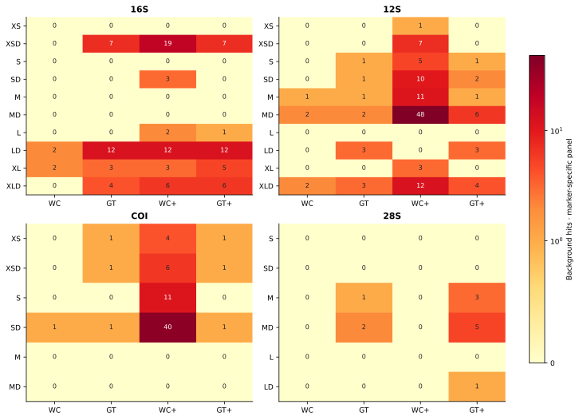
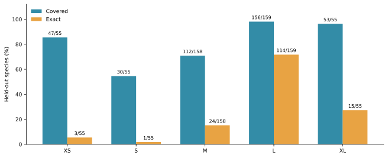
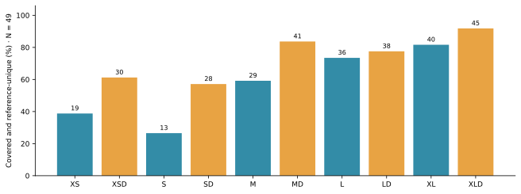

# MiUrchin: in silico design and evaluation of mitochondrial and nuclear primers for sea urchin (Echinoidea) eDNA metabarcoding

**Fei Xia**

Preprint v1.2 · 4 November 2026 · Not peer reviewed

## Abstract

Sea-urchin environmental DNA surveys require primers that accommodate target variation while retaining informative barcode regions. We evaluated 32 ordinary and degenerate primer pairs at 16 windows in mitochondrial 16S, 12S and COI and nuclear 28S. Marker-specific reference panels contained 165, 69, 314 and 122 named species, respectively. Paired matching, a common-species comparison at 16S, reference-insert diagnostics and genus-blocked sequence reselection assessed different components of assay performance. On the 49-species common 16S panel, XLD covered 45 species, whereas LD exactly matched 19, the largest exact count. The broader window-specific panels revealed an additional taxonomic contrast: MD missed all 37 evaluable Spatangoida, while LD covered 36 of 38. At 12S M, D primers increased coverage from 25 to 61 of 69 species and exact matching from zero to 24. Fourteen of sixteen D pairs included the corresponding ordinary sequences; the two non-nested 16S pairs combined degeneracy with fixed-base replacement. Nuclear 28S SD covered 99 of 101 species, but only eight of 99 recovered reference barcodes were unique. These results prioritize different assays for short-fragment compatibility, particular echinoid lineages and reference discrimination. They also show why a common denominator and an explicit sequence-inclusion audit are necessary when interpreting ordinary/D comparisons.

**Keywords:** Echinoidea; environmental DNA; mitochondrial markers; nuclear rRNA; degenerate primers; in silico PCR

## Introduction

Echinoidea includes regular sea urchins, heart urchins, sand dollars and related lineages with substantially different evolutionary histories. Phylogenomic studies resolve deep divisions among these groups and provide a framework for assessing taxonomic representation in a reference library (Mongiardino Koch et al., 2022). A primer that performs well in a species-rich sampled group may nevertheless fail to recover another lineage of interest. Environmental DNA assay selection therefore requires both aggregate performance and taxon-specific interpretation.

MiFish illustrates the use of conserved flanks surrounding an informative mitochondrial region (Miya et al., 2015). Anth-28S uses controlled degeneracy at a nuclear-ribosomal marker to accommodate variation among anthozoans (McCartin et al., 2024). These design principles motivate the comparison of concrete and degenerate oligos at shared binding coordinates, but they do not establish which marker is most informative in Echinoidea. The availability of reference sequence, compatibility of the binding sites and variability of the internal barcode must be evaluated separately.

Primer mismatches can influence amplification bias, although their effects depend on position and reaction conditions (Piñol et al., 2015). A mismatch-tolerant prediction consequently measures a different property from an exact paired match. Likewise, a unique reference insert is useful only if the assay recovers the corresponding template. We examine these distinctions across four markers, using the existing 16S common-panel and genus-blocked analyses to place window-specific results in context. We also test whether each D sequence actually includes its ordinary counterpart before attributing a performance change to degeneracy.

## Materials and methods

### Data acquisition and reference curation

The archived mitochondrial 16S library contained 1,401 target records and 6,045 background records. The curation workflow reconciled species names with archived WoRMS matches, using accepted identifiers and higher-group assignments. Unidentified or non-species labels, unresolved names and sequence-quality failures were excluded. Eligible sequences had at least 100 aligned A/C/G/T bases, no more than 5% ambiguous bases in the ungapped alignment, source-consistent orientation and at least one complete design window. A representative was selected by the number of complete windows, low ambiguity, the number of called reference columns, alignment continuity, called sequence length and accession. Primer-match success was not a representative-selection criterion. The resulting panel contained 165 species.

The independent 12S and COI searches and alias retrieval produced 9,988 distinct accession records. Annotated features, extraction decisions and exclusions are retained in the sequence audit and compressed GenBank batches. The eligible pools comprised 208 12S sequences representing 69 named species and 9,392 COI sequences representing 314 named species. Each marker retained one design representative per species. Their backgrounds comprised 459 and 1,719 representative species, respectively. These independently assembled marker libraries were not restricted to a common cross-gene species set.

The nuclear 28S alignment contained 122 target records, one per NCBI binomial, and the background library contained 832 records spanning the other echinoderm classes and additional aquatic animal groups. This panel uses archived NCBI labels rather than the same taxonomic reconciliation as the 16S panel. Background units are therefore stated explicitly: records for 16S and 28S, and one representative per species for 12S and COI. Raw background counts cannot be interpreted as comparable specificity rates across the four markers.

### Alignment and reference coordinates

The archived nucleotide alignments were produced using MAFFT (Katoh & Standley, 2013). All coordinates are one-based and inclusive on the ungapped reference gene. Mitochondrial windows are anchored to the corresponding genes of *Strongylocentrotus purpuratus* NC_001453.1; nuclear 28S uses XR_004063668.1. The four gene axes are independent, and none represents a shared whole-genome coordinate system.

For 16S, evaluability requires both binding windows to span the reference interval, at least 90% of the reference-site count as concrete bases, and no ambiguous nucleotide in either window; alignment gaps are allowed. The available denominators are 55 species for XS and S, 158 for M, 159 for L and 55 for XL. The 12S and COI checks require an alignment spanning both windows with no ambiguous binding-region bases. The 28S check requires concrete bases across the two projected 20-column binding segments. These marker-specific completeness rules precede the raw paired scan. A reference missing a binding region is excluded from that window's denominator rather than scored as an amplification failure.

For positional context, we calculated Shannon entropy from called A/C/G/T bases at each reference column and reported the number of contributing references. Gaps and ambiguous calls were excluded, and entropy was left undefined when fewer than two references contributed. This is a descriptive projection of the existing alignments. Low entropy in a sparsely sampled region does not demonstrate broad conservation.

### Candidate generation and selection

The release comprises five 16S windows, five 12S windows, three COI windows and three nuclear 28S windows. Each contains an ordinary pair and a D pair with the same four reference endpoints. Size labels describe windows within a marker; the same label does not imply the same length across genes. The 16S reference spans are 181, 188, 228, 343 and 440 bp for XS through XL. All released sequences are listed in Table 1.

The 16S workflow reconsidered observed binding motifs and earlier candidate seeds at fixed windows, retaining candidates ranked by species coverage and exact matching with additional lineage-aware candidates. Degenerate growth merged supported motifs within a common 5′ half. The final per-window choices followed paired background and thermodynamic screening. The ordinary XS search retained 100 forward and 101 reverse candidates, evaluated 10,100 pairs and favored coverage over an alternative gaining one exact match while losing three covered species. Thus the released XS is a finite-search choice, not a demonstrated optimum across all possible oligos.

The 12S search emphasized exact matching, whereas COI screening emphasized regions represented in more species. Within each selected D window, ordinary primers were selected among its concrete variants. The 28S release retained three ordinary/D pairs from an archived comparison of 56 candidates. These searches used different reference collections and candidate histories; their outcomes are compared as candidate assays rather than as a controlled competition between genes.

D oligos encode at most eight concrete variants per end and confine ambiguity to the 3′ half. Terminal screening in the mitochondrial design rejected possible five-base homopolymers and homogeneous terminal triplets, required an assured G/C within the final three positions and constrained terminal GC content. Degenerate terminal bases were allowed when the other filters were satisfied. A matching variant represents only a fraction of the total oligo concentration.

The archived mitochondrial pair checks used Primer3 (Untergasser et al., 2012), with 50 mM monovalent salt, 1.5 mM Mg²⁺ and 0.6 mM dNTP. Scenarios were 50 nM per concrete variant and 200 nM total per direction divided among variants. Screening required a modeled secondary-structure Tm below 55°C and a difference of no more than 5°C between forward and reverse variant-Tm midpoints. For the present property table, primer3-py 2.4.0 recalculated individual-oligo GC and Tm ranges under the same concentrations for all four markers. This descriptive calculation does not establish that the nuclear candidates passed every mitochondrial pair-screening gate. The second concentration scenario is supplied in Table S1.

### Matching models and background interpretation

Coverage denotes at least one paired hit with no more than two mismatches per end and IUPAC compatibility at each terminal three bases. Exact matching denotes zero mismatches at both sites, allowing any concrete forward and reverse variants of a D pair to provide the match. Both DNA orientations are searched, and an accession contributes once regardless of the number of predicted products.

For 16S S–XL, target products span 150–500 bp and contain at least 50 internal bases. XS uses 70–500 bp and at least 20 internal bases. The 12S, COI and 28S scanner uses 100–500 bp and at least 50 internal bases. All background scans allow 0–1,000 internal bases. Consequently, target and background geometry is deliberately different in this release, and the plotted counts are not sensitivity–specificity curves under a common geometry.

Strict Watson–Crick (WC) and G–T-permissive (GT) models retain the two-mismatch and terminal-triplet constraints. Relaxed WC allows three mismatches without terminal protection; relaxed GT allows two. In primer-oriented strings, the GT model additionally accepts primer G against template A and primer T against template C, corresponding to wobble pairing on the opposite strand. These pairings also satisfy the terminal compatibility rule in that model. Table 2 reports all four background counts so that a zero strict count is not confused with an absence of relaxed matches.

### Sequence-inclusion audit and common panels

We expanded IUPAC symbols conceptually as sets of bases and tested whether every ordinary base was included at the corresponding position of its D oligo. Both ends had to pass for a pair to be nested. Positions excluding an ordinary base were recorded in synthesis orientation. All ordinary/D reference endpoints were independently compared. This audit identifies whether a contrast combines additional variants with fixed-base replacement; it does not calculate the performance of untested factorial intermediate sequences.

The common 16S coverage panel is the intersection of the five evaluable species sets and contains 49 species. Coverage, exact matching and the joint covered-and-unique count were recalculated on this denominator. Window-specific and common-panel outcomes are both retained because the intersection omits many species represented at M and L. Species contribute equally within a panel; the archived higher-group counts provide taxonomic detail. A comparable common-panel analysis was not performed for the other three markers in this release.

### Reference discrimination and genus-blocked reselection

For 16S, primer-binding regions were removed from the homologous alignment interval and the remaining unambiguous inserts were compared by exact identity. Own-panel uniqueness was defined against every available unambiguous insert at that window. Common-panel query counts retain this same full-window uniqueness definition; they do not redefine uniqueness after discarding non-common species. A joint success requires both paired compatibility and an identity-unique insert. Global unit-cost edit distances provide nearest-neighbor diagnostics. Identical sequences bearing different species names are retained for source review.

The archived 28S diagnostics count unambiguous internal barcodes recovered by the paired scan and their identity uniqueness within the corresponding assay-specific barcode collection. Their denominator is recovered barcodes, not the common 16S species set. This distinction is retained when describing 28S detection and discrimination. The release does not provide equivalent species-resolution analyses for 12S and COI.

Five 16S folds were generated by linking genera that shared identical complete reference sequences, shuffling the resulting blocks with seed 20261030 and assigning them cyclically to folds. Within each training set, observed local motifs within five alignment columns of the frozen binding intervals supplied fixed-length seeds. Up to 24 frequent admissible seeds per end entered at most three ambiguity-expansion steps. Training coverage, exact matching and lower degeneracy determined paired selection. Withheld species were evaluated by raw paired scanning. Published primer sequences and global candidate pools were not used as training seeds.

This diagnostic tests sequence selection around previously discovered windows and an alignment derived from the full collection. It allows local offsets and does not impose the complete formal thermal and background gates on fold candidates. It is therefore different from both testing the released pair unchanged and independently discovering a new window. One design representative per species also leaves within-species variability unmeasured; no multi-record barcode-gap analysis is reported here.

### Independent implementation checks

The 16S release contains paired-scan hit tables and independent verification records; the common-panel validator checks denominators, barcode identities, unique test-species assignments, genus separation, fold sizes and frozen input hashes. The 12S/COI verification compared the archived scan flags against a separate seed-and-extension implementation for 32,382 record–model comparisons across the 16 released pairs. The 28S verification reconciles archived target and background hits with its six selected result rows and binding matrices. These checks establish agreement between computational representations on the archived references.

Publication scripts rebuild the result tables from source CSV files, test all 64 oligos against the combined FASTA and rendered PDF, and verify manuscript, README and citation metadata before release. Descriptive properties, sequence inclusion and reference-position profiles are archived separately from the original screening results.

## Results

### Equal-denominator comparisons change the interpretation of window coverage

On the 49-species common 16S panel, XLD covered 45 species (91.8%), MD 42 (85.7%) and LD 39 (79.6%). LD nevertheless had the largest paired exact count, 19/49 (38.8%), compared with 11/49 for MD and four for XLD. The ordinary XS and S pairs covered only 19 and 13 common-panel species, respectively. Coverage and exact compatibility therefore yield different rankings even when the denominator is fixed.

**Figure 1.** Covered and exact species on the common 49-species 16S panel. Numbers above bars are counts; blue denotes ordinary pairs and orange denotes D pairs. The same denominator applies to all bars.

The window-specific evidence adds a consequential lineage difference. MD covered 110/158 species overall but none of 37 evaluable Spatangoida. LD covered 141/159 overall, including 36/38 Spatangoida. Both missed all four evaluable Arbacioida. XLD covered both of its evaluable Arbacioida and both Spatangoida, but these much smaller subsets cannot replace the broader L-window evidence. The different completeness profiles visible in Figure 2 explain why a single aggregate percentage is insufficient for assay choice.

**Figure 2.** Reference-position variation, sampling support and primer geometry for all four markers. Each marker has three panels sharing a gene-relative, one-based axis: Shannon entropy of called bases, the number of contributing references, and the ordinary/D binding intervals. Arrows point toward the primer 3′ end; connecting lines show the intervening region. Gaps and ambiguous calls are excluded from entropy. Each marker has its own reference axis and sampling distribution.

### Nested and non-nested comparisons have different interpretations

Fourteen of sixteen D pairs included both corresponding ordinary oligos. All 12S, COI and 28S comparisons were nested. The exceptions were 16S S/SD and XL/XLD: SD excluded the ordinary reverse base at position 9, while XLD excluded ordinary bases at forward positions 1 and 3 and reverse position 19 (Table 3). Their performance changes therefore combine sequence replacement with additional variants.

The XL example shows why this distinction matters. On its own panel, XLD increased coverage from 41 to 51 of 55 species but reduced paired exact matches from nine to six. On the common panel, exact matches declined from nine to four. A pure expansion that retained every ordinary variant could not eliminate an existing exact sequence match under the same scanner. The non-nested sequences account for why the observed comparison permits that loss. These results identify a priority for a future controlled candidate audit without changing the present release.

**Figure 3.** Change in covered and exact species from the ordinary pair to its D counterpart on each window's own panel. Asterisks identify the two non-nested pairs. Counts use the corresponding denominators in Table 3 and are not directly comparable percentages across windows. No hypothetical factorial intermediates are included.

### Short products and broad reference libraries have distinct limitations

At the 249 bp 12S M window, MD covered 61/69 species and exactly matched 24, compared with 25 covered and zero exact for M. Strict WC and GT background counts each increased from one to two. The shorter 153 bp XSD covered 32/67 with 19 exact matches and no strict background hits. Thus the short 12S window offers exact compatibility with part of the panel, whereas MD provides broader predicted coverage.

The COI collection contained 314 named species, but only 103–106 were evaluable at the retained short windows. XSD covered 79/106 at a 152 bp reference span, with three paired exact matches. SD covered 63/105 at 209 bp, with six exact matches. COI's larger source library therefore did not yield a correspondingly large complete-window panel, and the mismatch-tolerant hit counts substantially exceeded exact matches.

The nuclear 28S S and SD pairs both covered 99/101 species at a 102 bp reference span. SD increased exact matching from 78 to 83. At 176 bp, MD covered 108/111 and exactly matched 72, compared with 104 covered and 49 exact for M. These short nuclear candidates provide high compatibility in their own panels, although the barcode diagnostics below impose a separate constraint on species discrimination.

### Background counts depend on the pairing model and reference panel

The 16S LD pair had two strict WC and twelve strict GT background hits. The 12S MD pair had two under each strict model, whereas 28S SD had zero under either. Relaxed-model results are retained alongside these strict counts in Table 2 and Figure 4. They describe potential matching in the screened libraries rather than experimentally measured off-target amplification.

**Figure 4.** Background hits for every released pair under strict WC, strict GT, relaxed WC (WC+) and relaxed GT (GT+) models. Cells show counts and share a symmetric-log color scale with a linear region through one hit. Panel sizes, taxonomic composition and numerical units differ among genes; the raw counts are not cross-marker specificity estimates.

Only three to four sea-cucumber background records spanned both nuclear binding sites per window in the archived 28S alignment. Low hit counts consequently provide limited evidence for excluding that closely related class. The scope of a background panel is part of the interpretation of each result, especially for a broadly conserved short ribosomal segment.

### Withheld genera reveal a candidate-selection opportunity at 16S

The genus-blocked diagnostic covered 156/159 L-window test species and exactly matched 114. XS covered 47/55 with three exact matches; M covered 112/158 with 24 exact matches. These are fold-specific, training-selected sequences rather than repeated evaluations of the released ordinary/D pairs. The strong L-window result suggests that alternative sequence choices deserve screening under the formal chemical and background constraints, but does not itself establish a replacement assay.

**Figure 5.** Conditional genus-blocked sequence-selection outcomes for 16S. Labels show covered or exact species over each window's available test denominator. Candidate generation used only training genera; window discovery and the original alignment preceded the split. Diagnostic candidates were not passed through the complete release gates.

### Reference discrimination depends on the sampled window and predicted recovery

All 55 available unambiguous XS and S inserts were identity-unique in their respective 16S collections. M and L each had 150 unique inserts among 158 unambiguous references, and XL had 55/55. Internal lengths ranged from 137–144 bp at XS to 395–413 bp at XL. These panels differ in species composition, so the proportions alone do not establish that the shorter regions are more discriminating.

On the common 49-species query panel, XLD yielded 45 covered-and-unique species, MD 41 and LD 38 (Figure 6). Uniqueness was evaluated against all available same-window inserts. This explains why a common-panel query may remain non-unique because it shares a barcode with a species outside the common set. The archived collisions include labels from different genera and higher groups, making accession-level source review important before interpreting them as biological identity.

**Figure 6.** Percentage of common-panel 16S species both predicted to amplify and identity-unique against the complete available insert collection for that window. Numbers above bars are species counts out of 49. Blue denotes ordinary and orange denotes D pairs. This measures sampled-reference discrimination rather than validated assignment success.

Nuclear 28S SD recovered 99 unambiguous reference barcodes, of which only eight were unique. MD had 59 unique barcodes among 106 recovered, and LD had 51 among 84. These assay-specific subsets cannot be ranked as a common-species experiment, but they demonstrate that high 28S compatibility and species-level separation are different properties. Equivalent insert-resolution evidence is not yet available for the 12S and COI candidates.

## Discussion

The comparison supports assay choice according to the taxonomic question rather than a single maximal coverage score. A survey emphasizing Spatangoida has a concrete reason to prioritize 16S LD over MD despite the latter's higher common-panel coverage. For shorter mitochondrial products, 12S MD provides a substantial gain in predicted compatibility and exact matching on its own reference panel. Nuclear 28S SD offers broad compatibility at 102 bp but limited species-level separation among recovered inserts. Each priority follows from a different component of the evidence.

The sequence-inclusion audit changes how the ordinary/D contrasts should be described. Most pairs are nested and therefore represent an expansion of available variants at fixed endpoints. The two non-nested 16S pairs instead combine expansion with replacement. The exact-match decline from XL to XLD cannot be assigned to degeneracy in isolation. A subsequent selection round should retain nested controls, compare gained and lost species and apply prospective terminal, thermal and background constraints before deciding whether the present coverage gain is worth the exact-match loss.

Reference availability remains a major source of variation between windows. The common 16S comparison standardizes the denominator but reduces the evidence to 49 species, while the longer L window includes 159. COI illustrates the same problem at the scale of a gene library: hundreds of named species may have sequences without having both sites of a chosen amplicon. Broad coverage of a database search is therefore different from broad evaluability of an assay. Taxonomic and geographic gaps should be checked against the intended survey community.

The holdout results identify a useful search direction while retaining a clear distinction between design stages. Fold-specific L candidates matched many withheld species, but the diagnostic allowed local offsets and omitted formal chemical and background gates. It supports further constrained sequence selection around that region, rather than validating the released LD pair or the original window-discovery procedure. Similarly, one representative per species cannot characterize population variation or establish a barcode gap. The current reference-identity results should guide complementary-marker choice and source review, not be interpreted as empirical classification accuracy.

### Priorities for assay evaluation

| Intended use | Computational priority | Reason and qualification |
| --- | --- | --- |
| Spatangoida-focused sampling | 16S LD | Covers 36/38 evaluable Spatangoida; both M and L D pairs miss the four available Arbacioida. |
| High coverage within the common 16S panel | 16S XLD, compared with LD | Covers 45/49, but has fewer exact matches and is not a nested expansion of XL. |
| Short mitochondrial products with broader matching | 12S MD | Covers 61/69 with 24 exact matches at 249 bp; internal species resolution remains to be assessed. |
| Very short nuclear detection | 28S SD | Covers 99/101 at 102 bp; only 8/99 recovered barcodes are unique. |
| COI-based candidate development | XSD or SD, with regional reference review | Short-window evaluability is much lower than total library size, and exact matching remains limited. |
| Further constrained sequence selection | 16S L | Strong conditional holdout performance motivates re-screening under the full release constraints. |
| Multiplex reactions | Evaluate separately | The release reports single-pair evidence; cross-assay and adapter-bearing interactions are not established. |

The reference-based comparisons do not measure amplification efficiency, environmental detection probability or abundance bias in mixed templates. Those properties depend on reaction chemistry, template competition and local community composition. The present contribution is a reproducible set of candidate assays and explicit comparisons that identify where those next evaluations are most informative.

## Conclusions

MiUrchin provides 32 candidate primer pairs spanning mitochondrial and nuclear markers. The rewritten comparison separates window-specific availability, common-panel compatibility, exact matching, sequence inclusion and reference discrimination. Fourteen D pairs are nested expansions, while two 16S comparisons require explicit consideration of fixed-base replacement. The results support marker selection according to target lineages and required resolution, with detailed source tables and sequence-level evidence available for further design and assay evaluation.

## Data availability and reproducibility

The project is hosted at [https://github.com/GUIBA-EX/MiUrchin](https://github.com/GUIBA-EX/MiUrchin). Frozen references, accession decisions, hit tables, coordinates and base-matching figures accompany each marker. The [publication guide](README.md) gives the rendering and verification commands. Descriptive properties, the sequence-inclusion audit and entropy profiles are distributed under `publications/evidence`; scripts regenerate the tables and six figures from the archived results. The [supplementary material](MiUrchin_supplement.md) contains the second oligo-concentration scenario, holdout counts and marker-specific barcode summaries. GitHub releases preserve the PDF, complete primer FASTA and checksums at the corresponding source tag.

## References

Katoh K, Standley DM. 2013. MAFFT multiple sequence alignment software version 7: improvements in performance and usability. *Molecular Biology and Evolution* 30:772–780. https://doi.org/10.1093/molbev/mst010

McCartin L et al. 2024. Nuclear eDNA metabarcoding primers for anthozoan coral biodiversity assessment. *PeerJ* 12:e18607. https://doi.org/10.7717/peerj.18607

Miya M et al. 2015. MiFish, a set of universal PCR primers for metabarcoding environmental DNA from fishes: detection of more than 230 subtropical marine species. *Royal Society Open Science* 2:150088. https://doi.org/10.1098/rsos.150088

Mongiardino Koch N et al. 2022. Phylogenomic analyses of echinoid diversification prompt a re-evaluation of their fossil record. *eLife* 11:e72460. https://doi.org/10.7554/eLife.72460

Piñol J, Mir G, Gomez-Polo P, Agustí N. 2015. Universal and blocking primer mismatches limit the use of high-throughput DNA sequencing for the quantitative metabarcoding of arthropods. *Molecular Ecology Resources* 15:819–830. https://doi.org/10.1111/1755-0998.12355

Untergasser A et al. 2012. Primer3—new capabilities and interfaces. *Nucleic Acids Research* 40:e115. https://doi.org/10.1093/nar/gks596

## Table 1. Oligos and predicted properties

All sequences run 5′–3′. Variant count is per end. GC and Tm ranges span all concrete variants; Tm uses 50 nM per variant. The 200 nM-per-direction scenario is supplied in the supplementary data.

| Gene | Oligo | Sequence | nt | Variants | GC % | Tm °C |
| --- | --- | --- | --- | --- | --- | --- |
| 16S | XS-F | CTTGTGTATAATGGATTAACGA | 22 | 1 | 32 | 51.8 |
| 16S | XS-R | AAACTAATTTCTTGGGAAAC | 20 | 1 | 30 | 49.3 |
| 16S | XSD-F | CTTGTGTATAATGGATTRACRA | 22 | 4 | 27–36 | 49.9–54.0 |
| 16S | XSD-R | AAACTAATTTCTTGGRRARC | 20 | 8 | 25–40 | 47.5–53.4 |
| 16S | S-F | TGTGTATAATGGATTAACGAGA | 22 | 1 | 32 | 52.5 |
| 16S | S-R | GCTTAGCTAAAACTAATTTCTTGG | 24 | 1 | 33 | 54.5 |
| 16S | SD-F | TGTGTATAATGGATTAACRAGH | 22 | 6 | 27–36 | 50.6–54.1 |
| 16S | SD-R | GCTTAGCTTAAACYAATTTCTYGR | 24 | 8 | 29–42 | 53.7–58.7 |
| 16S | M-F | CGTTAGACGAGAAGACCCTG | 20 | 1 | 55 | 57.5 |
| 16S | M-R | CTTTGATCACCTTAGTGGATCA | 22 | 1 | 41 | 55.5 |
| 16S | MD-F | CGTTAGACGAGAAGACCCTR | 20 | 2 | 50–55 | 55.8–57.5 |
| 16S | MD-R | CTTTGATCACCTDARTGGATCA | 22 | 6 | 36–45 | 53.9–57.8 |
| 16S | L-F | GTCTCCTAAATAGAGACTAGTATGAATGGC | 30 | 1 | 40 | 60.8 |
| 16S | L-R | GCGGTAACTTGTTCCTTTGATCACC | 25 | 1 | 48 | 62.5 |
| 16S | LD-F | GTCTCCTAAATAGAGACTAGHATGAATGGC | 30 | 3 | 40–43 | 60.8–63.0 |
| 16S | LD-R | GCGGTAACTTGTTYCTTTGRTCACY | 25 | 8 | 40–52 | 60.3–64.4 |
| 16S | XL-F | GAATAGGCCTAGAAGCAGCC | 20 | 1 | 55 | 57.8 |
| 16S | XL-R | CCGTCTTGCCATTCATACTAGTCTC | 25 | 1 | 48 | 61.0 |
| 16S | XLD-F | AAGTAGGCCTARAAGCAGCC | 20 | 2 | 50–55 | 57.9–59.2 |
| 16S | XLD-R | CCGTCTTGCCATTCATACCAGTCTY | 25 | 2 | 48–52 | 63.1–63.4 |
| 12S | XS-F | TGCCACATGCAAGCTTATTAG | 21 | 1 | 43 | 56.9 |
| 12S | XS-R | TTTAGCACTGCAGATGTGG | 19 | 1 | 47 | 55.5 |
| 12S | XSD-F | TGCCACATGCAAGCYWAYTAG | 21 | 8 | 43–52 | 56.9–61.5 |
| 12S | XSD-R | TTTAGCACTGCAGDYGTGG | 19 | 6 | 47–58 | 55.5–61.0 |
| 12S | S-F | GTCCTAGTCCCAATTTTAAC | 20 | 1 | 40 | 51.1 |
| 12S | S-R | AATGTTTAGCACTGCAGTTG | 20 | 1 | 40 | 54.8 |
| 12S | SD-F | GTCCTAGTCCCAAYWTTARC | 20 | 8 | 40–50 | 50.0–55.2 |
| 12S | SD-R | AATGTTTAGCACTGCAGDYG | 20 | 6 | 40–50 | 54.3–59.5 |
| 12S | M-F | CGGTTTTCCAAACCTCCCT | 19 | 1 | 53 | 57.6 |
| 12S | M-R | ACTGCTGAATCCAGTTTCT | 19 | 1 | 42 | 53.9 |
| 12S | MD-F | CGGTTTTCCAWAYCTCCCT | 19 | 4 | 47–53 | 53.9–57.6 |
| 12S | MD-R | ACTGCTGAATCCARTTTCN | 19 | 8 | 37–47 | 52.0–55.5 |
| 12S | L-F | ACCCTGTTATACTTAGACGT | 20 | 1 | 40 | 52.8 |
| 12S | L-R | GCATTCCAGAGCTCTCTTCA | 20 | 1 | 50 | 57.3 |
| 12S | LD-F | ACCCTGTTATACTTAGMHGT | 20 | 6 | 35–45 | 50.1–55.6 |
| 12S | LD-R | GCATTCCAGAGCTSWYTTCA | 20 | 8 | 45–50 | 56.0–57.9 |
| 12S | XL-F | CCACATGCAAGCTAACTAGC | 20 | 1 | 50 | 56.9 |
| 12S | XL-R | AAACCGCCAAGTCCTTTGAG | 20 | 1 | 50 | 58.7 |
| 12S | XLD-F | CCACATGCAAGYYAAYTAGC | 20 | 8 | 40–55 | 52.9–59.8 |
| 12S | XLD-R | AAACCGCCAARTCCTTTGAR | 20 | 4 | 40–50 | 56.4–58.7 |
| COI | XS-F | TCAAACCTACAATGAGAAAC | 20 | 1 | 35 | 51.0 |
| COI | XS-R | ACATAGTGGAAGTGAGCTAC | 20 | 1 | 45 | 54.2 |
| COI | XSD-F | TCAAACCTACARTGRGARAC | 20 | 8 | 35–50 | 51.0–56.5 |
| COI | XSD-R | ACATAGTGGAAGTGDGCWAC | 20 | 6 | 45–50 | 54.2–57.8 |
| COI | S-F | CAAGGATCAAACCTACAATG | 20 | 1 | 40 | 51.8 |
| COI | S-R | AATCAGTGAGTAAATCCTGC | 20 | 1 | 40 | 53.0 |
| COI | SD-F | CAAGGATCAAAYYTACARTG | 20 | 8 | 30–45 | 48.2–53.6 |
| COI | SD-R | AATCAGTGAGTRAAYCCWGC | 20 | 8 | 40–50 | 53.0–57.8 |
| COI | M-F | TCAAACCTACAATGGGAAAC | 20 | 1 | 40 | 53.4 |
| COI | M-R | ACCTTTCCTCATAGTGGGTG | 20 | 1 | 50 | 56.5 |
| COI | MD-F | TCAAACCTACARTGRGARAC | 20 | 8 | 35–50 | 51.0–56.5 |
| COI | MD-R | ACCTTTCCTCAWAGYGGRTG | 20 | 8 | 45–55 | 54.1–60.5 |
| 28S | S-F | GCCTGGAGCCACCAAGAGTC | 20 | 1 | 65 | 62.8 |
| 28S | S-R | TTGTCTGCTATCGGTCTCGT | 20 | 1 | 50 | 58.5 |
| 28S | SD-F | GCCTGGAGCCRCCAAGARTC | 20 | 4 | 60–70 | 61.0–65.6 |
| 28S | SD-R | TTGTCTGCTATCGGTCTCGT | 20 | 1 | 50 | 58.5 |
| 28S | M-F | AAGAGCCCATCGCTGAATCC | 20 | 1 | 55 | 60.2 |
| 28S | M-R | CCGACTCTTGGTGGCTCCAG | 20 | 1 | 65 | 62.5 |
| 28S | MD-F | AAGAGCCCATCGCYGAATCS | 20 | 4 | 55–60 | 60.2–63.0 |
| 28S | MD-R | CCGACTCTTGGYGRCTCCMG | 20 | 8 | 60–75 | 59.8–67.7 |
| 28S | L-F | AAGCTGGGCGCCTGCTCGAC | 20 | 1 | 70 | 67.9 |
| 28S | L-R | AATCGCTGCGGACCTCCACC | 20 | 1 | 65 | 65.0 |
| 28S | LD-F | AAGCTGGGCGCCTGYTCGAC | 20 | 2 | 65–70 | 65.8–67.9 |
| 28S | LD-R | AATCGCTGCGGACCTCCACC | 20 | 1 | 65 | 65.0 |

## Table 2. Predicted target and background matches

Span is the primer-inclusive reference interval, not an observed product-length distribution. Common denotes the 49-species 16S intersection. NA indicates that a common-panel comparison was not performed for that marker. Strict and relaxed columns give WC/GT hits. Background units are records for 16S and 28S and one representative per species for 12S and COI.

| Gene | Pair | Span bp | Own covered | Own exact | Common covered | Common exact | Strict bg | Relaxed bg |
| --- | --- | --- | --- | --- | --- | --- | --- | --- |
| 16S | XS | 181 | 19/55 | 0/55 | 19/49 | 0/49 | 0/0 | 0/0 |
| 16S | XSD | 181 | 35/55 | 6/55 | 30/49 | 6/49 | 0/7 | 19/7 |
| 16S | S | 188 | 13/55 | 2/55 | 13/49 | 2/49 | 0/0 | 0/0 |
| 16S | SD | 188 | 29/55 | 3/55 | 28/49 | 3/49 | 0/0 | 3/0 |
| 16S | M | 228 | 85/158 | 12/158 | 29/49 | 8/49 | 0/0 | 0/0 |
| 16S | MD | 228 | 110/158 | 28/158 | 42/49 | 11/49 | 0/0 | 0/0 |
| 16S | L | 343 | 103/159 | 18/159 | 37/49 | 10/49 | 0/0 | 2/1 |
| 16S | LD | 343 | 141/159 | 30/159 | 39/49 | 19/49 | 2/12 | 12/12 |
| 16S | XL | 440 | 41/55 | 9/55 | 40/49 | 9/49 | 2/3 | 3/5 |
| 16S | XLD | 440 | 51/55 | 6/55 | 45/49 | 4/49 | 0/4 | 6/6 |
| 12S | XS | 153 | 27/67 | 0/67 | NA | NA | 0/0 | 1/0 |
| 12S | XSD | 153 | 32/67 | 19/67 | NA | NA | 0/0 | 7/0 |
| 12S | S | 188 | 27/64 | 1/64 | NA | NA | 0/1 | 5/1 |
| 12S | SD | 188 | 56/64 | 19/64 | NA | NA | 0/1 | 10/2 |
| 12S | M | 249 | 25/69 | 0/69 | NA | NA | 1/1 | 11/1 |
| 12S | MD | 249 | 61/69 | 24/69 | NA | NA | 2/2 | 48/6 |
| 12S | L | 347 | 23/69 | 0/69 | NA | NA | 0/0 | 0/0 |
| 12S | LD | 347 | 56/69 | 17/69 | NA | NA | 0/3 | 0/3 |
| 12S | XL | 452 | 32/67 | 15/67 | NA | NA | 0/0 | 3/0 |
| 12S | XLD | 452 | 40/67 | 21/67 | NA | NA | 2/3 | 12/4 |
| COI | XS | 152 | 34/106 | 0/106 | NA | NA | 0/1 | 4/1 |
| COI | XSD | 152 | 79/106 | 3/106 | NA | NA | 0/1 | 6/1 |
| COI | S | 209 | 28/105 | 3/105 | NA | NA | 0/0 | 11/0 |
| COI | SD | 209 | 63/105 | 6/105 | NA | NA | 1/1 | 40/1 |
| COI | M | 248 | 22/103 | 0/103 | NA | NA | 0/0 | 0/0 |
| COI | MD | 248 | 57/103 | 1/103 | NA | NA | 0/0 | 0/0 |
| 28S | S | 102 | 99/101 | 78/101 | NA | NA | 0/0 | 0/0 |
| 28S | SD | 102 | 99/101 | 83/101 | NA | NA | 0/0 | 0/0 |
| 28S | M | 176 | 104/111 | 49/111 | NA | NA | 0/1 | 0/3 |
| 28S | MD | 176 | 108/111 | 72/111 | NA | NA | 0/2 | 0/5 |
| 28S | L | 282 | 88/91 | 82/91 | NA | NA | 0/0 | 0/0 |
| 28S | LD | 282 | 89/91 | 82/91 | NA | NA | 0/0 | 0/1 |

## Table 3. Ordinary-to-D sequence inclusion audit

A nested D pair includes both ordinary oligos among its concrete variants. Positions run from the 5′ end in synthesis orientation. Excluded ordinary bases identify coupled sequence replacement; this audit is not a factorial re-screen of hypothetical intermediates. All pairs have identical reference endpoints.

| Gene | D pair | Nested | Excluded ordinary bases | N | Covered O/D | Exact O/D |
| --- | --- | --- | --- | --- | --- | --- |
| 16S | XSD | Yes | None | 55 | 19/35 | 0/6 |
| 16S | SD | No | R9: A>T | 55 | 13/29 | 2/3 |
| 16S | MD | Yes | None | 158 | 85/110 | 12/28 |
| 16S | LD | Yes | None | 159 | 103/141 | 18/30 |
| 16S | XLD | No | F1: G>A; F3: A>G; R19: T>C | 55 | 41/51 | 9/6 |
| 12S | XSD | Yes | None | 67 | 27/32 | 0/19 |
| 12S | SD | Yes | None | 64 | 27/56 | 1/19 |
| 12S | MD | Yes | None | 69 | 25/61 | 0/24 |
| 12S | LD | Yes | None | 69 | 23/56 | 0/17 |
| 12S | XLD | Yes | None | 67 | 32/40 | 15/21 |
| COI | XSD | Yes | None | 106 | 34/79 | 0/3 |
| COI | SD | Yes | None | 105 | 28/63 | 3/6 |
| COI | MD | Yes | None | 103 | 22/57 | 0/1 |
| 28S | SD | Yes | None | 101 | 99/99 | 78/83 |
| 28S | MD | Yes | None | 111 | 104/108 | 49/72 |
| 28S | LD | Yes | None | 91 | 88/89 | 82/82 |

[Supplementary material](MiUrchin_supplement.md)
