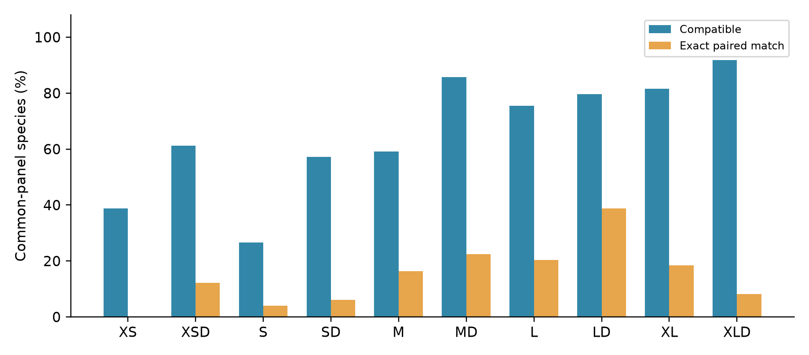
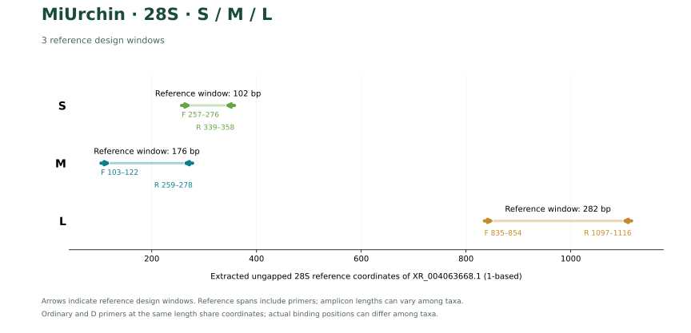
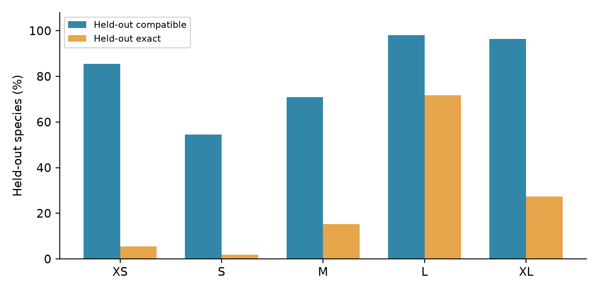

# MiUrchin, a set of universal PCR primers for metabarcoding environmental DNA from sea urchin

Fei Xia

Preprint v1.1 · 4 November 2026 · Not peer reviewed

## Abstract

The choice of a sea-urchin metabarcoding primer depends on which species have reference sequences, how closely both primer ends match, and whether the internal sequence distinguishes the target. We evaluated 32 ordinary and degenerate primer pairs at 16 windows in mitochondrial 16S, 12S and COI and nuclear 28S. Among 49 species evaluable at every 16S window, XLD covered 45 species, whereas LD provided the most exact matches (19). At 12S M, degeneracy increased coverage from 25 to 61 of 69 species and exact matching from zero to 24. The nuclear 28S SD pair covered 99 of 101 species, but only eight of the 99 recovered barcodes were unique in the tested panel. In COI, partial reference sequences restricted each window to 103–106 evaluable species out of 314. These results distinguish three properties of a marker: compatibility with target templates, susceptibility to non-target matching and discrimination by its primer-free insert.

## Introduction

A primer for sea-urchin environmental DNA must accommodate divergence in its binding sites while retaining variation between them. MiFish used conserved flanks around a variable mitochondrial segment in fishes (Miya et al., 2015). Anth-28S incorporated lineage variation into primers for anthozoans (McCartin et al., 2024). These approaches suggest two comparisons for Echinoidea: what is gained by changing sequence at fixed endpoints, and what is gained by moving to another window or gene?

We evaluated these questions on marker-specific panels. For 16S we also used a common species denominator, examined which orders were missed and tested sequence selection with genera held out. For the remaining markers we compared ordinary and degenerate pairs within each window and quantified the limits imposed by incomplete references.

## Materials and methods

**Reference panels.** The mitochondrial 16S library contained 1,401 target records and 6,045 background records. Taxonomic and sequence curation yielded one representative for each of 165 named target species. The independent 12S and COI panels comprised 69 and 314 species, with backgrounds of 459 and 1,719 echinoderm species, respectively. The nuclear 28S alignment contained 122 named sea-urchin species; its background comprised 832 records. Coordinates refer to ungapped gene sequences from NC_001453.1 for mitochondrial markers and XR_004063668.1 for 28S.

**Design and paired matching.** Ordinary and D primers share the four reference endpoints of their window. Each D oligo encodes at most eight sequence variants. We scored compatible target pairs under Watson–Crick pairing, allowing up to two mismatches per primer and requiring compatibility at each of its last three bases. Exact matching required both ends to match at every base. Strict background comparisons used the same mismatch and terminal constraints, with and without allowance for G–T pairing. Only references spanning the binding sites contributed to the corresponding denominator. For the 16S aligned-site evaluation, binding regions had to contain at least 90% of the reference-site count as concrete bases and no ambiguous nucleotides. The archived 12S and COI searches tested both strands for paired products of 100–500 bp with at least 50 internal bases.

**Discrimination and conditional holdout.** We compared 16S pairs first on their own evaluable panels, then on the intersection of all five panels. We removed primer sites and checked unambiguous inserts for identity between species and nearest-neighbor edit distance. In five genus-blocked folds, diagnostic primers were selected from training species only; identical full representatives were kept in the same block. Window discovery preceded splitting. Fold scores consequently measure transfer of sequence selection at previously chosen windows. The fold-specific candidates were not screened through all release gates.

## Results

### One denominator changes the interpretation of 16S coverage

The five windows shared 49 evaluable species. XLD had the highest coverage (45/49), and LD had the largest number of paired exact matches (19/49). MD covered 42 common-panel species compared with 39 for LD. The order-specific result differed sharply: on their respective available panels MD covered none of 37 Spatangoida, whereas LD covered 36 of 38. Both missed all four evaluable Arbacioida. A single common-panel count therefore concealed a consequential difference for surveys of irregular echinoids.

**Figure 1.** Ordinary and D 16S pairs on the same 49 species. The common panel is the intersection of the available reference windows.

### A controlled change at 12S M increased exact matching

At the same 249 bp 12S window, M covered 25/69 species with zero paired exact matches. MD covered 61/69 with 24 exact matches. Strict WC and GT background counts each rose from one to two species. COI XSD covered 79/106 at 152 bp but matched only three species exactly. The 209 bp COI SD pair had six exact matches among 105 evaluable species. Although the COI library contained 314 species, only 103–106 had both binding sites at the retained windows. Broad coverage of gene records therefore did not translate into broad evaluability of a specific short amplicon.

### Nuclear 28S distinguished detection from identification

At the 102 bp 28S S window, S and SD both covered 99/101 species. SD increased exact matching from 78 to 83; neither pair had strict WC or GT background hits. Only eight of the 99 species with an SD barcode had a unique internal sequence. At 176 bp, MD covered 108/111 and exactly matched 72, with zero strict WC and two GT background hits. Only three to four sea-cucumber background records spanned both sites per window; specificity against that group is particularly uncertain.

**Figure 2.** The S, M and L 28S windows share endpoints between ordinary and D pairs within each size class. The reference axis is independent of the mitochondrial axes.

### Reference discrimination and holdout at 16S

All 55 unambiguous XS inserts were unique on their own panel. At M and L, each had 150 unique inserts among 158 references. The species represented differ between these panels. Across held-out genera, the L-window training-selected pairs covered 156/159 species and exactly matched 114. XS yielded 47/55 compatible and three exact matches. These outcomes describe primers selected within folds, rather than performance estimates for the released LD or XS pair.

**Figure 3.** Held-out compatibility and paired exact matches across the five 16S windows.

## Discussion

The results support marker choice at the level of the biological question. A survey emphasizing Spatangoida has a concrete reason to consider 16S LD even though another window covers more species on the common panel. For a shorter mitochondrial product with more exact matches, 12S MD offers a measurable gain over ordinary M with a small increase in predicted background matching. Nuclear 28S SD provides broad short-fragment compatibility but little species-level separation in its observed inserts. Its detection score would overstate its utility if interpreted as an identification score.

The gene panels differ in taxonomic composition and completeness, so the reported fractions do not establish a universal ranking across four genes. One representative per species cannot describe geographic haplotype variation, and reference insert uniqueness is not classifier accuracy. The computational comparisons estimate template compatibility; amplification efficiency and detection probability in environmental mixtures remain unmeasured.

## Conclusions

MiUrchin provides 32 assays with linked sequences and computational evidence. Paired comparisons reveal where degeneracy improves matching, equal-denominator analysis exposes rank changes between windows, and order-level and insert-level results identify taxa and applications for which a high aggregate coverage figure is insufficient.

## Data availability

The [MiUrchin repository](https://github.com/GUIBA-EX/MiUrchin) contains accession panels, scripts, ordinary and D base-matching figures, raw results and the combined [primer FASTA](../sequences/all_markers.fasta). The [16S evaluation](../results/computational_evaluation/README.md), [12S and COI results](../markers/12S_COI/README.md) and [28S verification](../markers/28S/README.md) document marker-specific analyses.

## References

Miya M et al. 2015. MiFish, a set of universal PCR primers for metabarcoding environmental DNA from fishes: detection of more than 230 subtropical marine species. *Royal Society Open Science* 2:150088. [DOI](https://doi.org/10.1098/rsos.150088)

McCartin L et al. 2024. Nuclear eDNA metabarcoding primers for anthozoan coral biodiversity assessment. *PeerJ* 12:e18607. [DOI](https://doi.org/10.7717/peerj.18607)

## Table 1. Oligos in synthesis orientation

| Marker | Assay | Forward (5′–3′) | Reverse (5′–3′) |
| --- | --- | --- | --- |
| 16S | XS | CTTGTGTATAATGGATTAACGA | AAACTAATTTCTTGGGAAAC |
| 16S | XSD | CTTGTGTATAATGGATTRACRA | AAACTAATTTCTTGGRRARC |
| 16S | S | TGTGTATAATGGATTAACGAGA | GCTTAGCTAAAACTAATTTCTTGG |
| 16S | SD | TGTGTATAATGGATTAACRAGH | GCTTAGCTTAAACYAATTTCTYGR |
| 16S | M | CGTTAGACGAGAAGACCCTG | CTTTGATCACCTTAGTGGATCA |
| 16S | MD | CGTTAGACGAGAAGACCCTR | CTTTGATCACCTDARTGGATCA |
| 16S | L | GTCTCCTAAATAGAGACTAGTATGAATGGC | GCGGTAACTTGTTCCTTTGATCACC |
| 16S | LD | GTCTCCTAAATAGAGACTAGHATGAATGGC | GCGGTAACTTGTTYCTTTGRTCACY |
| 16S | XL | GAATAGGCCTAGAAGCAGCC | CCGTCTTGCCATTCATACTAGTCTC |
| 16S | XLD | AAGTAGGCCTARAAGCAGCC | CCGTCTTGCCATTCATACCAGTCTY |
| 12S | XS | TGCCACATGCAAGCTTATTAG | TTTAGCACTGCAGATGTGG |
| 12S | XSD | TGCCACATGCAAGCYWAYTAG | TTTAGCACTGCAGDYGTGG |
| 12S | S | GTCCTAGTCCCAATTTTAAC | AATGTTTAGCACTGCAGTTG |
| 12S | SD | GTCCTAGTCCCAAYWTTARC | AATGTTTAGCACTGCAGDYG |
| 12S | M | CGGTTTTCCAAACCTCCCT | ACTGCTGAATCCAGTTTCT |
| 12S | MD | CGGTTTTCCAWAYCTCCCT | ACTGCTGAATCCARTTTCN |
| 12S | L | ACCCTGTTATACTTAGACGT | GCATTCCAGAGCTCTCTTCA |
| 12S | LD | ACCCTGTTATACTTAGMHGT | GCATTCCAGAGCTSWYTTCA |
| 12S | XL | CCACATGCAAGCTAACTAGC | AAACCGCCAAGTCCTTTGAG |
| 12S | XLD | CCACATGCAAGYYAAYTAGC | AAACCGCCAARTCCTTTGAR |
| COI | XS | TCAAACCTACAATGAGAAAC | ACATAGTGGAAGTGAGCTAC |
| COI | XSD | TCAAACCTACARTGRGARAC | ACATAGTGGAAGTGDGCWAC |
| COI | S | CAAGGATCAAACCTACAATG | AATCAGTGAGTAAATCCTGC |
| COI | SD | CAAGGATCAAAYYTACARTG | AATCAGTGAGTRAAYCCWGC |
| COI | M | TCAAACCTACAATGGGAAAC | ACCTTTCCTCATAGTGGGTG |
| COI | MD | TCAAACCTACARTGRGARAC | ACCTTTCCTCAWAGYGGRTG |
| 28S | S | GCCTGGAGCCACCAAGAGTC | TTGTCTGCTATCGGTCTCGT |
| 28S | SD | GCCTGGAGCCRCCAAGARTC | TTGTCTGCTATCGGTCTCGT |
| 28S | M | AAGAGCCCATCGCTGAATCC | CCGACTCTTGGTGGCTCCAG |
| 28S | MD | AAGAGCCCATCGCYGAATCS | CCGACTCTTGGYGRCTCCMG |
| 28S | L | AAGCTGGGCGCCTGCTCGAC | AATCGCTGCGGACCTCCACC |
| 28S | LD | AAGCTGGGCGCCTGYTCGAC | AATCGCTGCGGACCTCCACC |

## Table 2. Window-specific performance

| Marker | Pair | N | Covered | Exact | Strict WC | Strict GT |
| --- | --- | --- | --- | --- | --- | --- |
| 16S | XS | 55 | 19 | 0 | 0 | 0 |
| 16S | XSD | 55 | 35 | 6 | 0 | 7 |
| 16S | S | 55 | 13 | 2 | 0 | 0 |
| 16S | SD | 55 | 29 | 3 | 0 | 0 |
| 16S | M | 158 | 85 | 12 | 0 | 0 |
| 16S | MD | 158 | 110 | 28 | 0 | 0 |
| 16S | L | 159 | 103 | 18 | 0 | 0 |
| 16S | LD | 159 | 141 | 30 | 2 | 12 |
| 16S | XL | 55 | 41 | 9 | 2 | 3 |
| 16S | XLD | 55 | 51 | 6 | 0 | 4 |
| 12S | XS | 67 | 27 | 0 | 0 | 0 |
| 12S | XSD | 67 | 32 | 19 | 0 | 0 |
| 12S | S | 64 | 27 | 1 | 0 | 1 |
| 12S | SD | 64 | 56 | 19 | 0 | 1 |
| 12S | M | 69 | 25 | 0 | 1 | 1 |
| 12S | MD | 69 | 61 | 24 | 2 | 2 |
| 12S | L | 69 | 23 | 0 | 0 | 0 |
| 12S | LD | 69 | 56 | 17 | 0 | 3 |
| 12S | XL | 67 | 32 | 15 | 0 | 0 |
| 12S | XLD | 67 | 40 | 21 | 2 | 3 |
| COI | XS | 106 | 34 | 0 | 0 | 1 |
| COI | XSD | 106 | 79 | 3 | 0 | 1 |
| COI | S | 105 | 28 | 3 | 0 | 0 |
| COI | SD | 105 | 63 | 6 | 1 | 1 |
| COI | M | 103 | 22 | 0 | 0 | 0 |
| COI | MD | 103 | 57 | 1 | 0 | 0 |
| 28S | S | 101 | 99 | 78 | 0 | 0 |
| 28S | SD | 101 | 99 | 83 | 0 | 0 |
| 28S | M | 111 | 104 | 49 | 0 | 1 |
| 28S | MD | 111 | 108 | 72 | 0 | 2 |
| 28S | L | 91 | 88 | 82 | 0 | 0 |
| 28S | LD | 91 | 89 | 82 | 0 | 0 |
