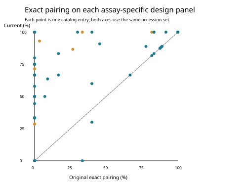
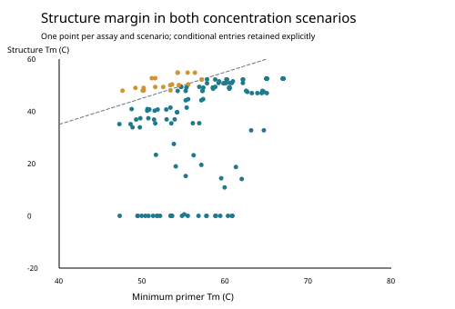

# MiUrchin: terminal-triplet-first, branch-limited primer candidates for sea-urchin eDNA

**Fei Xia**

Local integrated computational manuscript v2.0.0 · 5 November 2026 · Not peer reviewed or remotely published

## Abstract

We integrated two rounds of computational optimization into a catalog of 76 branch- or taxon-limited primer-pair entries derived from 32 historical ordinary and degenerate schemes across mitochondrial 16S, 12S and COI and nuclear 28S. Selection prioritized Watson–Crick compatibility at the final three primer positions within each design group. The catalog contains 67 distinct F/R sequence combinations and 119 distinct oligo sequences; repeated entries retain separate provenance and applicability. Each retained entry covers all records in its own selected design panel under a two-mismatch-per-end rule and does not exceed its original assay in four background-count comparisons. Exhaustive paired scans, an independent target-matching implementation and two thermodynamic concentration scenarios were reconciled. Sixty-five entries have a minimum modeled structure margin of at least 5 °C; eleven remain conditional. A second round moved binding endpoints and added 22 pairs for eight previously unresolved parent schemes. These are in-sample selection outcomes, not independent estimates of biological sensitivity. Mixed subprimer pools are not recommended, and barcode resolution for shifted products remains untested. The integrated resource provides explicit sequence provenance, separate-PCR pairings and reproducible computational checks while retaining the historical release unchanged.

## 中文摘要

本项目将两轮计算优化整合为76对分支或分类群限定方案，来源于四个标记的32组历史普通／D引物。设计首先保证各自设计面板内双端最后三位匹配，再优化内部简并、结合位置和结构。65对列为优先实验验证，11对保留为条件备选。原始序列扫描、独立算法及两种浓度情景下的结构结果一致。第二轮通过移动位置为此前未解决的8组加入22对候选。所有结果均为设计面板内计算筛选，不能解释为独立检出率，也不证明覆盖整个进化枝。建议分别PCR；移动后条码分辨率和湿实验性能尚未验证。

## Introduction

MiFish illustrates lineage-aware primer design around conserved mitochondrial sites, while Anth-28S illustrates incorporating supported nucleotide variants and separating divergent target groups (Miya et al., 2015; McCartin et al., 2024). These principles motivated a re-examination of the MiUrchin catalog. They do not validate sea-urchin primers by analogy. Deep echinoid relationships provide a useful stratification framework (Mongiardino Koch et al., 2022), but taxonomic labels in an archived library are not equivalent to a newly inferred phylogeny.

The present revision addresses a specific design requirement: observed variation at the terminal triplet must be handled before internal degeneracy is expanded. It also separates historical whole-panel summaries from branch-limited, selected-panel outcomes. Ordinary and D labels refer to their historical parent schemes; new endpoints, sequences and applicability can differ. No factorial comparison isolates a pure effect of degeneracy in this release.

## Materials and methods

### Frozen references and design panels

We used the existing project FASTA files without retrieving new public records. Marker-specific target and background inputs are hashed in the release manifest. Design groups used existing higher-taxon and order labels; exact species-name matches transferred available classifications to 28S. Unresolved labels were excluded from branch design. Later COI S searches included genus-labelled groups without asserting newly demonstrated monophyly. Each retained design group contains at least three records. Small and uneven groups limit generalization.

### Terminal-triplet-first search

Initial searches used existing homologous binding regions or unique nearest raw-sequence primer pairs whose terminal eight bases agreed with the reference alignment. Ordinary candidates remained concrete; D candidates first included all observed terminal-triplet bases, then considered internal ambiguity. The initial variant cap was 64 per end, with both terminal-only and internally expanded alternatives. Five-prime trimming was evaluated. A second round for 16S XL/XLD, 12S XS/S/L and COI XS/S/M searched 18–27 nt primers with endpoint offsets up to 20 nt; COI S extended this to 50 nt and finer taxonomic groups. This round capped degeneracy at 16 variants per end. Candidate ranking and top-subset screening make the search heuristic and finite.

### Paired matching and background gates

Both DNA orientations were scanned. Target products span 60–650 bp with non-overlapping primer sites. Coverage requires no more than two mismatches per end and WC-compatible final three bases; exact pairing requires no mismatches. Ambiguous binding-site template bases were excluded. Background scans permit 0–1,000 internal bases. We retained strict WC, strict GT-permissive, relaxed WC with three mismatches and relaxed GT with two mismatches per end. Only strict models preserve terminal-triplet compatibility; target matching uses WC. Every selected row matches its full design panel under the coverage rule and has no increase in any of the four background counts relative to its original parent on the same frozen input. Original nonzero counts can therefore remain. Background libraries do not establish specificity against all other sea-urchin branches.

### Structures, concentrations and pairing

Primer3-py 2.4.0 (Untergasser et al., 2012) expanded all variants and evaluated hairpins, homodimers, within-direction variant dimers and F/R dimers. Conditions were 50 mM monovalent salt, 1.5 mM Mg and 0.6 mM dNTP. Both 50 nM per variant and 200 nM total per direction were evaluated. Required limits were structure Tm below 55 °C, primer Tm 45–75 °C and F/R Tm-range-midpoint difference at most 5 °C. The larger participating concentration was used for heterodimers. Priority status additionally requires a 5 °C minimum primer-to-structure Tm margin in both scenarios. These model gates are not experimentally established annealing conditions. Sequencing adapters were not included.

### Verification and scope

The integrated validator recompiles the exhaustive C++ scanner and recalculates all candidate and baseline target/background quantities. A separate Python motif-extension implementation checks target pairing, and both thermodynamic scenarios are recomputed. The second-round evidence additionally checks intended shifted positions and product lengths. Cross-subprimer dimers and F-A/R-B products were evaluated separately. All proposed assays are designated for separate PCR. No independent holdout or wet-lab experiment was performed on the current catalog; historical holdout and barcode analyses are not transferred to these sequences.

## Results

### Catalog composition

| Gene | Parent schemes | Priority pairs | Conditional pairs |
| --- | --- | --- | --- |
| 16S | 10 | 17 | 2 |
| 12S | 10 | 17 | 5 |
| COI | 6 | 9 | 3 |
| 28S | 6 | 22 | 1 |

All 32 historical parent schemes have at least one group-limited candidate. This does not imply restoration of coverage across each original parent panel. There are 152 named directional FASTA records but only 119 distinct sequences. Repeated sequences across provenance-defined entries are retained transparently. Sixty-five entries are priority and eleven conditional (Figure 1).

**Figure 1.** Adopted entries by marker and tier. Counts refer to catalog entries, not unique sequences or independent assay discoveries.

### Same-panel comparisons and shifted candidates

Comparisons use exactly the accession set listed for each new entry. Coverage is 100% on these selected design sets by construction; it must not be presented as an unbiased sensitivity estimate. Exact matching can increase or decrease despite passing the coverage gate (Figure 2). For the eight unresolved parent schemes, the second round produced 22 additional pairs. On the union of their disjoint selected subgroup panels, 12S S coverage changed from 13/40 to 40/40, 12S L from 10/21 to 21/21, and COI S from 12/22 to 22/22. These fractions do not include unrepresented or unresolved taxa.

**Figure 2.** Original versus current exact paired matching on each entry's own accession set. Multiple entries can share templates or sequences, so points are not independent biological replicates. The diagonal indicates equal exact proportions.

### Structural margins and mixed pools

Every adopted entry passed the two concentration-scenario gates. Eleven entries have a margin below 5 °C and remain conditional; modeled structure constraints therefore remain a material selection distinction (Figure 3). For the shifted COI S subprimer collection, unintended cross F/R combinations matched 26 strict-WC and 135 strict-GT background records. Passing individual-pair gates does not justify pooling. The current catalog prescribes separate PCRs.

**Figure 3.** Minimum primer Tm versus maximum structure Tm in each modeled scenario. The dashed line marks a 5 °C margin. Conditions are model assumptions and exclude adapters.

## Discussion

Terminal-triplet-first design can redirect degeneracy toward positions that were incompletely represented in previous candidates, while branch restriction and shifted sites can lower the burden on a single universal oligo. However, finer groups also make in-sample success easier to achieve. Neither the number of retained entries nor their complete design-panel coverage demonstrates superiority over an independently evaluated broad-range assay.

A central change in this revision is evidence bookkeeping. New branch-specific sequences, old parent comparisons and historical barcode-resolution studies have different scopes. Keeping them in separate versioned resources prevents the old common-panel and genus-blocked statistics from being interpreted as validation of new sequences. In particular, changes to product endpoints require renewed evaluation of taxonomic resolution. This has not yet been performed.

Small sample sizes, classification uncertainty, incomplete background sampling and absence of biological replication remain limitations. Genus-labelled COI S groups are not a substitute for phylogenetic testing. Other echinoids were not universally treated as negatives for each branch-specific candidate; the group label indicates design applicability, not proven branch exclusivity. Experimental work should test diverse samples, controls, concentration choices, adapters and cross-reactivity before practical use.

## Data, code and declarations

The local v2.0.0 integrated project contains a canonical JSON catalog, generated CSV/FASTA, frozen FASTA inputs, current verification code and immutable evidence from both rounds. The historical tracked v1.2 project is retained under legacy/v1.2. This local revision has not been remotely published; no release DOI or tag URL is asserted. Authorship is retained as Fei Xia. Funding, competing-interest and AI-assistance disclosure statements require author review before external submission; this manuscript does not infer those declarations.

## References

Miya M et al. (2015). MiFish, a set of universal PCR primers for metabarcoding environmental DNA from fishes. Royal Society Open Science 2:150088. https://doi.org/10.1098/rsos.150088

McCartin L et al. (2024). Nuclear eDNA metabarcoding primers for anthozoan coral biodiversity assessment. PeerJ 12:e18607. https://doi.org/10.7717/peerj.18607

Mongiardino Koch N et al. (2022). Phylogenomic analyses of echinoid diversification prompt a re-evaluation of their fossil record. eLife 11:e72460. https://doi.org/10.7554/eLife.72460

Untergasser A et al. (2012). Primer3—new capabilities and interfaces. Nucleic Acids Research 40:e115. https://doi.org/10.1093/nar/gks596

[Complete sequence and evidence supplement](MiUrchin_supplement.md)
