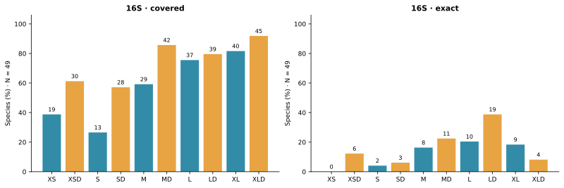
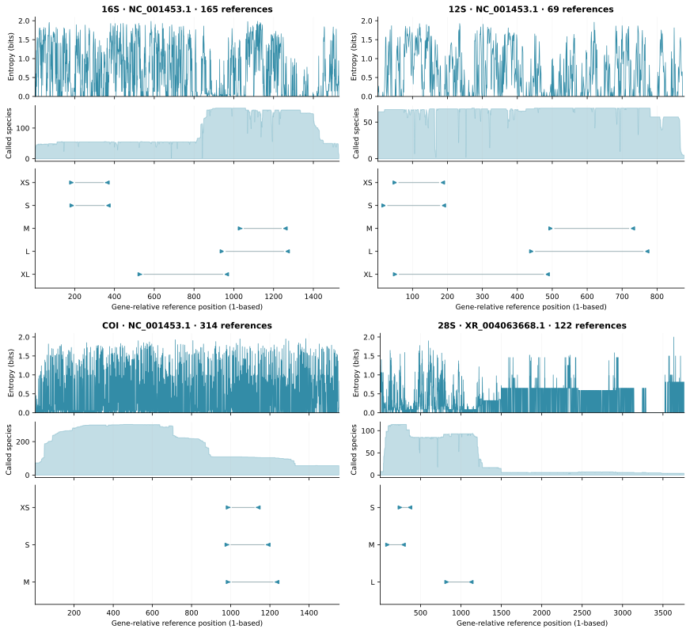
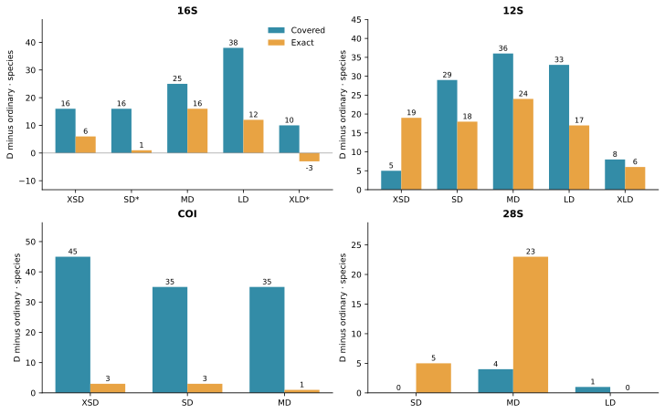
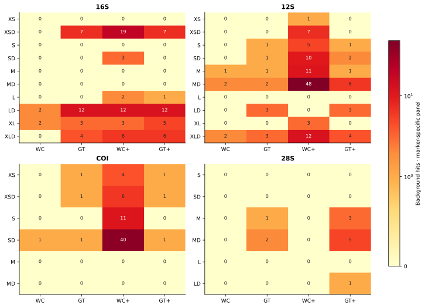
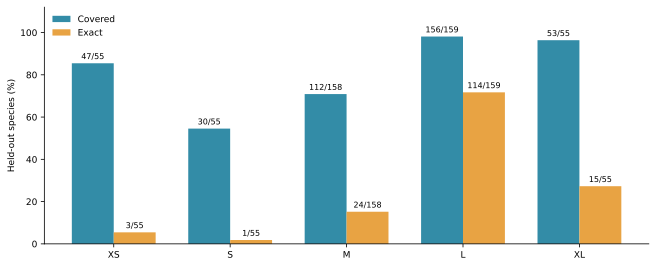
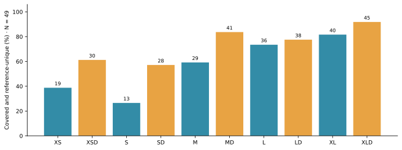

# MiUrchin primer design and computational evaluation for sea urchin eDNA metabarcoding

**Fei Xia**

[Affiliation and corresponding author details to be supplied]

## Abstract

Background. Sea urchin environmental DNA metabarcoding requires primer compatibility across divergent lineages and sufficient variation within amplified barcodes. These properties may respond differently to degeneracy and changes in binding position.

Methods. We assembled MiUrchin as a primary collection of 32 non-partitioned ordinary and degenerate primer pairs across 16S, 12S, COI and 28S, with 76 supplementary branch- or taxon-limited candidates. Marker-specific panels contained 165, 69, 314 and 122 named species, respectively. Evaluation separated window completeness, paired matching, background hits, sequence inclusion and available reference-discrimination diagnostics. Supplementary optimization prioritized compatibility at the final three primer bases and screened expanded oligos under two concentration scenarios.

Results. On a common 49-species 16S panel, XLD covered 45 species, whereas LD had the most exact paired matches (19). On their larger window-specific panels, MD missed all 37 evaluable Spatangoida, whereas LD covered 36 of 38. At 12S M, degeneracy increased coverage from 25 to 61 of 69 species. Fourteen of 16 ordinary/D comparisons were nested; two also involved fixed-base replacement. The 28S SD pair covered 99 of 101 species, but only eight of 99 recovered barcodes were identity-unique. Supplementary candidates comprised 67 distinct F/R combinations; 65 entries met the priority structural-margin criterion and 11 remained conditional. A uniform reanalysis found that all 32 primary pairs passed the basic structural gates, but five lacked a 5 °C minimum margin. Supplementary design panels had a median of five records, and candidate unions lost some original matches in 26 of 32 parent comparisons on the full archived inputs.

Conclusions. MiUrchin provides a reproducible computational resource for selecting sea urchin primer candidates by taxonomic coverage, terminal compatibility and available barcode information. Selected-panel success does not establish independent sensitivity. Independent sequence evaluation and fuller barcode-resolution analysis remain necessary; experimental performance has not been established.

Keywords: Echinoidea; environmental DNA; metabarcoding; degenerate primers; primer-template mismatch; taxonomic resolution

## Introduction

Echinoidea includes regular sea urchins, heart urchins, sand dollars and related lineages with substantially different evolutionary histories. Phylogenomic studies resolve deep divisions among these groups and provide a framework for assessing taxonomic representation in a reference library (Mongiardino Koch et al., 2022). A primer that performs well in a species-rich sampled group may nevertheless fail to recover another lineage of interest. Environmental DNA assay selection therefore requires both aggregate performance and taxon-specific interpretation.

MiFish illustrates the use of conserved flanks surrounding an informative mitochondrial region (Miya et al., 2015). Anth-28S uses controlled degeneracy at a nuclear-ribosomal marker to accommodate variation among anthozoans (McCartin et al., 2024). These design principles motivate the comparison of concrete and degenerate oligos at shared binding coordinates, but they do not establish which marker is most informative in Echinoidea. The availability of reference sequence, compatibility of the binding sites and variability of the internal barcode must be evaluated separately.

Primer mismatches can influence amplification bias, although their effects depend on position and reaction conditions (Piñol et al., 2015). A mismatch-tolerant prediction consequently measures a different property from an exact paired match. Likewise, a unique reference insert is useful only if the assay recovers the corresponding template. We examine these distinctions across four markers, using the existing 16S common-panel and genus-blocked analyses to place window-specific results in context. We also test whether each D sequence actually includes its ordinary counterpart before attributing a performance change to degeneracy.

Two complementary approaches inform the present comparison. Bae (2025) evaluated an ascidian COI primer redesign through changes to primer sequence and binding location, with both computational and experimental checks. Marquina, Andersson and Ronquist (2019) developed insect mitochondrial primers computationally and distinguished coverage from the ability of the amplified region to discriminate taxa. These studies motivate explicit comparison of sequence changes and barcode information, but their validation results cannot be transferred to echinoids.

We ask whether the original non-partitioned MiUrchin collection offers complementary coverage and reference discrimination across markers, and whether terminal-triplet-first, group-limited optimization provides additional candidates for poorly matched lineages. The 32 original pairs remain the primary collection; the 76 group-limited entries are supplementary options for separate PCRs. All results reported here derive from existing sequence resources and computational analyses, without newly generated tissue or environmental DNA data.

## Materials and methods

### Data acquisition and reference curation

The archived mitochondrial 16S library contained 1,401 target records and 6,045 background records. The curation workflow reconciled species names with archived WoRMS matches, using accepted identifiers and higher-group assignments. Unidentified or non-species labels, unresolved names and sequence-quality failures were excluded. Eligible sequences had at least 100 aligned A/C/G/T bases, no more than 5% ambiguous bases in the ungapped alignment, source-consistent orientation and at least one complete design window. A representative was selected by the number of complete windows, low ambiguity, the number of called reference columns, alignment continuity, called sequence length and accession. Primer-match success was not a representative-selection criterion. The resulting panel contained 165 species.

The independent 12S and COI searches and alias retrieval produced 9,988 distinct accession records. Annotated features, extraction decisions and exclusions are retained in the sequence audit and compressed GenBank batches. The eligible pools comprised 208 12S sequences representing 69 named species and 9,392 COI sequences representing 314 named species. Each marker retained one design representative per species. Their backgrounds comprised 459 and 1,719 representative species, respectively. These independently assembled marker libraries were not restricted to a common cross-gene species set.

The nuclear 28S alignment contained 122 target records, one per NCBI binomial, and the background library contained 832 records spanning the other echinoderm classes and additional aquatic animal groups. This panel uses archived NCBI labels rather than the same taxonomic reconciliation as the 16S panel. Background units are therefore stated explicitly: records for 16S and 28S, and one representative per species for 12S and COI. Raw background counts cannot be interpreted as comparable specificity rates across the four markers.

### Alignment and reference coordinates

The archived nucleotide alignments were produced using MAFFT (Katoh & Standley, 2013). All coordinates are one-based and inclusive on the ungapped reference gene. Mitochondrial windows are anchored to the corresponding genes of *Strongylocentrotus purpuratus* NC_001453.1; nuclear 28S uses XR_004063668.1. The four gene axes are independent, and none represents a shared whole-genome coordinate system.

For 16S, evaluability requires both binding windows to span the reference interval, at least 90% of the reference-site count as concrete bases, and no ambiguous nucleotide in either window; alignment gaps are allowed. The available denominators are 55 species for XS and S, 158 for M, 159 for L and 55 for XL. The 12S and COI checks require an alignment spanning both windows with no ambiguous binding-region bases. The 28S check requires concrete bases across the two projected 20-column binding segments. These marker-specific completeness rules precede the raw paired scan. A reference missing a binding region is excluded from that window's denominator rather than scored as an amplification failure.

For positional context, we calculated Shannon entropy from called A/C/G/T bases at each reference column and reported the number of contributing references. Gaps and ambiguous calls were excluded, and entropy was left undefined when fewer than two references contributed. This is a descriptive projection of the existing alignments. Low entropy in a sparsely sampled region does not demonstrate broad conservation.

### Candidate generation and selection

The release comprises five 16S windows, five 12S windows, three COI windows and three nuclear 28S windows. Each contains an ordinary pair and a D pair with the same four reference endpoints. Size labels describe windows within a marker; the same label does not imply the same length across genes. The 16S reference spans are 181, 188, 228, 343 and 440 bp for XS through XL. All primary sequences and numerical results are supplied in Supplementary Data S1 and S2.

The 16S workflow reconsidered observed binding motifs and earlier candidate seeds at fixed windows, retaining candidates ranked by species coverage and exact matching with additional lineage-aware candidates. Degenerate growth merged supported motifs within a common 5′ half. The final per-window choices followed paired background and thermodynamic screening. The ordinary XS search retained 100 forward and 101 reverse candidates, evaluated 10,100 pairs and favored coverage over an alternative gaining one exact match while losing three covered species. Thus the released XS is a finite-search choice, not a demonstrated optimum across all possible oligos.

The 12S search emphasized exact matching, whereas COI screening emphasized regions represented in more species. Within each selected D window, ordinary primers were selected among its concrete variants. The 28S release retained three ordinary/D pairs from an archived comparison of 56 candidates. These searches used different reference collections and candidate histories; their outcomes are compared as candidate assays rather than as a controlled competition between genes.

D oligos encode at most eight concrete variants per end and confine ambiguity to the 3′ half. Terminal screening in the mitochondrial design rejected possible five-base homopolymers and homogeneous terminal triplets, required an assured G/C within the final three positions and constrained terminal GC content. Degenerate terminal bases were allowed when the other filters were satisfied. A matching variant represents only a fraction of the total oligo concentration.

The archived mitochondrial pair checks used Primer3 (Untergasser et al., 2012), with 50 mM monovalent salt, 1.5 mM Mg²⁺ and 0.6 mM dNTP. Scenarios were 50 nM per concrete variant and 200 nM total per direction divided among variants. Screening required a modeled secondary-structure Tm below 55°C and a difference of no more than 5°C between forward and reverse variant-Tm midpoints. For the present property table, primer3-py 2.4.0 recalculated individual-oligo GC and Tm ranges under the same concentrations for all four markers. These archived single-oligo properties are distinguished from the uniform pair-level reanalysis described below. The second concentration scenario is supplied in Supplementary Data S4.

### Matching models and background interpretation

Coverage denotes at least one paired hit with no more than two mismatches per end and IUPAC compatibility at each of the final three positions. Exact matching denotes zero mismatches at both sites, allowing any concrete forward and reverse variants of a D pair to provide the match. Both DNA orientations are searched, and an accession contributes once regardless of the number of predicted products.

For 16S S–XL, target products span 150–500 bp and contain at least 50 internal bases. XS uses 70–500 bp and at least 20 internal bases. The 12S, COI and 28S scanner uses 100–500 bp and at least 50 internal bases. All background scans allow 0–1,000 internal bases. Consequently, target and background geometry is deliberately different in this release, and the plotted counts are not sensitivity–specificity curves under a common geometry.

Strict Watson–Crick (WC) and G–T-permissive (GT) models retain the two-mismatch and terminal-triplet constraints. Relaxed WC allows three mismatches without terminal protection; relaxed GT allows two. In primer-oriented strings, the GT model additionally accepts primer G against template A and primer T against template C, corresponding to wobble pairing on the opposite strand. These pairings also satisfy the terminal compatibility rule in that model. Supplementary Data S2 reports all four background counts so that a zero strict count is not confused with an absence of relaxed matches.

### Sequence-inclusion audit and common panels

We expanded IUPAC symbols conceptually as sets of bases and tested whether every ordinary base was included at the corresponding position of its D oligo. Both ends had to pass for a pair to be nested. Positions excluding an ordinary base were recorded in synthesis orientation. All ordinary/D reference endpoints were independently compared. This audit identifies whether a contrast combines additional variants with fixed-base replacement; it does not calculate the performance of untested factorial intermediate sequences.

The common 16S coverage panel is the intersection of the five evaluable species sets and contains 49 species. Coverage, exact matching and the joint covered-and-unique count were recalculated on this denominator. Window-specific and common-panel outcomes are both retained because the intersection omits many species represented at M and L. Species contribute equally within a panel; the archived higher-group counts provide taxonomic detail. The historical common-panel analysis was restricted to 16S; the added COI comparison is described below.

### Reference discrimination and genus-blocked reselection

For 16S, primer-binding regions were removed from the homologous alignment interval and the remaining unambiguous inserts were compared by exact identity. Own-panel uniqueness was defined against every available unambiguous insert at that window. Common-panel query counts retain this same full-window uniqueness definition; they do not redefine uniqueness after discarding non-common species. A joint success requires both paired compatibility and an identity-unique insert. Global unit-cost edit distances provide nearest-neighbor diagnostics. Identical sequences bearing different species names are retained for source review.

The archived 28S diagnostics count unambiguous internal barcodes recovered by the paired scan and their identity uniqueness within the corresponding assay-specific barcode collection. Their denominator is recovered barcodes, not the common 16S species set. This distinction is retained when describing 28S detection and discrimination. The archived release did not provide equivalent species-resolution analyses for 12S and COI; the recovered-insert extension below has a narrower scope.

Five 16S folds were generated by linking genera that shared identical complete reference sequences, shuffling the resulting blocks with seed 20261030 and assigning them cyclically to folds. Within each training set, observed local motifs within five alignment columns of the frozen binding intervals supplied fixed-length seeds. Up to 24 frequent admissible seeds per end entered at most three ambiguity-expansion steps. Training coverage, exact matching and lower degeneracy determined paired selection. Withheld species were evaluated by raw paired scanning. Published primer sequences and global candidate pools were not used as training seeds.

This diagnostic tests sequence selection around previously discovered windows and an alignment derived from the full collection. It allows local offsets and does not impose the complete formal thermal and background gates on fold candidates. It is therefore different from both testing the released pair unchanged and independently discovering a new window. One design representative per species also leaves within-species variability unmeasured; no multi-record barcode-gap analysis is reported here.

### Independent implementation checks

The 16S release contains paired-scan hit tables and independent verification records; the common-panel validator checks denominators, barcode identities, unique test-species assignments, genus separation, fold sizes and frozen input hashes. The 12S/COI verification compared the archived scan flags against a separate seed-and-extension implementation for 32,382 record–model comparisons across the 16 released pairs. The 28S verification reconciles archived target and background hits with its six selected result rows and binding matrices. These checks establish agreement between computational representations on the archived references.

Archived primary-release publication scripts rebuild the result tables from source CSV files, test all 64 oligos against the combined FASTA and rendered PDF, and verify manuscript, README and citation metadata before release. Descriptive properties, sequence inclusion and reference-position profiles are archived separately from the original screening results.

### Supplementary group-limited optimization

Existing target labels defined Cidaroidea, Aulodonta, Echinacea and Irregularia, with finer order or genus-labelled subsets where needed. Exact species-name matches transferred available taxonomy to 28S; unresolved labels were not guessed. Each design group contained at least three records. Genus labels do not establish monophyly.

Initial searches used existing homologous binding regions or unique nearest raw-sequence primer pairs whose terminal eight bases agreed with the reference alignment. Ordinary candidates remained concrete; D candidates first included all observed terminal-triplet bases, then considered internal ambiguity. The initial variant cap was 64 per end, with both terminal-only and internally expanded alternatives. Five-prime trimming was evaluated. A second round for 16S XL/XLD, 12S XS/S/L and COI XS/S/M searched 18–27 nt primers with endpoint offsets up to 20 nt; COI S extended this to 50 nt and finer taxonomic groups. This round capped degeneracy at 16 variants per end. Candidate ranking and top-subset screening make the search heuristic and finite.

### Paired matching and background gates

Both DNA orientations were scanned. Target products span 60–650 bp with non-overlapping primer sites. Coverage requires no more than two mismatches per end and WC-compatible final three bases; exact pairing requires no mismatches. Ambiguous binding-site template bases were excluded. Background scans permit 0–1,000 internal bases. We retained strict WC, strict GT-permissive, relaxed WC with three mismatches and relaxed GT with two mismatches per end. Only strict models preserve terminal-triplet compatibility; target matching uses WC. Every selected row matches its full design panel under the coverage rule and has no increase in any of the four background counts relative to its original parent on the same frozen input. Original nonzero counts can therefore remain. Background libraries do not establish specificity against all other sea-urchin branches.

### Structures, concentrations and pairing

Primer3-py 2.4.0 (Untergasser et al., 2012) expanded all variants and evaluated hairpins, homodimers, within-direction variant dimers and F/R dimers. Conditions were 50 mM monovalent salt, 1.5 mM Mg and 0.6 mM dNTP. Both 50 nM per variant and 200 nM total per direction were evaluated. Required limits were structure Tm below 55 °C, primer Tm 45–75 °C and F/R Tm-range-midpoint difference at most 5 °C. The larger participating concentration was used for heterodimers. Priority status additionally requires a 5 °C minimum primer-to-structure Tm margin in both scenarios. These model gates are not experimentally established annealing conditions. Sequencing adapters were not included.

### Verification and scope

The integrated validator recompiles the exhaustive C++ scanner and recalculates all candidate and baseline target/background quantities. A separate Python motif-extension implementation checks target pairing, and both thermodynamic scenarios are recomputed. The second-round evidence additionally checks intended shifted positions and product lengths. Cross-subprimer dimers and F-A/R-B products were evaluated separately. All proposed assays are designated for separate PCR. No independent holdout or wet-lab experiment was performed on the 76 supplementary candidates; historical holdout and barcode analyses are not transferred to these sequences.

### Uniform frozen-reference evaluation

We retained all released sequences and added a separate, uniform evaluation of the 32 primary pairs and 76 supplementary entries. Both DNA orientations were scanned for nonoverlapping primer sites and total products of 60–650 bp, allowing at most two mismatches per end and requiring WC compatibility at the final three bases. The archived input libraries contained 1,401, 69, 314 and 122 records for 16S, 12S, COI and 28S, respectively. The 16S input includes multiple and incompletely identified records, unlike its curated 165-species primary panel. These raw-record results therefore do not replace the original species-level denominators. Unmatched records may lack a complete binding region and are not interpreted as amplification failures. No new external sequences were obtained. Results outside a candidate's selected panel remain retrospective because the archived library was available during development.

For each parent scheme, we computed the union of its supplementary candidates as separate reactions and reported gained, retained and lost raw-record matches relative to the parent. We also tabulated matches by archived order labels; unresolved taxonomy remained unresolved. These tables test the scope of the supplementary candidates, not monophyly or lineage exclusivity. All 32 primary pairs underwent the same expanded-variant structure calculations, concentration scenarios and basic gates used for supplementary screening. We report the additional 5 °C margin separately from basic gate passage. A fixed homologous-site audit independently counts terminal-one, terminal-three and terminal-five compatibility for each primary oligo and paired terminal-three compatibility, retaining exclusions for gaps, ambiguity or insertions.

For all 108 entries, we extracted unambiguous internal sequences from each predicted paired product, excluding the primer-binding regions. Multiple distinct products per accession were retained and flagged. An accession with a single insert was called identity-unique among recovered records only when no recovered record bearing another archived species label shared that exact insert. This measure excludes references without predicted products, does not establish assignment accuracy, and is not the full-window 16S uniqueness metric used earlier. We report record counts and retain accession-level inserts for source inspection.

### Published COI comparators and implementation verification

We included three explicitly documented combinations: mlCOIintF/HCO2198 and mlCOIintF/dgHCO2198 from Leray et al. (2013), and Uni-MinibarF1/R1 from the original design of Meusnier et al. (2008). The latter uses forward TCCACTAATCACAARGATATTGGTAC and reverse GAAAATCATAATGAAGGCATGAGC; the source manifest records a conflicting sequence/direction presentation in the later Leray table. The inosine-containing jgHCO2198 combination was not evaluated because the scanner has no explicit inosine model. No substitution of N for inosine was made.

The six primary COI pairs and three published combinations were evaluated on the same archived target and background inputs with the same matching rules. Original MiUrchin reference coordinates were retained. Published primer intervals were located as unique lowest-total-mismatch, geometrically admissible pairs on the fixed COI reference NC_001453.1, permitting up to eight mismatches per end for coordinate mapping only; this is distinct from the two-mismatch evaluation gate. Reference product lengths of 365 bp for the two mlCOIintF combinations and 177 bp for Uni-Minibar are consistent with their published primer-trimmed fragments of 313 and 130 bp. Site completeness required A/C/G/T at every projected binding-site column before evaluating matches. The intersection across all nine assays contained 56 records. This stricter common-panel definition is reported separately from the historical COI window panels. Comparator taxonomic scope, product length and degeneracy differ; non-echinoid matches are expected for broadly targeted metazoan primers and are not treated as evidence of inferior design.

A separate Python terminal-motif and extension implementation verified every target match, exact match and recovered insert produced by the C++ scanner for all 108 entries and all nine COI comparison rows. This is implementation verification on shared inputs, not independent biological validation. New tables, input hashes, verified comparator sequences and reproduction commands are supplied in Supplementary Data S9.

## Results

### Equal-denominator comparisons change the interpretation of window coverage

On the 49-species common 16S panel, XLD covered 45 species (91.8%), MD 42 (85.7%) and LD 39 (79.6%). LD nevertheless had the largest paired exact count, 19/49 (38.8%), compared with 11/49 for MD and four for XLD. The ordinary XS and S pairs covered only 19 and 13 common-panel species, respectively. Coverage and exact compatibility therefore yield different rankings even when the denominator is fixed.

The window-specific results reveal a lineage-dependent difference. MD covered 110/158 species overall but none of 37 evaluable Spatangoida. LD covered 141/159 overall, including 36/38 Spatangoida. Both missed all four evaluable Arbacioida. XLD covered both of its evaluable Arbacioida and both Spatangoida, but these much smaller subsets cannot replace the broader L-window evidence. The different completeness profiles visible in Figure 2 explain why a single aggregate percentage is insufficient for assay choice.

### Nested and non-nested comparisons have different interpretations

Fourteen of sixteen D pairs included both corresponding ordinary oligos. All 12S, COI and 28S comparisons were nested. The exceptions were 16S S/SD and XL/XLD: SD excluded the ordinary reverse base at position 9, while XLD excluded ordinary bases at forward positions 1 and 3 and reverse position 19 (Supplementary Data S3). Their performance changes therefore combine sequence replacement with additional variants.

The XL example shows why this distinction matters. On its own panel, XLD increased coverage from 41 to 51 of 55 species but reduced paired exact matches from nine to six. On the common panel, exact matches declined from nine to four. A pure expansion that retained every ordinary variant could not eliminate an existing exact sequence match under the same scanner. The non-nested sequences account for why the observed comparison permits that loss. These results identify a priority for a future controlled candidate audit without changing the present release.

### Short products and broad reference libraries have distinct limitations

At the 249 bp 12S M window, MD covered 61/69 species and exactly matched 24, compared with 25 covered and zero exact for M. Strict WC and GT background counts each increased from one to two. The shorter 153 bp XSD covered 32/67 with 19 exact matches and no strict background hits. Thus the short 12S window offers exact compatibility with part of the panel, whereas MD provides broader predicted coverage.

The COI collection contained 314 named species, but only 103–106 were evaluable at the retained short windows. XSD covered 79/106 at a 152 bp reference span, with three paired exact matches. SD covered 63/105 at 209 bp, with six exact matches. COI's larger source library therefore did not yield a correspondingly large complete-window panel, and the mismatch-tolerant hit counts substantially exceeded exact matches.

The nuclear 28S S and SD pairs both covered 99/101 species at a 102 bp reference span. SD increased exact matching from 78 to 83. At 176 bp, MD covered 108/111 and exactly matched 72, compared with 104 covered and 49 exact for M. These short nuclear candidates provide high compatibility in their own panels, although the barcode diagnostics below impose a separate constraint on species discrimination.

### Background counts depend on the pairing model and reference panel

The 16S LD pair had two strict WC and twelve strict GT background hits. The 12S MD pair had two under each strict model, whereas 28S SD had zero under either. Relaxed-model results are retained alongside these strict counts in Supplementary Data S2 and Figure 4. They describe potential matching in the screened libraries rather than experimentally measured off-target amplification.

Only three to four sea-cucumber background records spanned both nuclear binding sites per window in the archived 28S alignment. Low hit counts consequently provide limited evidence for excluding that closely related class. The scope of a background panel is part of the interpretation of each result, especially for a broadly conserved short ribosomal segment.

### Withheld genera reveal a candidate-selection opportunity at 16S

The genus-blocked diagnostic covered 156/159 L-window test species and exactly matched 114. XS covered 47/55 with three exact matches; M covered 112/158 with 24 exact matches. These are fold-specific, training-selected sequences rather than repeated evaluations of the released ordinary/D pairs. The strong L-window result suggests that alternative sequence choices deserve screening under the formal chemical and background constraints, but does not itself establish a replacement assay.

### Reference discrimination depends on the sampled window and predicted recovery

All 55 available unambiguous XS and S inserts were identity-unique in their respective 16S collections. M and L each had 150 unique inserts among 158 unambiguous references, and XL had 55/55. Internal lengths ranged from 137–144 bp at XS to 395–413 bp at XL. These panels differ in species composition, so the proportions alone do not establish that the shorter regions are more discriminating.

On the common 49-species query panel, XLD yielded 45 covered-and-unique species, MD 41 and LD 38 (Figure 6). Uniqueness was evaluated against all available same-window inserts. This explains why a common-panel query may remain non-unique because it shares a barcode with a species outside the common set. The archived collisions include labels from different genera and higher groups, making accession-level source review important before interpreting them as biological identity.

Nuclear 28S SD recovered 99 unambiguous reference barcodes, of which only eight were unique. MD had 59 unique barcodes among 106 recovered, and LD had 51 among 84. These assay-specific subsets cannot be ranked as a common-species experiment, but they demonstrate that high 28S compatibility and species-level separation are different properties. The additional reanalysis below reports identity sharing among recovered 12S and COI inserts; full-library species-resolution evaluation remains unavailable.

### Supplementary candidates and their comparison scope

| Gene | Parent schemes | Priority pairs | Conditional pairs |
| --- | --- | --- | --- |
| 16S | 10 | 17 | 2 |
| 12S | 10 | 17 | 5 |
| COI | 6 | 9 | 3 |
| 28S | 6 | 22 | 1 |

All 32 historical parent schemes have at least one group-limited candidate. This does not imply restoration of coverage across each original parent panel. There are 152 named directional FASTA records but only 119 distinct sequences. Repeated sequences across provenance-defined entries are retained transparently. Sixty-five entries are priority and eleven conditional (Supplementary Figure S1).

### Same-panel comparisons and shifted candidates

Comparisons use exactly the accession set listed for each new entry. Coverage is 100% on these selected design sets by construction; it must not be presented as an unbiased sensitivity estimate. Exact matching can increase or decrease despite passing the coverage gate (Supplementary Figure S2). For the eight unresolved parent schemes, the second round produced 22 additional pairs. On the union of their disjoint selected subgroup panels, 12S S coverage changed from 13/40 to 40/40, 12S L from 10/21 to 21/21, and COI S from 12/22 to 22/22. These fractions do not include unrepresented or unresolved taxa.

### Structural margins and mixed pools

All 76 supplementary entries passed the screening gates under both concentration scenarios. Eleven entries have a margin below 5 °C and remain conditional; modeled structure constraints therefore remain a material selection distinction (Supplementary Figure S3). For the shifted COI S subprimer collection, unintended cross F/R combinations matched 26 strict-WC and 135 strict-GT background records. Passing individual-pair gates does not justify pooling. The supplementary catalog specifies separate PCRs.

### Uniform structural and terminal checks of the primary collection

All 32 primary pairs passed the basic structural gates under both concentration scenarios. Twenty-seven also retained a minimum primer-to-structure Tm margin of at least 5 °C in both scenarios. The exceptions were 16S XSD and SD, and 12S XSD, SD and XLD. The smallest margin was −4.11 °C for 16S SD under 200 nM total oligo per direction. Thus a structure Tm below the absolute 55 °C cutoff does not necessarily imply a favorable margin relative to primer Tm. These five pairs warrant additional assessment before experimental prioritization; their released sequences were retained.

The homologous-site audit supplies separate terminal-one, terminal-three and terminal-five counts rather than inferring terminal quality from aggregate coverage. For 16S XS/XSD and S/SD, only one record per pair had two complete, insertion-free projected sites under this conservative audit. Their apparently complete compatibility in that subset cannot establish broad conservation. Raw paired scanning and the fixed-column audit address different questions when indels shift contiguous binding motifs.

### Coverage scope and recovered insert identity

Supplementary design panels contained 3–40 records, with a median of five; 41 of 76 entries had at most five records and 22 had only three. The 100% design-panel result is therefore a selection outcome rather than an independent sensitivity estimate. In the full archived-input reanalysis, unions of the relevant supplementary candidates lost at least one parent-matched record in 26 of 32 parent comparisons. For example, the two supplementary 12S MD candidates together matched 19 of the 69 archived records, compared with 61 matched by the original MD pair; 42 original matches were absent from their union. Such candidates cannot replace the parent across its entire original scope, even when their intended subsets are completely matched.

The new recovered-insert analysis extends descriptive evidence to 12S, COI and shifted candidates. For primary 12S MD, 53 of 61 single-insert records were identity-unique among that assay's recovered records. For COI XSD and SD, the corresponding counts were 65/79 and 57/63. These are conditional reference-identity counts, not independently measured identification rates; matching failure removes some potential competing references from the comparison. Complete accession-level insert sequences, shared-label counts and flags for multiple products are retained in S9. Wider reference sampling and within-species variation remain necessary before barcode-gap or classification claims are possible.

### COI comparison on a shared evaluable panel

| Primer pair | Reference total product bp | Covered on common panel | Exact on common panel |
| --- | --- | --- | --- |
| MiUrchin COI XS | 152 | 17/56 | 0/56 |
| MiUrchin COI XSD | 152 | 43/56 | 0/56 |
| MiUrchin COI S | 209 | 14/56 | 0/56 |
| MiUrchin COI SD | 209 | 36/56 | 0/56 |
| MiUrchin COI M | 248 | 15/56 | 0/56 |
| MiUrchin COI MD | 248 | 32/56 | 1/56 |
| mlCOIintF/HCO2198 | 365 | 5/56 | 0/56 |
| mlCOIintF/dgHCO2198 | 365 | 16/56 | 0/56 |
| Uni-MinibarF1/R1 | 177 | 0/56 | 0/56 |

MiUrchin XSD had the highest mismatch-tolerant count among these nine combinations on this shared subset, but no exact paired matches. Uni-Minibar had no covered records under the specified WC and terminal-triplet rules. These outcomes describe this echinoid reference set and model; they are not experimental failure rates. The comparison excludes the frequently used inosine-bearing jgHCO2198 combination and does not establish superiority over the published-primer literature. Strict WC/GT background counts and each assay's own site-complete panel are reported alongside the common-panel results in S9.

## Discussion

The comparison supports assay choice according to the taxonomic question rather than a single maximal coverage score. A survey emphasizing Spatangoida has a concrete reason to prioritize 16S LD over MD despite the latter's higher common-panel coverage. For shorter mitochondrial products, 12S MD provides a substantial gain in predicted compatibility and exact matching on its own reference panel. Nuclear 28S SD offers broad compatibility at 102 bp but limited species-level separation among recovered inserts. Each priority follows from a different component of the evidence.

The sequence-inclusion audit changes how the ordinary/D contrasts should be described. Most pairs are nested and therefore represent an expansion of available variants at fixed endpoints. The two non-nested 16S pairs instead combine expansion with replacement. The exact-match decline from XL to XLD cannot be assigned to degeneracy in isolation. A subsequent selection round should retain nested controls, compare gained and lost species and apply prospective terminal, thermal and background constraints before deciding whether the present coverage gain is worth the exact-match loss.

Reference availability remains a major source of variation between windows. The common 16S comparison standardizes the denominator but reduces the evidence to 49 species, while the longer L window includes 159. COI illustrates the same problem at the scale of a gene library: hundreds of named species may have sequences without having both sites of a chosen amplicon. Broad coverage of a database search is therefore different from broad evaluability of an assay. Taxonomic and geographic gaps should be checked against the intended survey community.

The holdout results identify a useful search direction while retaining a clear distinction between design stages. Fold-specific L candidates matched many withheld species, but the diagnostic allowed local offsets and omitted formal chemical and background gates. It supports further constrained sequence selection around that region, rather than validating the released LD pair or the original window-discovery procedure. Similarly, one representative per species cannot characterize population variation or establish a barcode gap. The current reference-identity results should guide complementary-marker choice and source review, not be interpreted as empirical classification accuracy.

### Priorities for assay evaluation

| Intended use | Computational priority | Reason and qualification |
| --- | --- | --- |
| Spatangoida-focused sampling | 16S LD | Covers 36/38 evaluable Spatangoida; both M and L D pairs miss the four available Arbacioida. |
| High coverage within the common 16S panel | 16S XLD, compared with LD | Covers 45/49, but has fewer exact matches and is not a nested expansion of XL. |
| Short mitochondrial products with broader matching | 12S MD | Covers 61/69 with 24 exact matches at 249 bp; internal species resolution remains to be assessed. |
| Very short nuclear detection | 28S SD | Covers 99/101 at 102 bp; only 8/99 recovered barcodes are unique. |
| COI-based candidate development | XSD or SD, with regional reference review | Short-window evaluability is much lower than total library size, and exact matching remains limited. |
| Further constrained sequence selection | 16S L | Strong conditional holdout performance motivates re-screening under the full release constraints. |
| Multiplex reactions | Evaluate separately | The release reports single-pair evidence; cross-assay and adapter-bearing interactions are not established. |

The reference-based comparisons do not measure amplification efficiency, environmental detection probability or abundance bias in mixed templates. Those properties depend on reaction chemistry, template competition and local community composition. The present contribution is a reproducible set of candidate assays and explicit comparisons that identify where those next evaluations are most informative.

### Comparison with recent primer development frameworks

Bae (2025) provides a useful model for showing how a change to a binding site affects predicted coverage while retaining explicit non-target checks. The MiUrchin shifted-window candidates address the same general design question, but the evidence differs: the present candidates have not undergone the laboratory validation reported for the ascidian assay. Their selection-panel gains support further testing, not a claim of improved environmental detection.

The computational framework of Marquina, Andersson and Ronquist (2019) emphasizes that successful template matching and taxonomic resolution are separate outcomes. Our 16S common-panel joint counts address a related question using identity uniqueness against the available reference inserts. They are not a reproduction of that study's exclusive taxonomic resolution index. Neither identity uniqueness nor between-species separation alone establishes a barcode gap; within-species sampling is required. The new 12S and COI insert diagnostics describe identity sharing only among recovered records. They do not provide an equivalent full-library resolution assessment or a multi-record barcode-gap analysis.

Supplementary group restriction can improve in-sample matching while reducing the taxonomic scope of an assay. The 76 retained entries should not be ranked against the original 32 pairs using their respective percentages without controlling the tested accession set. Sequence replacement, moved endpoints, group restriction and increased degeneracy can occur together. A prospective comparison should isolate these changes and use fixed, independently selected test records. The current search does not establish that its terminal-first heuristic is superior to alternative optimization strategies.

### Limitations

No wet-lab sensitivity, inhibition, amplification bias or field detection probability was measured. New branch candidates have no independent holdout test. Their recovered-insert identity diagnostics exclude undetected references and do not establish full-library barcode discrimination. The genus-blocked analysis concerns historical 16S sequence reselection around previously defined windows, not independent validation of the 76 supplementary candidates. Background libraries are incomplete and differ among markers; branch labels do not establish exclusivity against other echinoid groups. Thermodynamic calculations omit adapters and assume specified concentrations. All supplementary F/R pairings are intended for separate PCR, because cross-pair background products were found when subprimers were considered together.

### Remaining validation requirements

The current data support an auditable candidate resource and retrospective comparisons. They do not yet establish generalization to previously unseen species. A future external test must freeze the released sequences and matching rules before acquiring records absent from design and selection, and audit overlap by accession, sequence and species. New records of previously represented species should be reported separately from new species. Re-running development in genus-blocked training sets can assess the workflow, but must include candidate selection and all filtering gates within each fold; it cannot be described as an external test of the fixed released sequences.

The additional background scans reuse existing libraries. They do not repair the sparse complete-site representation of close non-target groups, particularly Holothuroidea at 28S. Expanding those references and harmonizing taxonomy across markers remain priorities. Full-library barcode discrimination, multi-record within-species evaluation, and validated 16S, 12S and 28S published-primer comparisons remain incomplete. We therefore retain the original collection, keep the 76 entries as exploratory supplementary candidates, and avoid claims of universal coverage, lineage exclusivity or validated environmental detection.

## Conclusions

MiUrchin retains 32 non-partitioned primer pairs as a primary computational resource and adds 76 branch- or taxon-limited entries as supplementary candidates. Common-denominator comparisons, an ordinary/D inclusion audit and separate reference-discrimination diagnostics prevent coverage from being conflated with exact matching or species identification. The results identify marker- and lineage-dependent choices rather than a single universal best pair. Independent sequence evaluation and experimental testing are needed before these candidates can be recommended as validated eDNA assays.

## Data availability

The project repository is https://github.com/GUIBA-EX/MiUrchin. The accompanying supplementary package preserves the primary sequence collection, original assay summaries, sequence-inclusion audit, oligo properties, the branch catalog and its recorded verification results. Accession-level inputs and source code remain in the repository. The manuscript manifest and S9 identify the source commit, new reanalysis inputs, output tables and file hashes. S9 provides separate commands for the primary-site audit, uniform pair and insert evaluation, published COI comparison and independent implementation checks. A permanent archival DOI and final submission-version identifier are to be supplied before submission.

## Declarations

Author information. Fei Xia. [Confirm affiliation, correspondence details and final author list.]

Author contributions. [Confirm CRediT contributions for every author; no allocation has been inferred.]

Funding. [Author to provide funding sources and grant numbers, or confirm that no specific funding was received.]

Competing interests. [Author to supply the declaration.]

Ethics. This study reports computational analyses of archived public sequence resources and no new animal collection, animal experiment or human-participant research. [Author to confirm any applicable institutional requirements.]

AI assistance. OpenAI Codex assisted with manuscript assembly, language revision, analysis-script development and consistency checks. [Authors must verify the final text, references and numerical claims, confirm the full scope of tool use and approve the journal-specific disclosure.]

## References

Bae S. 2025. Validation of improved cytochrome c oxidase I (COI) primers for comprehensive biodiversity assessment of ascidians. PeerJ 13:e19671. https://doi.org/10.7717/peerj.19671

Katoh K, Standley DM. 2013. MAFFT multiple sequence alignment software version 7: improvements in performance and usability. *Molecular Biology and Evolution* 30:772–780. https://doi.org/10.1093/molbev/mst010

Leray M, Yang JY, Meyer CP, Mills SC, Agudelo N, Ranwez V, Boehm JT, Machida RJ. 2013. A new versatile primer set targeting a short fragment of the mitochondrial COI region for metabarcoding metazoan diversity: application for characterizing coral reef fish gut contents. *Frontiers in Zoology* 10:34. https://doi.org/10.1186/1742-9994-10-34

Marquina D, Andersson AF, Ronquist F. 2019. New mitochondrial primers for metabarcoding of insects, designed and evaluated using in silico methods. Molecular Ecology Resources 19:90–104. https://doi.org/10.1111/1755-0998.12942

McCartin L et al. 2024. Nuclear eDNA metabarcoding primers for anthozoan coral biodiversity assessment. *PeerJ* 12:e18607. https://doi.org/10.7717/peerj.18607

Meusnier I, Singer GAC, Landry JF, Hickey DA, Hebert PDN, Hajibabaei M. 2008. A universal DNA mini-barcode for biodiversity analysis. *BMC Genomics* 9:214. https://doi.org/10.1186/1471-2164-9-214

Miya M et al. 2015. MiFish, a set of universal PCR primers for metabarcoding environmental DNA from fishes: detection of more than 230 subtropical marine species. *Royal Society Open Science* 2:150088. https://doi.org/10.1098/rsos.150088

Mongiardino Koch N et al. 2022. Phylogenomic analyses of echinoid diversification prompt a re-evaluation of their fossil record. *eLife* 11:e72460. https://doi.org/10.7554/eLife.72460

Piñol J, Mir G, Gomez-Polo P, Agustí N. 2015. Universal and blocking primer mismatches limit the use of high-throughput DNA sequencing for the quantitative metabarcoding of arthropods. *Molecular Ecology Resources* 15:819–830. https://doi.org/10.1111/1755-0998.12355

Untergasser A et al. 2012. Primer3—new capabilities and interfaces. *Nucleic Acids Research* 40:e115. https://doi.org/10.1093/nar/gks596

## Figure legends

**Figure 1.** Covered and exact species on the common 49-species 16S panel. Numbers above bars are counts; blue denotes ordinary pairs and orange denotes D pairs. The same denominator applies to all bars.

**Figure 2.** Reference-position variation, sampling support and primer geometry for all four markers. Each marker has three panels sharing a gene-relative, one-based axis: Shannon entropy of called bases, the number of contributing references, and the ordinary/D binding intervals. Arrows point toward the primer 3′ end; connecting lines show the intervening region. Gaps and ambiguous calls are excluded from entropy. Each marker has its own reference axis and sampling distribution.

**Figure 3.** Change in covered and exact species from the ordinary pair to its D counterpart on each window's own panel. Asterisks identify the two non-nested pairs. Counts use the corresponding denominators in Supplementary Data S3 and are not directly comparable percentages across windows. No hypothetical factorial intermediates are included.

**Figure 4.** Background hits for every released pair under strict WC, strict GT, relaxed WC (WC+) and relaxed GT (GT+) models. Cells show counts and share a symmetric-log color scale with a linear region through one hit. Panel sizes, taxonomic composition and numerical units differ among genes; the raw counts are not cross-marker specificity estimates.

**Figure 5.** Conditional genus-blocked sequence-selection outcomes for 16S. Labels show covered or exact species over each window's available test denominator. Candidate generation used only training genera; window discovery and the original alignment preceded the split. Diagnostic candidates were not passed through the complete release gates.

**Figure 6.** Percentage of common-panel 16S species both predicted to amplify and identity-unique against the complete available insert collection for that window. Numbers above bars are species counts out of 49. Blue denotes ordinary and orange denotes D pairs. This measures sampled-reference discrimination rather than validated assignment success.

## Figures

